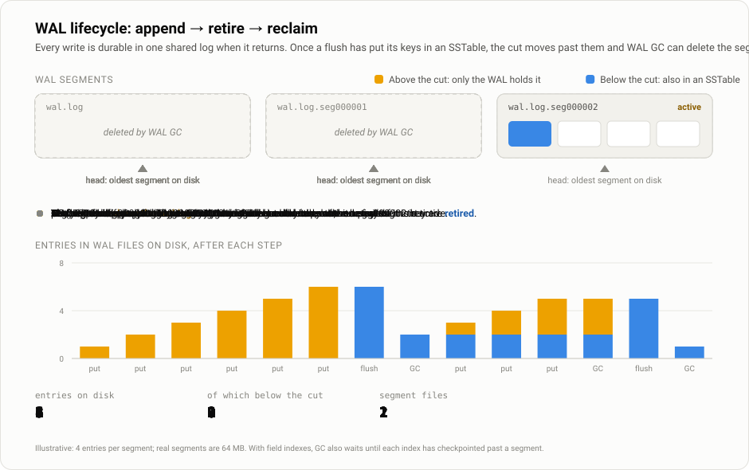
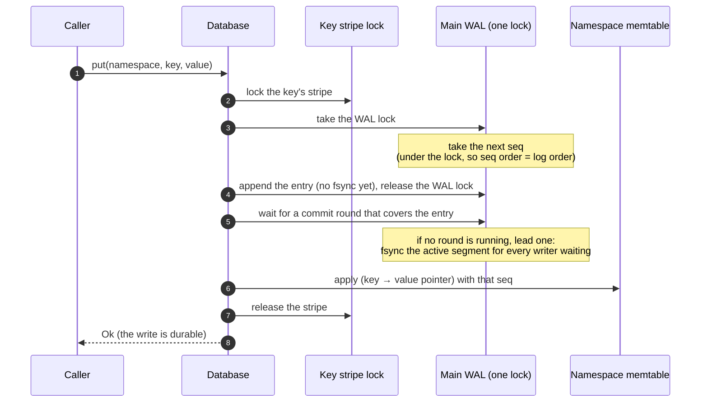
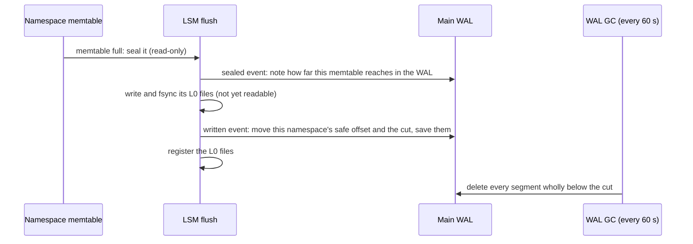
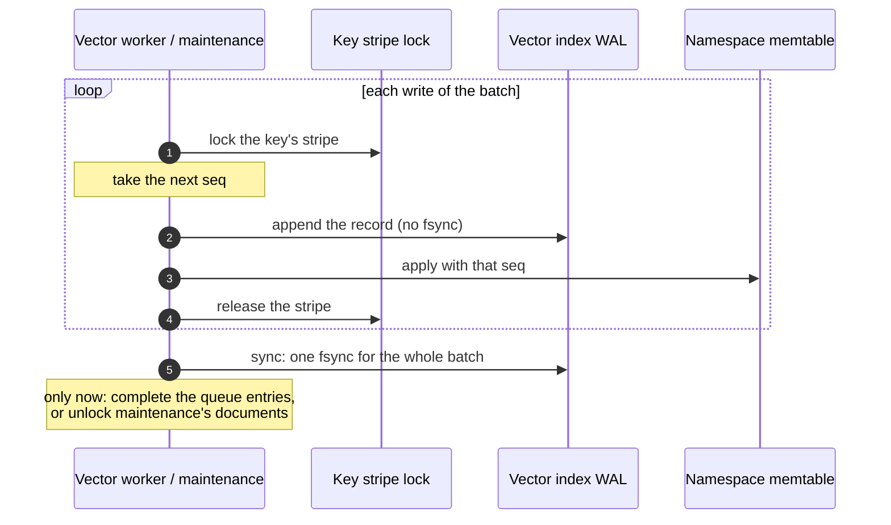
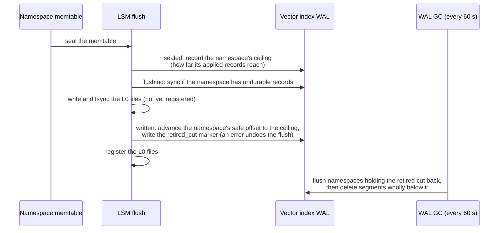

# MinnalDB

MinnalDB is an embedded, high-performance key-value store written in Rust. Its defining characteristic is that it stores keys and values *separately* — keys live in a small, cheaply-compacted LSM tree, while values live in an append-only log alongside it. This design, taken from the [WiscKey paper](https://www.usenix.org/conference/fast16/technical-sessions/presentation/lu), keeps write amplification low even for large values. The name *minnal* (மின்னல்) means "lightning" in Tamil.

> **Platform support:** Linux and macOS only. Windows is not supported — the WAL relies on Unix positional I/O (`pread`/`pwrite`) for safe concurrent access without a global file lock.

> **Just want to use it?** This document is the engine's internal design
> reference — it walks through the storage internals in depth. If you want to
> add `minnal_db` to your project and start writing code, go straight to the
> **[Embedded Quickstart](QUICKSTART.md)** instead; come back here when you
> want to know *why* it works the way it does.

## Table of Contents

- [Design Inspiration](#design-inspiration)
- [Architecture Overview](#architecture-overview)
- [Component Deep Dives](#component-deep-dives)
  - [LSM Tree](#lsm-tree)
  - [Value Log](#value-log)
  - [Write-Ahead Log (WAL)](#write-ahead-log-wal)
  - [Vector index WAL](#vector-index-wal)
  - [WAL terms](#wal-terms)
  - [Sharding](#sharding)
  - [Namespaces](#namespaces)
  - [Background Workers](#background-workers)
- [Storage Layout](#storage-layout)
- [Read & Write Paths](#read--write-paths)
- [Compaction & Garbage Collection](#compaction--garbage-collection)
- [Crash Safety & Recovery](#crash-safety--recovery)
- [MinnalDB as an Embedded Store](#minnaldb-as-an-embedded-store)
- [Configuration](#configuration)
- [Performance](#performance)
- [Building & Benchmarks](#building--benchmarks)

---

## Design Inspiration

MinnalDB is built on the central idea from the **WiscKey** paper:

> **WiscKey: Separating Keys from Values in SSD-Conscious Storage**
> Lanyue Lu, Thanumalayan Sankaranarayana Pillai, Andrea C. Arpaci-Dusseau, Remzi H. Arpaci-Dusseau
> *USENIX FAST '16* — [usenix.org/conference/fast16/.../lu](https://www.usenix.org/conference/fast16/technical-sessions/presentation/lu)

A traditional LSM tree stores keys and values together inside its SSTables. The problem is compaction: every time the tree reorganizes itself, it rewrites the values too — even when only the key metadata needed to move. For large values on an SSD, this *write amplification* dominates the I/O cost and wears the drive down faster.

WiscKey's answer is to **keep only keys (and pointers to their values) in the LSM tree, and store the values themselves in a separate append-only log**. Now the LSM tree is small, so compacting it is cheap, and the bulky values are only ever rewritten during a dedicated garbage-collection pass rather than on every compaction.

MinnalDB takes this separation as its foundation and builds four things on top of it:

- **A sharded value log** — values are spread across a configurable number of buckets (`num_buckets`, fixed at creation) so I/O and garbage collection can run in parallel.
- **A sharded LSM** — each bucket has its own L1 SSTable, avoiding a single-file write bottleneck.
- **Multi-namespace isolation** — many independent keyspaces coexist in one database.
- **Epoch-tracked records** — every value carries a timestamp in its record header. TTL expiry is opt-in: it only kicks in for namespaces given a TTL, where a background worker uses these timestamps to expire stale records.

The rest of this document works from the top of the stack down to these components, then covers the paths data takes through them and how the whole thing survives a crash.

---

## Architecture Overview

The diagram below shows how a request flows through MinnalDB. At the top, callers use the public API; underneath, a single **Database Coordinator** routes each operation to the right place; and at the bottom sit the storage components that actually persist data.

```
┌──────────────────────────────────────────────────────────────────────────┐
│ Public API                                                               │
│                                                                          │
│ Db / AsyncDb                  Namespace / AsyncNamespace                 │
│   the default namespace, plus   one named namespace                      │
│   engine-wide operations                                                 │
│                                                                          │
│ put · get · delete · merge (and _typed forms via rkyv)                   │
│ iter · range · scan_prefix · scan (cursor-paginated)                     │
└──────────────────────────────────────────────────────────────────────────┘
                                      │
                                      ▼
                      ┌──────────────────────────────┐
                      │ Database coordinator         │
                      │ (db/database.rs)             │
                      │                              │
                      │ • namespace registry         │
                      │ • the shared WAL             │
                      │ • one KVStore per namespace  │
                      │ • background workers         │
                      └──────────────────────────────┘
                                      │
            ┌─────────────────────────┴─────────────────────────┐
            ▼                         ▼                         ▼
┌──────────────────────┐  ┌──────────────────────┐  ┌──────────────────────┐
│ KVStore              │  │ Write-ahead log      │  │ Namespace registry   │
│ (one per namespace)  │  │ (one, shared)        │  │                      │
│                      │  │                      │  │ • name → u32 id      │
│ • LSM tree (keys)    │  │ • append-only        │  │ • ids never reused   │
│ • value log (values) │  │ • 64 MB segments     │  │ • TTL settings       │
│                      │  │ • CRC-checked        │  │                      │
│                      │  │ • fsync per write    │  │                      │
└──────────────────────┘  └──────────────────────┘  └──────────────────────┘
            │
            ├────────────────────────────────────────────┐
            ▼                                            ▼
┌──────────────────────────────────┐  ┌────────────────────────────────────┐
│ LSM tree (keys + pointers)       │  │ Value log (values)                 │
│                                  │  │                                    │
│ MemTable: a skip list in memory, │  │ 16 buckets, each a series of       │
│   up to 100k entries             │  │ 256 MB segment files               │
│       │ flush when full          │  │                                    │
│       ▼                          │  │ • append-only; sealed segments     │
│ L0 files, per bucket             │  │   never change                     │
│       │ compact                  │  │ • segment ids never reused         │
│       ▼                          │  │ • record = header + value + key    │
│ L1 SSTable, one per bucket       │  │ • GC rewrites one segment,         │
└──────────────────────────────────┘  │   then deletes it                  │
                                      └────────────────────────────────────┘

┌──────────────────────────────────────────────────────────────────────────┐
│ Background workers: one task each, visiting every namespace              │
│ LSM compaction · value-log GC · WAL GC · TTL expiry                      │
└──────────────────────────────────────────────────────────────────────────┘
```

A few things are worth pulling out of the diagram, because they shape everything that follows:

- **Each namespace owns a private `KVStore`** — its own LSM tree and value log. Namespaces never share key data.
- **The WAL is the one global, shared component.** Every write from every namespace lands in the same log first, which is what makes crash recovery a single, ordered replay. (With semantic search, the vector index's bulky, re-creatable writes go to a second shared log instead, the [vector index WAL](#vector-index-wal).)
- **A write fans out into two stores.** The LSM tree records the *key* and a pointer; the value log holds the *value*. A read reverses this: find the pointer in the LSM, then follow it into the value log.
- **Background workers do the slow work off the critical path** — compaction, garbage collection, WAL cleanup, and TTL expiry all run on their own schedules so foreground reads and writes stay fast. Each is a single task for the whole database that visits every namespace in turn.

> **A note on bucket count.** Throughout this document we use **16 buckets** as a concrete example, because that is the default. The count is actually set by `num_buckets`, fixed once at database creation, and everything that is "16-wide" here — the value-log shards, the L1 SSTables, and bucket routing — scales to whatever you configure.

---

## Component Deep Dives

With the overall shape in mind, this section examines each component in turn: the two storage structures that a write fans out into (the LSM tree — including the skip list that backs its in-memory tier — and the value log), the WAL that protects them, and finally the cross-cutting concerns of sharding, namespaces, and background work.

### LSM Tree

The LSM (Log-Structured Merge) tree is MinnalDB's index over keys. Following WiscKey, it stores **only keys and value-log pointers — never the values themselves**. Because the entries are tiny, the tree stays small and is cheap to compact.

Data moves through three levels, from fast-and-volatile to slow-and-durable — the in-memory **MemTable**, the **L0 files** it flushes into, and the single sorted **L1 SSTable** those compact down to:


A write first lands in the in-memory **MemTable** (a skip list). At 95% capacity it is sealed read-only, a fresh MemTable takes over writes, and the sealed one is flushed to disk as an **L0 file** for the relevant bucket. L0 files accumulate and *overlap* — the same key can appear in several of them — so a background worker periodically merge-sorts a bucket's L0 files together with its L1 file into a single, sorted **L1 SSTable**. That merge is where the tree shrinks: duplicate versions of a key collapse to the newest one, and a tombstone drops the key entirely, so L1 holds fewer entries than the inputs it was built from.

Because the same key can exist in several tiers at once, a read must decide which copy is current. It does that by **write sequence, not by layer order**:

1. **Fast path.** Look up the key in the active MemTable (an `O(log n)` skip-list lookup). Each tree tracks the highest sequence held anywhere below that MemTable, so if the hit's sequence beats it, no lower tier can hold anything newer and the read returns straight away. Ordinary writes always carry the newest sequence, so this is the common case.
2. **Full resolution.** Otherwise, gather the key's entry from *every* layer — the active MemTable, each sealed read-only MemTable, the bucket's L0 files, and its L1 SSTable — and keep the one with the **highest sequence**. A tombstone winning means "not found".
3. Follow the winning pointer into the value log to fetch the actual bytes.

Step 2 exists because layer order is not a safe proxy for recency. Value-log GC relocates a value and re-points its key while *preserving that key's original sequence*, so an older version can end up in a newer layer, sitting above a newer tombstone — and a read that stopped at the first hit would resurrect the deleted key. Resolving by sequence everywhere (reads, the GC liveness scan, and the L0→L1 merge alike) is what rules that out, at a cost of roughly 5–10% on reads.

Two details make this efficient. First, each LSM entry stores its key alongside a compact **`u128` pointer** that packs the value's location — `bucket (32b) | segment_id (32b) | rec_offset (32b) | value_len (32b)` — and is extracted in `O(1)` from the skip-list node. Second, keys are **routed to buckets by a Murmur3 hash of their first 8 bytes**, so any given lookup only ever touches one bucket's L1 file — a single 1/16th-sized slice of the data rather than the whole tree.

#### Skip List

**New to skip lists?** A skip list is an ordered data structure that delivers the `O(log n)` search, insert, and delete of a balanced tree — but without any rebalancing. Picture a sorted linked list with **express lanes stacked on top of it**: the bottom level links every element in order, and each level above links a random subset (~half) of the level below. A search rides the highest lane, skipping over long stretches in a single hop, and only drops to a finer lane as it closes in on the target — so it touches `O(log n)` nodes instead of walking the whole list. The lane heights are decided by a **coin flip** at insert time rather than maintained by tree rotations, which is what makes inserts cheap and the implementation far simpler than a red-black or B-tree. That combination — ordered, `O(log n)`, and simple to mutate — is exactly what a hot, write-heavy in-memory tier wants. For a fuller walkthrough see [Wikipedia's *Skip list*](https://en.wikipedia.org/wiki/Skip_list), or William Pugh's original 1990 paper that introduced them, [*Skip Lists: A Probabilistic Alternative to Balanced Trees*](https://dl.acm.org/doi/10.1145/78973.78977).

The MemTable — the in-memory tier of every LSM tree — is a custom **arena-allocated skip list** tuned for CPU cache efficiency. Rather than allocating each node on the heap (which scatters related data across memory), it packs everything into three flat, contiguous buffers:

```
nodes[]   — Node structs (height, key_offset, key_len, value, tombstone, seq)
keys[]    — Raw key bytes, packed contiguously (nodes index by offset+len)
links[]   — Forward pointer arrays (u32 node indices, packed per-node)
```

Keeping nodes, keys, and forward links in separate flat arrays means that walking the list touches cache-local memory, which makes traversal markedly faster than a pointer-chasing node graph. A node is referred to by its **`u32` index into `nodes[]`**, not by a pointer.

Here is the whole structure under the four operations that touch it:


> 🖱️ Prefer to go at your own pace? Open the **[interactive walkthrough](docs/skiplist-crud.html)** — click (or use the arrow keys) to step through one stage at a time. *(Open it in a browser; GitHub shows the raw source unless the page is served via GitHub Pages.)*

Each operation earns its keep differently:

- **Create.** A new node's height is decided by a coin flip (geometric, `p = 0.5`, capped at 32 levels), then it is linked in at every level it reaches. Tall nodes are the express lanes — level 0 is the complete sorted list, and each level above it is a shortcut over the level below.
- **Read.** Start at the head's top level and hop right while the next key is still smaller than the target; when the next hop would overshoot, drop a level and continue. That is the `O(log n)` search, and every hop is an array index rather than a pointer dereference.
- **Update.** If the key is already present, its value and sequence are overwritten **in place** — no new node, no relinking. A write whose sequence is *older* than the node's is **dropped** (highest-sequence-wins), which is what makes the winner of two racing same-key writes identical to the one WAL recovery would replay.
- **Delete.** The node is **not** unlinked; it is flagged as a **tombstone** and stays in the list. That is deliberate: a search must be able to report "deleted" as distinct from "absent", because a delete recorded here has to shadow any older copy of the key still sitting in an L0 file or the L1 SSTable.

The structure's other properties:

- Up to **32 levels**, with probabilistic height assignment.
- Up to **100,000 entries** by default (configurable), flushing at **95% capacity**.
- **Tombstones are counted separately** from live entries, and capacity is measured against live entries only.
- Key ordering uses **SIMD-accelerated byte comparison** — AVX-512/AVX2 on x86_64, NEON on Apple Silicon (see [SIMD coverage by architecture](#simd-coverage-by-architecture)). Bucket assignment uses a separate, also SIMD-accelerated hash of the key prefix.
- Every node carries its write's **`u64` sequence number** — the same global number the WAL and SSTables use — which is what resolves two writes to the same key.

### Value Log

If the LSM tree holds the keys, the value log holds the bytes. It is the heart of the WiscKey design: **values never enter the LSM at all**, so compaction never has to move them. Each shard bucket owns a series of **segment files** (`value_log_3.seg000012`), sealed at `value_log.segment_size_bytes` (256 MB by default).

Two properties make everything else fall out:

- **A sealed segment is immutable.** Only the bucket's *active tail* is ever appended to; once it fills it is sealed and never modified again.
- **Segment ids are monotone and never reused** — not within a process, and not across restarts (a high-water mark is persisted alongside the segment inventory).


#### A record

```
segment file:  [file header 16B] [record] [record] ...

record:        [header 36B][value bytes][key bytes]
                ^ rec_offset
```

The header holds `total_len`, `version`, `epoch_ms`, the write `seq`, `key_len`, `value_len`, and a CRC32 of the value. A key's pointer — the `u128` the LSM stores — is:

```
 127            96 95            64 63            32 31             0
┌────────────────┬────────────────┬────────────────┬────────────────┐
│  bucket (32)   │ segment_id(32) │ rec_offset(32) │  value_len(32) │
└────────────────┴────────────────┴────────────────┴────────────────┘
```

Two details in there earn their keep. The **value sits before the key** in the record, and the pointer **carries `value_len`** — so reading a value is **one `pread` of exactly `36 + value_len` bytes**. There is no page header to consult and no slot directory to walk. And the **key is stored in the record**, which is what lets GC decide what a segment still owes without inverting the entire LSM (see below).

Every record also carries an **`epoch_ms` timestamp**. This is what makes TTL cheap: the TTL worker reads a record's creation time straight from its 36-byte header, without touching the value or the LSM.

#### Writes, deletes, and garbage

Writes only ever append, which turns all value writes into sequential I/O — exactly what SSDs and NVMe drives are fastest at. Nothing is ever rewritten in place, and — unlike most log-structured stores — **records carry no tombstone or "superseded" flags at all**. The LSM is the sole authority on what is live.

So an update appends a *new* record and a delete writes an LSM tombstone; in both cases the displaced record is simply **added to its segment's garbage counter**. That accounting costs **zero I/O**: the writer already holds the old pointer, and the pointer carries `value_len`, so the record's size is known without reading it. (The alternative — flipping a flag inside the old record — is a read-modify-write of a header at a random, possibly-cold offset on *every* overwrite and delete, and it cannot work at all when the record lives in a sealed, immutable segment.)

#### Garbage collection

GC's unit is a **segment**, never the whole bucket:

1. **Pick** the sealed segments whose garbage ratio is over the per-segment selection bar, worst first. The active tail is never a candidate.
2. **Scan** the segment sequentially, *without holding any lock*. Each record carries its key, so GC looks all of the segment's keys up in the LSM in one batched lookup: a record survives if the LSM still points at exactly this location.
3. **Relocate** the survivors into the active tail and re-point their keys — under the bucket lock, as a **compare-and-set**: a key is only moved if it *still* maps to the old location, so a key overwritten or deleted since step 2 is left alone. The re-insert preserves the key's existing sequence, so relocating a record never changes its version.
4. **Flush** the memtable to L0, making the re-point durable.
5. **Unlink** the old segment file.

The cost of a pass is therefore proportional to *one segment's survivors*, not to the size of the bucket. Segments GC didn't select are never read or written.

**The ordering of steps 4 and 5 is the entire crash-safety story.** At every crash point the durable LSM still refers to a segment that exists: die before step 4 and the keys still point at the old segment, which is still there; die between 4 and 5 and they point at the new one, while the old segment is merely dead weight that the next pass reclaims. Nothing has to be rolled forward or back — which is why the value log has **no GC journal, no commit marker, and no `.new`/`.old` shadow files**. Unlinking *before* step 4 would be data loss, and is the one invariant to protect.

#### Reading while GC moves the bytes

A read is two steps — ask the LSM where the value is, then read it there — and GC can relocate the value in between. It cannot, however, make the read *wrong*:

- A pointer GC has already superseded still resolves to **that key's own bytes**. The record is still sitting in the old segment, and GC re-points under the key's existing sequence, so the relocated copy is the same write.
- A pointer into a segment GC has already **unlinked** fails loudly (`SegmentMissing`) — never silently against some other key's record, because that id will never be handed out again. The reader re-resolves through the LSM, which by then holds the new pointer, and retries.

That is the whole protocol. There is **no seqlock, no generation counter, and no per-record sequence check on the read path** — a stale pointer is *stale*, never *wrong*. A read that keeps losing the race falls back, after a few attempts, to a read holding the bucket write lock, which excludes GC entirely and guarantees progress.

Batch reads (`get_multiple`, scans) group their pointers by bucket and read each bucket in parallel; any key whose segment vanished mid-batch is simply re-resolved through the single-key path. A reader that is *already inside* a segment when GC unlinks it keeps reading safely, because on POSIX an open file descriptor outlives the unlink.

### Write-Ahead Log (WAL)

*The terms this section and the next use (seal, flush, seq, stripe, retired cut and so on) are defined in [WAL terms](#wal-terms).*

The WAL is the safety net beneath every write. It is a single, global, append-only log shared by all namespaces, and its job is to make a write durable *before* it is acknowledged — bridging the gap between "the caller was told it succeeded" and "it has been flushed from the in-memory MemTable into a stable SSTable."

**Durability model.** Every `put`/`delete`/`merge` returns only once a WAL `fsync` that started after its entry was written has finished, so each acknowledged write is durable against power loss the moment the call returns. Concurrent writes **share** fsyncs (**group commit**): each appends its entry under the WAL lock and releases it, then waits for a **commit round** — one fsync, issued by whichever waiting writer finds no round running, that covers every entry appended before it started. A lone writer pays one fsync per write; under load one fsync covers many. No write is acknowledged early: the fsync is shared, not skipped or deferred. A failed fsync stops the WAL (**poisoned**): every writer in that round, and every later one, gets an error until the database is reopened. (`sync.commit_delay_us` can make a round's leader wait briefly for more writers when others are already waiting; it is 0 by default. Separately, `records_per_sync` tunes only the *value-log* `fsync` cadence, which is safe to batch precisely because the WAL holds a durable copy until the entry is retired.)

Each WAL entry is a **frame**: its length, a CRC32 of its body, then the body in a compact binary format. Once written, an entry never changes: the log is append-only.

```
[size: 4B] [crc32(body): 4B] [body: rkyv-serialized WalEntry]

WalEntry {
  operation:    Upsert | Delete
  namespace_id: u32
  sequence:     u64   — global monotonic counter
  op_name:      String — caller-supplied label, used in fail-log output
  key:          Vec<u8>
  value:        Option<Vec<u8>>   — None for Delete
}
```

Every write is a **single-op transaction**: one `put` or `delete` is one WAL append, and a single append is inherently atomic, so every entry not yet in an SSTable is replayed on recovery. There is no multi-op batch/transaction type — secondary structures (field index, vector index) are derived and reconstructable, so higher layers order independent single-op writes and reconcile on recovery rather than committing them atomically.

Recovery reads frames until the first one whose length, CRC or body is not valid: that is the end of the log (a record torn by a crash, or damaged), and open zeroes the segment from there on. A checksum is needed because a changed byte inside a key or value still decodes.

The **`sequence` number** is what keeps recovery correct. It is allocated under the WAL append lock, so it always matches the order entries were written to disk. On recovery, MinnalDB sorts every eligible entry by sequence and replays them in that one global order — so the last write to any key wins after a crash just as it did before.

The WAL knows how far it is no longer needed through its **cut**: every entry below that offset is safely in an L0 or L1 SSTable on disk. Each namespace also has a **safe offset** — all of *its* entries below it are in SSTables — which can be ahead of the cut (the cut is the slowest namespace's). Both are kept in the WAL metadata file, saved by the flush that moves them, before the flush's L0 files become readable. Recovery replays each namespace's entries from its own safe offset (or the cut), and nothing below.

Physically, the WAL is split into **64 MB segment files** (`wal.log` is segment 0, `wal.log.seg000001` is segment 1, and so on). Each is created at its full size (a sparse file, so it takes disk space only as it is written): an fsync on a file whose size does not change is about 3× cheaper than on one that grows with every write. Once a segment lies wholly below the cut, and every field index has checkpointed past it (field indexes rebuild themselves after a crash by replaying the WAL from their last checkpoint), the WAL garbage collector deletes the whole segment and advances the WAL head pointer past it, so a later startup scan never tries to open a file that is gone.

#### How WAL storage evolves over time

The log grows with every write and shrinks in whole-segment steps, so its on-disk size is a sawtooth rather than a monotonic climb. The animation below follows entries through all three stages — appended (above the cut), retired by a memtable flush (below the cut), and reclaimed:



Three rules set the shape of that curve:

- **Only flushes shrink the log.** An entry stays above the cut — and its segment stays on disk — until *its* memtable is flushed to an L0 SSTable, and every other namespace with older unflushed writes has flushed too. Until then the WAL is the only durable copy of that write, so nothing about it can be reclaimed.
- **Reclamation is per segment, never per entry.** A segment is deleted only when it lies *wholly* below the cut, which is why the size drops in 64 MB steps: one straggler entry pins the whole file. GC also skips the **active segment** — the tail the log is currently appending to is never reclaimed, even if all of it is below the cut.
- **Segments go oldest first.** GC deletes from the head up and advances `head` past what it deleted, so recovery's scan always starts at a file that still exists.

The steady-state footprint therefore isn't "everything ever written" but roughly *the entries not yet flushed to L0, plus the active segment*. A large memtable (or a stalled flush) widens the sawtooth by holding the cut back; a database that stops writing settles at a single active segment once the last flush lands, with all earlier segments reclaimed.


#### One write, step by step

A `put` (a `delete` is the same with no value) takes its key's stripe lock, then the WAL lock to append, and returns only once an fsync covers its WAL entry:



Later, independently of the write:



The WAL lock is held only to append, never across an fsync. On the NVMe drive the benchmarks here were measured on, an fsync takes about 2.3 ms, so a single client makes at most about 400 WAL-backed writes per second; concurrent clients share each fsync, so together they make many more. A segment is fsynced as it is left (commit rounds fsync only the active segment), so everything below the active segment is always durable.

### Vector index WAL

Semantic search (the `semantic-search` feature) writes a lot per document: each document's chunk codes and its whole-document code, plus the copies, rewrites and deletes partition maintenance makes as it splits and merges postings. These are large or frequent, and all of them can be made again (by re-embedding the document, or by redoing a maintenance step). Sending each one through the main WAL would cost one fsync on the global WAL lock per write. They go to a second log instead, the **vector index WAL** (`db/vector_index_wal.rs`):

- **One per database**, shared by every namespace, in `<db_path>/vector_index_wal/`. Each record names its namespace.
- **No fsync per write.** `Database::put_ns_logged` / `delete_ns_logged` (called through a namespace as `put_logged` / `delete_logged`) append the record and apply it to the memtable, and return. A later `sync_vector_index_wal` makes every record appended before it durable with one fsync. The vector worker syncs once per batch of up to 256 documents before it removes their queue entries; partition maintenance syncs once per batch of 16 documents.
- **Its own lock.** Appends take the log's append lock only to write the bytes, and the fsync runs outside it. A client's main-WAL write never waits on this log.
- **Same seq counter, same key stripe** as every other write, so writes to one key through either log apply in seq order, and the highest seq wins after a crash too.



**What survives a crash is a prefix of the log.** A sync makes everything before it durable, and a crash tears off only the end. A logged write can also reach disk another way: in its namespace's L0 files when the memtable is flushed. So before a flush writes any L0 file, it syncs the log if that namespace has records not yet durable. An L0 file never holds a logged write the log could still lose. Partition maintenance relies on this: it changes a document's meta (one namespace) before the document's chunk key (another), and after a crash the second never survives without the first.

**Retirement: when a record is no longer needed.** A record is *retired* once the memtable holding its write is in L0 files, since replay would only repeat it. The log tracks this per namespace, through the same flush events the main WAL uses:



**Recovery.** At open, before the main WAL is replayed, every record at or above its namespace's safe offset is applied again with its original seq. The namespaces it replayed into are then flushed and recorded as retired, before main-WAL recovery compacts anything. Otherwise that compaction could drop the tombstone of a key deleted after one of its replayed records, and a second crash would bring the key back.

**A failed fsync stops the log** until the database is reopened: the kernel may have dropped the unwritten pages, so a later successful fsync proves nothing about them. Appends and syncs then fail, vector indexing stops, and documents stay queued.

The design and its measurements are in `src/semantic_search/report/Vector-Index-WAL-Design.md` and `Fewer-WAL-Fsyncs-Design.md`.

### WAL terms

- **WAL (main WAL)** — the database's write-ahead log, `db/wal.rs`. Every ordinary write appends one entry and fsyncs it before the call returns.
- **fsync** — the system call that waits until a file's written bytes are on stable storage. The cost that matters here: about 2.3 ms each on the NVMe drive the benchmarks use.
- **WAL lock** (`Database::wal_metadata`) — the one lock every main-WAL write takes to append its entry (and take its seq). It is released before the fsync.
- **Group commit** — several concurrent writers sharing one fsync. Each still returns only after an fsync that covers its own entry (see *Durability model* above).
- **Commit round** (main WAL) — one fsync and the writers it releases: the writer that finds no round running leads one, fsyncing the active segment up to the tail it read; writers whose entries came later wait for, or lead, the next. `wal_commit_rounds` / `wal_commit_writes` count them.
- **Sequence (seq)** — the global write counter (`next_seq`) every write draws from, whichever log it uses. The highest seq for a key wins everywhere: memtable, L0, L1, and replay of either log.
- **Key stripe lock** (`db/key_locks.rs`) — a fixed array of 1,024 locks; each key hashes to one, its *stripe*, so two keys may share one. Every write takes its key's stripe first, before any log lock. It is what makes `merge` (read, decide, write) indivisible for one key, and it orders a key's writes across both logs.
- **Memtable** — a namespace's in-memory sorted buffer of recent writes (a skip list). **Seal:** turning a full one read-only so it can be flushed. **Flush:** writing a sealed memtable to L0 files and fsyncing them.
- **L0 / L1** — the LSM tree's on-disk levels: L0 holds one file per flush per bucket, L1 one merged file per bucket. **Compaction** merges L0 into L1 and may drop tombstones there.
- **Tombstone** — the record a delete leaves, so the key reads as absent until compaction removes both.
- **WAL consumer** (main WAL) — anything that needs the WAL from some position on, and reports by an event when that position moves: each namespace's memtables (moved by a flush) and each active field index (moved by its checkpoint). WAL GC keeps the log from the lowest of them.
- **Cut** (main WAL) — every entry below this offset is in an SSTable: the lowest safe offset of any namespace with unflushed writes, capped at the oldest write still in flight. WAL GC deletes segments wholly below it, once every field index has checkpointed past them. Saved, with each namespace's safe offset, in the WAL metadata file by the flush that moves it, before its L0 files are registered.
- **No-WAL write** — `put_no_wal` / `delete_no_wal` / `merge_no_wal`: applied to the memtable with no log entry at all. It is durable only once its memtable is flushed (the LSM worker flushes such namespaces every tick, 60 s by default), and lost if the process dies first. Used only where losing it is harmless: the query-embedding cache, and the embed queue's completions.
- **`merge` / `merge_no_wal`** — read a key, run a closure on its value, write the result back (or delete the key), all under the key's stripe. `merge` logs the result in the main WAL; `merge_no_wal` does not.
- **Logged write** — `put_ns_logged` / `delete_ns_logged` (facade: `put_logged` / `delete_logged`): a write recorded in the vector index WAL instead of the main WAL, durable at the log's next sync.
- **`LoggedWrite`** — the guard an append returns. While it is alive the record counts as *in flight* (appended, not yet in a memtable), so no seal can count it as covered.
- **Segment** — one file of a log. Both logs are a series of segment files; a full one is **sealed** (closed with an end marker) and the next is started.
- **Tail / durable tail** — the position the next record will be written at / the position below which everything is fsynced. In the main WAL the saved metadata never records a tail beyond the durable tail.
- **Torn tail** — a partly written last record after a crash, found by its length running past the data or its CRC not matching. Opening either log cuts it off there (the main WAL zeroes the rest of its preallocated segment; the vector index WAL truncates the file), so a later, shorter record cannot leave older valid-looking records behind it; only the last segment may have one.
- **Ceiling** — when a namespace's memtable is sealed, how far into the vector index WAL its applied records reach: the tail, lowered to the oldest of its records still in flight.
- **Safe offset** — per namespace, in either log: every one of its records below this position is in L0 files. Its replay starts here.
- **Retired cut** — the lowest safe offset of any namespace that still has records above its own (capped by the oldest record still in flight). Records below it are retired; GC deletes segments that lie wholly below it. It is kept in the `retired_cut` marker file, written before the flush's L0 files are registered.
- **Holding the cut** — a namespace whose unflushed records keep the retired cut from moving. The WAL GC tick flushes such namespaces.
- **Replay** — re-applying a log's records at open, each with its original seq: in either log, a namespace's records from its safe offset (or the cut) on.
- **Prefix rule** — whatever survives a crash of the vector index WAL is a prefix of it: a flush syncs the log before writing L0 files.
- **Poisoned** — either log's state after a failed fsync: it refuses writes until the database is reopened, since the kernel may have dropped the unwritten pages and a later fsync would not say so. The main WAL is also poisoned if a flush's saved progress cannot be put back after the flush was undone.
- **Flush observer** (`LsmFlushObserver`) — the hook through which a namespace's LSM tree reports each flush, in order: sealed, flushing (before any L0 file is written), written (files durable, not yet registered), flushed (registered). Both logs listen to it: the vector index WAL syncs at *flushing*, and both save their progress at *written*, the main WAL first; if either save fails the flush is undone (and the main WAL puts its saved progress back).

### Sharding

Sharding is what lets MinnalDB do its slow work in parallel. Every storage component is split across **16 buckets** (set at creation and fixed thereafter), which means:

- Garbage collection runs across 16 independent value-log files at once.
- Compaction runs across 16 independent L1 SSTables at once.
- Value-log writes take a **per-bucket lock** rather than one global value-log lock.

Sharding does not parallelise durable writes, though. Every write appends to the one shared WAL and fsyncs it while holding the WAL lock, so writes from all threads and namespaces reach the disk one at a time. Write throughput is set by the drive's fsync latency, not by the bucket count (see [Performance](#performance)).

A key is assigned to a bucket by hashing its first eight bytes:

```
bucket = Murmur3(key[0..8]) % num_buckets
```

Using a fixed-length prefix has a useful consequence: **keys that share an 8-byte prefix always land in the same bucket**, so a prefix scan only needs to touch a predictable subset of buckets rather than fanning out across all of them.

The location a bucket assignment ultimately produces is encoded in the `u128` value pointer stored in the LSM:

```
bits 96–127  bucket_id     (u32)
bits 64–95   segment_id    (u32, which segment file — monotone, never reused)
bits 32–63   rec_offset    (u32, byte offset of the record within that segment)
bits  0–31   value_len     (u32, so a read is one exactly-sized pread)
```

### Namespaces

A namespace is a fully isolated keyspace inside a single database instance — the mechanism for keeping, say, documents and their vector embeddings in separate logical stores without opening separate databases.

**Each namespace is self-contained.** It has its own LSM tree (skip list, L0 files, L1 SSTables), its own sharded value log (`num_buckets` shards), and its own on-disk directory at `<db_path>/ns_<name>/`. Keys in one namespace are invisible to another. (Maintenance — GC, LSM compaction, and TTL expiry — is run by single global workers that fan out over the namespaces, not one worker per namespace; see [Background Workers](#background-workers).)

**Two things are shared across all namespaces:** the single global WAL (each entry tagged with its `namespace_id`), and the namespace registry — a persistent file that maps names to numeric IDs. The registry makes two guarantees worth relying on: the default namespace is always ID `0`, and IDs are assigned monotonically and **never reused**, even after a namespace is deleted. The registry also stores each TTL-enabled namespace's TTL configuration (`ttl` + `max_deletes_per_run`), so TTL expiry is restored automatically on restart rather than having to be re-declared.

**Dropping a namespace** (`remove_namespace`) reclaims its storage and is carefully ordered so that it is crash-safe:

1. The registry deletion is persisted **first**. From this moment the namespace is logically gone, and all of its files *and* WAL entries are unreferenced.
2. Its `KVStore` is flushed, shut down, and dropped, releasing every open file handle.
3. It stops holding the WAL's cut back, so WAL GC can reclaim the segments its entries occupy.
4. Its on-disk data directory and index files are deleted.

The reason this order matters is recovery. The cleanup touches only the namespace's own files — **never the shared WAL or its metadata** — so recovery for surviving namespaces is unaffected. And because the registry deletion is made durable *before* any file is removed, a crash partway through cleanup simply leaves some unreferenced files behind (a harmless disk leak): on the next startup, recovery **skips any WAL entry whose namespace is absent from the registry**, so a dropped namespace can never be resurrected. The never-reused-ID guarantee is what makes this unambiguous — a leftover WAL entry pointing at a missing namespace can only mean that namespace was deleted, never that its ID was handed to something else.

**The WAL leak self-heals — it never becomes permanent.** A crash before step 3 leaves the dropped namespace's entries above the saved cut. That is not a standing leak: the next startup runs WAL recovery, which skips them (their namespace is gone) and then retires the whole log, moving the cut to the tail. WAL GC reclaims those segments on its next cycle.

### Background Workers

Everything expensive happens off the foreground path, on `tokio` tasks that run on their own intervals and shut down gracefully when the database closes:

| Worker | Scope | Trigger | Action |
|---|---|---|---|
| `GCWorker` | Global (fans out per namespace) | Interval; per-namespace waste ratio > threshold | Compact each namespace's value log |
| `LsmWorker` | Global (fans out per namespace) | Interval OR memtable seal | Flush L0, compact L0→L1 across namespaces |
| `WalGcWorker` | Global | Interval | Remove WAL segments wholly below the cut |
| `TtlWorker` | Global (fans out per namespace) | Interval (default 1h) | Tombstone expired records in each TTL-enabled namespace |

**On "Scope":** every worker is a **single** background task — one interval, one handle on `Database`. `GCWorker`, `LsmWorker`, and `TtlWorker` are global tasks that loop over the relevant namespaces on each tick (each namespace has its own value log / LSM tree, so the per-store *work* is still isolated). `TtlWorker` reads the per-namespace TTL configuration (`ttl` / `max_deletes_per_run`) from the persistent namespace registry and expires only the namespaces that have it — so a database with many TTL stores still runs just one timer task, not one per store, and the configuration is restored on restart.

These workers don't poll blindly; they are driven by an **observer pattern** that fires on LSM events. When a memtable is sealed, `LsmFlushObserver` wakes the LSM worker. When that sealed table's L0 files are written, `WalPersistObserver` moves the namespace's safe offset and the cut and saves them, before the files are registered. An `LsmFlushObserverHub` coordinates the observers so that the WAL's progress is durable before the flush completes — which is what lets WAL GC safely reclaim a segment the instant its data is durable in an SSTable.

---

## Storage Layout

Putting the pieces together, here is how a database lays itself out on disk. The top level holds the shared structures (registry, WAL, fail logs, field indexes); each namespace then gets its own directory containing the value log and LSM data described above.

```
<db_path>/
├── namespace_registry          # Namespace name → ID map, plus TTL settings (rkyv)
│
├── wal_metadata                # WAL head/tail/counters (CRC32-protected)
├── wal_segment_size            # WAL segment size, fixed when the WAL is created
├── wal.log                     # WAL segment 0 (64 MB)
├── wal.log.seg000001           # WAL segment 1
├── ...                         # (reclaimed segments are deleted)
│
├── vector_index_wal/           # The vector index WAL (semantic search only)
│   ├── 0000000000.log          # Segments, 64 MiB each
│   └── retired_cut             # Where replay starts, per namespace
│
├── fail_logs/                  # Recovery fail-log files (one per recovery run)
│   └── fail_log_<timestamp>.json
│
├── index/                      # Field indexes, keyed by namespace ID
│   └── <ns_id>/
│       ├── <field_id>/         # One field: bitmaps, value→bitmap map, checkpoint
│       └── rowmap/             # Dense row-ID map shared by the namespace's fields
│
├── ns_default/                 # Default namespace (always present)
│   ├── config.json             # Field-index registrations (only once a field is indexed)
│   ├── value_logs/
│   │   ├── value_log_0.seg000007   # Bucket 0, sealed segment (immutable)
│   │   ├── value_log_0.seg000008   # Bucket 0, active tail
│   │   ├── value_log_0.metadata    # Segment inventory + id high-water mark
│   │   └── ...                     # Buckets 0–15
│   └── lsm/
│       ├── level0/
│       │   ├── level0_0/       # L0 files for bucket 0
│       │   └── ...
│       ├── level1/
│       │   ├── level1_0.dat    # L1 SSTable for bucket 0
│       │   └── ...
│       └── manifest
│
└── ns_<name>/                  # Each named namespace (e.g. ns_orders), same shape
```

---

## Read & Write Paths

Having seen the components individually, it helps to trace a single operation end to end. The two paths are mirror images: a write fans *out* into the WAL, the value log, and the LSM; a read works *in* from the LSM index to the value bytes.

### Write Path

A write is durable the moment the WAL `fsync` returns — everything after that updates in-memory or amortised state.

```
put(key, value)
        │
        ├──► WAL.append(Upsert)             ← put() returns only once a WAL
        │                                      fsync covers it (one fsync shared
        │                                      by concurrent writes), so the write
        │                                      is crash-durable before it returns
        │
        ├──► ValueLog.append(value)          ← sharded by Murmur3(key)
        │         └─ returns u128 pointer
        │
        └──► LSM.insert(key, pointer)        ← in skip list (memory only)

        ...every records_per_sync writes...
        └──► fsync(value_log)                ← value-log durability cadence only
```

> **On `fsync` cadence.** Each `put`/`delete` `fsync`s the WAL *individually* — that is what makes the operation durable on return — so `records_per_sync` governs only how often the **value log** is `fsync`ed, never the WAL.

#### The merge path

`merge(key, operand, closure)` is the same write path with a read in front of it, made indivisible:

```
merge(key, operand, closure)
        │
        ├──► lock key stripe                 ← OUTERMOST lock; held to the end
        │
        ├──► get(key)                        ← the read path, below
        │
        ├──► closure(existing, operand)      ← your code decides the new value
        │         ├─ Ok(Some(v)) ──► the put path above
        │         ├─ Ok(None)    ──► the delete path (nothing if already absent)
        │         └─ Err(e)      ──► abort: no WAL entry, no sequence consumed
        │
        └──► unlock key stripe
```

Three things fall out of that shape:

- **The WAL never learns a merge happened.** It records the *result* as an ordinary `Upsert` or `Delete`, so recovery, WAL GC and index replay are byte-for-byte unchanged, and nothing re-runs the closure at replay — which is what makes an arbitrary Rust closure usable here at all.
- **The stripe is above the WAL lock, not below it.** Holding the (global) WAL metadata lock across user code would stall every namespace's writes, and taking the value-log bucket lock first would invert the order the rest of the engine uses. A striped per-key mutex above both gives one uniform order — `key stripe → WAL → value-log bucket` — at effectively no cost, since every write already serialises on the WAL `fsync` anyway.
- **`put` and `delete` take the stripe too**, so a blind write cannot land between a merge's read and its write. The guarantee is per key: this is not a transaction.

### Read Path

A read resolves the key's current version by **highest write sequence**, then follows that pointer into the value log:

```
get(key)
        │
        ├──► SkipList.get(key)  → hit whose seq beats every lower tier?
        │                            └─► yes: nothing below can be newer, return it  (fast path)
        │
        │    otherwise gather candidates from every layer and keep the highest seq:
        ├──► active MemTable            → (pointer | tombstone, seq)
        ├──► read-only MemTables         → (pointer | tombstone, seq)
        ├──► L0 files for bucket         → (pointer | tombstone, seq)
        ├──► L1 SSTable for bucket       → (pointer | tombstone, seq)
        │                                            │
        │                          winner = max by seq
        │                                            │
        │                    tombstone ──► None      │ pointer
        │                                            ▼
        │                            ValueLog.read(segment, offset, len)
        │                                     └─► value bytes
        │
        └──► no candidate → return None
```

Layer order is deliberately *not* the tie-breaker: value-log GC re-points a relocated key under its original sequence, so a newer layer can legitimately hold an older version. See [LSM Tree](#lsm-tree) for why first-hit-wins would resurrect deleted keys.

---

## Compaction & Garbage Collection

Three independent reclamation processes keep the on-disk footprint in check, each operating on a different structure: LSM compaction merges accumulated L0 files, value-log GC reclaims dead value bytes, and WAL GC drops segments whose data is safely in SSTables.

### LSM Compaction (L0 → L1)

LSM compaction runs when a memtable fills (95% capacity) or on the compaction worker's interval (default 60s). It folds the loose L0 files for a bucket into that bucket's single sorted L1 SSTable:

1. The active MemTable is sealed, becoming a read-only table.
2. A background worker flushes that sealed table to per-bucket L0 files.
3. All of a bucket's L0 files are merge-sorted into a new L1 SSTable.
4. The old L0 files are removed only once every in-flight read has finished with them, so a concurrent read is never pulled out from under.

The [LSM tier animation](#lsm-tree) walks through a full cycle of this — flush, accumulate, merge — including how duplicate keys and tombstones make L1 smaller than the files it was built from.

### Value Log GC

Value-log GC is gated by two separate bars. A **trigger** decides whether a namespace is worth collecting at all: it fires once the namespace's overall waste (garbage bytes ÷ total bytes), or any single bucket's, climbs past 30%. Once triggered, a lower **per-segment selection** bar (10%) picks *which* sealed segments are dirty enough to be worth rewriting — a segment cleaner than that is left in place.

Keeping those two bars separate is load-bearing. A segment below the selection bar keeps its garbage, so if the two were equal, garbage sitting just under the trigger could never be collected at all: every pass would skip those segments, report success, and leave the namespace still over its trigger.

The pass itself is described in full under [Value Log](#value-log): pick the worst sealed segments, scan each one *without a lock* (every record carries its key, so liveness is one batched LSM lookup), relocate the survivors under a compare-and-set that respects concurrent writes and deletes, flush the re-point to L0, and only then unlink the old files.

Two consequences worth stating plainly:

- **Cost is proportional to what is being reclaimed**, not to the size of the bucket. Segments GC didn't select are never read or written, and the bucket lock is held only across the CAS re-point loop — not across the copying.
- **A crash mid-GC needs no repair**, because the old segment is unlinked only after the re-point is durable (see [Garbage collection](#garbage-collection)).

### WAL GC

WAL GC runs every 60s. Its job is simply to drop segments whose every entry is already safely in an SSTable:

1. Starting at the head, take each segment other than the current write segment that lies wholly below the cut.
2. Keep those an active field index still needs: a field index replays the WAL from its last checkpoint after a crash. Each field's checkpoint reports its WAL position as it completes (and a field reports none once it is deactivated or dropped), so GC reads these positions from memory rather than from the checkpoint files. If too many segments pile up waiting on an index (`thresholds.max_pinned_wal_segments`, default 32), GC deletes the oldest anyway and records a gap on the index, which the index health and repair endpoints then report and fix.
3. Delete the rest, oldest first, and advance the WAL `head` past them, so the next startup scan begins at a live file.

The cut moves past an entry once its key is flushed from the MemTable to an on-disk L0 file — once a durable copy exists in the LSM and the WAL no longer needs to protect it — and every namespace with older unflushed writes has flushed too. See [How WAL storage evolves over time](#how-wal-storage-evolves-over-time) for the resulting sawtooth in on-disk size.

---

## Crash Safety & Recovery

The components above were each designed with one shared goal: surviving a crash without losing acknowledged data or leaving storage in an inconsistent state. The table below maps the failure scenarios to the mechanism that covers each one.

| Scenario | Protection |
|---|---|
| Process crash after `put()` | WAL is fsynced on every append; recovery replays the WAL on startup |
| Crash after `put()` returns, before in-memory apply | The op is durable in the WAL and replayed on next startup |
| Crash mid-GC (value-log) | Nothing to repair: GC only unlinks a segment *after* the re-point is flushed to L0, so the durable LSM always points at a segment that still exists |
| Corrupt metadata file | CRC32 mismatch is detected; the file is recovered or the error reported |
| Crash between writing L0 files and saving the WAL's progress | The files are not registered yet; the saved progress still covers those entries, so they are replayed on next open |
| Recovery apply failure (transient error) | Each entry is retried once; persistent failures are written to a timestamped fail-log |

**Startup recovery** runs these steps in order, reconstructing in-memory state from what's on disk and then replaying anything the WAL still holds:

1. Load the namespace registry.
2. Load WAL metadata and scan all WAL segments.
3. Load the LSM manifest and reopen the L0/L1 SSTables.
4. Open each bucket's value-log segments: reconcile the segment files on disk against the recorded inventory, and seed the segment-id allocator from `max(persisted high-water mark, highest existing id + 1)` so an id is never reused. A bucket whose metadata was lost has its live/garbage accounting recomputed exactly from the LSM's pointers.
5. Replay the vector index WAL: every record at or above its namespace's safe offset, with its original seq. Then flush the namespaces it replayed into and record them as retired, before anything below can compact (see [Vector index WAL](#vector-index-wal)).
6. Replay the WAL entries at or above their namespace's safe offset (or the cut):
   - Sort all eligible entries by sequence number and apply them in that one global order — so writes to the same key resolve to whichever was written last — retrying each once on failure.
   - Any entry that fails both attempts is written to `fail_logs/<timestamp>.json`.
   - Flush the replayed namespaces, then retire the whole log (cut = tail), so WAL GC can make progress.
7. Spawn the background workers (GC, LSM compaction, WAL GC, TTL).

There is deliberately **no value-log GC recovery step**. GC unlinks a segment only after its re-point is durable, so a crash can leave dead weight (a segment nothing points at) or an orphan, but never a dangling pointer — and the next GC pass reclaims both.

**The fail log** is the operator's escape hatch. When recovery cannot apply an entry even after a retry, it writes a human-readable JSON file to `<db_path>/fail_logs/` (configurable via `[recovery] fail_log_dir`). The file records each failed op with its `name`, `operation`, `namespace_id`, key/value (rendered as nested JSON when the payload is JSON, hex otherwise), and the `error` — so the affected records can be replayed, deleted, or ignored deliberately rather than silently lost.

---

## MinnalDB as an Embedded Store

MinnalDB is the **base storage layer** of the minnal stack and is designed to be embedded directly inside any Rust process — no server, no separate daemon. You depend on the `minnal_db` crate, call `Db::open` (or `AsyncDb::open`) on a directory path, and get a durable, namespaced key-value store with all background workers (compaction, value-log GC, WAL GC, TTL) running inside your process.

`minnal_db` is a **single crate**; the document and semantic-search layers are
provided as cargo features (`doc-store`, `semantic-search`) that you opt into.
The base (`kv-store`, default) is the KV engine plus **built-in field indexing** —
secondary (field-level) indexing is a capability of the engine itself, not
something layered on by the document store.

Crucially, MinnalDB stores **opaque value bytes** — it never assumes a format. The field index is driven by an *extractor closure* you supply (`&[u8] -> Option<IndexValue>`), so you decide how to pull an indexed field out of your own value encoding (JSON, Protocol Buffers, a fixed binary layout, …). Deriving those extractors from a JSON schema is precisely what the `doc-store` feature adds on top; the indexing machinery itself is engine-level.

> **Want the API?** The feature matrix, the key-value API (sync and async), TTL
> namespaces, field indexing with predicate queries, and the document-store and
> semantic-search handles are all covered — with runnable examples — in the
> **[Embedded Quickstart](QUICKSTART.md)**. **Platform:** Linux and macOS only
> (`pread`/`pwrite`).

---

## Configuration

MinnalDB is configured through a TOML file or a `DbConfig` built in code.

[`config/sample.toml`](../config/sample.toml) is the annotated reference: it lists every tunable parameter with its default and a short explanation, and is the recommended starting point rather than writing a config from scratch.

The knobs that most affect engine behaviour:

| Key | Effect |
|---|---|
| `sharding.num_buckets` | Value-log / L1 shard count. **Fixed at creation** — it cannot change once data exists. |
| `value_log.segment_size_bytes` | Size at which a value-log segment is sealed (default 256 MiB; multiple of 4096, ≥ 64 KiB, ≤ 4 GiB). Bigger segments mean fewer files but coarser GC. **Not** fixed at creation — the size is not encoded in any pointer. |
| `memtable.max_capacity` | SkipList entry limit before a flush is triggered. |
| `lsm.compaction_threshold_percent` | How full the memtable gets before it is sealed and flushed. |
| `sync.records_per_sync` | Value-log `fsync` cadence. The WAL is `fsync`ed on **every** write regardless. |
| `thresholds.value_log_waste_threshold` | Waste ratio at which value-log GC **triggers** on a bucket. |
| `thresholds.segment_gc_threshold` | Garbage ratio at which GC rewrites an individual **sealed segment** (default 10%). Keep it below the trigger: a segment under this threshold is left in place *with its garbage intact*, so setting the two equal makes garbage just under the trigger uncollectable. |
| `recovery.fail_log_dir` | Where recovery fail-log JSON files are written (defaults to `<db_path>/fail_logs`). |

---

## Performance

### Where the speed comes from

Each design choice in MinnalDB pays off as a specific performance property:

| Choice | Impact |
|---|---|
| Key/value separation (WiscKey) | Low write amplification — LSM compaction never rewrites values |
| Arena skip list | Reduced GC pressure and high cache locality for key lookups |
| 16-bucket sharding | GC and compaction work on 16 independent shards; value-log writes lock one bucket, not the whole log |
| Append-only value log | Sequential write I/O; ideal for SSDs and NVMe |
| SIMD key comparison | Faster skip-list traversal on x86_64 (AVX-512/AVX2) and Apple Silicon (NEON). See [SIMD coverage by architecture](#simd-coverage-by-architecture) below. |
| `rkyv` serialization | Typed reads and writes cost the same as raw-byte ones (within noise in [`benchmark.md`](benchmark.md#typed-api)) |
| Epoch-based memory reclamation | Lock-free L0 cleanup without stopping readers |

### SIMD coverage by architecture

minnal targets both x86_64 and Apple Silicon (aarch64/ARM64). Not every hot path has a hand-written vector version for both — this table is the accurate picture of what's accelerated where:

| Subsystem | x86_64 | Apple Silicon | Notes |
|---|---|---|---|
| Field-index bitmap operations (AND/OR/NOT, popcount, merge) | AVX-512 → AVX2 → scalar | NEON | Detected automatically at build/run time; both paths are unit-tested against a scalar reference |
| Vector search distance math | AVX-512 / AVX2 | NEON / SVE | Provided by the `simsimd` library |
| Skip-list key comparison | AVX-512 / AVX2 | NEON | Compares 16 bytes/iteration via `vceqq_u8` + movemask emulation; unit-tested against `<[u8]>::cmp` |
| Bucket-assignment hashing | AVX | Portable scalar path | From the `mm3h` hashing library |

In short: on Apple Silicon, key comparison, field-index queries, and vector search all get a hand-written SIMD path; only bucket-assignment hashing currently runs the portable fallback. All fallback paths are correctness-equivalent — this is a speed difference, not a behavioural one.

### Expected throughput

These are ballpark figures; treat them as orders of magnitude rather than guarantees. Only the *value log's* fsync cadence is configurable (`records_per_sync`). Every write waits for a WAL fsync, by design (see [Write-Ahead Log (WAL)](#write-ahead-log-wal)), so one writer's throughput is set by the drive's fsync latency. Concurrent writers share each fsync, so together they write faster than one.

| Operation | Approximate throughput |
|---|---|
| `put` (small values) | ~400–500 ops/s for one writer on an NVMe drive without power-loss protection: each write waits for its own fsync. Concurrent writers share fsyncs, so together they do more. |
| `delete` | ~400–500 ops/s for one writer — same fsync bound as `put` |
| `merge` (small values) | ~400–500 ops/s — the read-modify-write and its per-key lock add ~0.5–0.7 µs, which is 0.03% of the fsync it pays anyway |
| `get` from memory | 1M–2.5M ops/s per thread |
| `get` from disk (L1 SSTable) | 100k–300k ops/s per thread |
| Range / prefix scan | Proportional to the number of results |

Actual numbers depend mostly on value size and the drive's fsync latency. [`benchmark.md`](benchmark.md) measures every figure above, with the hardware it ran on. Be suspicious of any write figure measured without the fsync: the same WAL append runs about 3,000 times faster with the sync left out, so it is easy to publish a write throughput that quietly assumes it away.

**For one writer, every durable write costs one fsync, and nothing else it does is measurable next to that.** `put`, `delete`, `merge`, and a typed write all land within 2.8% of each other on the same hardware — closer together than the run-to-run noise on any one of them — so the way to reason about write throughput is to count fsyncs, not operations. `merge`'s guarantee (an atomic read-modify-write under a per-key lock) is therefore effectively free: the hand-rolled `get`-then-`put` a caller would write instead measures no faster. See [`benchmark.md`](benchmark.md#what-merge-costs-over-put) for the decomposition.

---

## Building & Benchmarks

```bash
# Build
cargo build --release

# Run tests
cargo test

# Run benchmarks (individual)
cargo bench --bench bench_write
cargo bench --bench bench_read
cargo bench --bench bench_merge           # merge vs. the other CRUD operations
cargo bench --bench bench_scan
cargo bench --bench bench_mixed
cargo bench --bench bench_typed
cargo bench --bench bench_wal
cargo bench --bench bench_sstable_lookup
cargo bench --bench bench_predicate       # field-index query evaluation
cargo bench --bench bench_bitmap_paging   # paginating query results
cargo bench --bench bench_distance_estimation --features semantic-search

# All benchmarks
cargo bench -p minnal_db --all-features
```

Benchmark reports are written to `target/criterion/`. The helpers in `benches/common.rs` disable background workers and use `target/bench_tmp/` (rather than `/tmp/`) to avoid skew from RAM-backed filesystems.

To regenerate [`benchmark.md`](benchmark.md)'s dataset and charts in one step — every suite, then Criterion's means extracted and the charts re-rendered — run:

```bash
minnal_db/docs/benchmarks/tools/run_report.sh    # ~100 min; archives any previous target/criterion
```

Run it on an otherwise idle machine: several suites measure sub-microsecond operations, where a busy host shows up as a 20-40% swing.

---

## License

See [LICENSE](../LICENSE).
