# minnal_db benchmarks

How fast the `minnal_db` engine is at the things an application does with it:
writing, reading, scanning, querying a field index, and running a semantic
search. Every number up to the last section is a single-threaded latency on an
otherwise idle engine; [The engine at work](#the-engine-at-work) measures the
same operations while the engine's background work runs, alone and with up to
16 concurrent clients. All of it is measured on one machine (below), so read
the absolute values as specific to that machine. The
comparisons — memory against disk, small values against large ones — carry over
to other hardware much better than the raw microseconds do.

## Summary

| What | Typical cost | Section |
|---|---|---|
| A durable write (`put`, `delete`, `merge`) | 2.3 ms, whatever the value size up to 64 KiB | [Writes](#writes) |
| Reading one key from memory | 0.3–0.6 µs | [Reads](#reads) |
| Reading one key from disk | 3.3–3.5 µs, barely growing with store size | [Reads](#reads) |
| Scanning 1,000 keys with their values | 0.3–0.5 ms | [Scans](#scans) |
| A field-index equality query over 100,000 rows | 0.4–2.0 µs | [Field-index queries](#field-index-queries) |
| A field-index range query over 100,000 rows | 61–139 µs | [Field-index queries](#field-index-queries) |
| A semantic search over 5,000 documents | 2.0–5.8 ms, excluding the embedding call | [Semantic search](#semantic-search) |
| The whole engine under load, 1 to 16 clients | 129 to 460 operations per second; searches 15 to 24 ms at the median | [Latency by number of clients](#latency-by-number-of-clients) |
| jemalloc instead of glibc `malloc`, 16 clients | 8% more operations, searches 28% faster at the median, a quarter of the resident memory | [Choosing the memory allocator](#choosing-the-memory-allocator) |

The one number that shapes everything else: **a write costs 2.3 ms because it
waits for the disk to confirm the data is safe** (an fsync). The WAL append
itself, without the fsync, takes 0.55 µs. That is a deliberate choice — a write that
returns has survived a power cut — and it caps the database at about 440 writes
per second on this drive. Adding writer threads does not raise that ceiling,
because writes fsync one at a time.

## Terms used here

- **In memory / on disk.** New writes land in an in-memory table (the
  *memtable*). As it fills, it is flushed to sorted files on disk
  (*SSTables*; the benchmarks call the on-disk level *L1*). A long-running
  database holds most of its keys on disk, so every read benchmark measures
  both.
- **Value log.** Values are stored separately from keys, in an append-only
  value log. The key structures hold a pointer into it. Reading a value is one
  extra disk read whichever tier holds its key.
- **WAL (write-ahead log).** Every write is first appended to the WAL and
  fsynced. After a crash, the WAL is replayed to restore anything not yet
  flushed.
- **fsync.** The system call that waits until the drive has made data durable.
  It is the dominant cost of every write.
- **Miss.** A lookup for a key that does not exist.
- **Allocator.** The code behind every memory allocation and free in the
  process: glibc `malloc` unless the program chooses another, such as jemalloc.

## Setup

| | |
|---|---|
| Machine | AMD Ryzen 9 9950X3D (16 cores), 96 GB RAM, NVMe SSD, bare metal |
| OS | Ubuntu 26.04, Linux 7.0.0-38 |
| Rust | 1.96.0 |
| Code | commit `1007dbd` |
| Date | 2026-10-18 |

To reproduce everything, including the charts:

```sh
minnal_db/docs/benchmarks/tools/run_report.sh    # about 100 minutes; run on an idle machine
```

It runs `cargo bench -p minnal_db --all-features`, takes Criterion's mean for
every case, and redraws the charts in this report from
`docs/benchmarks/tools/charts.json`. Criterion's own detailed reports land in
`target/criterion/*/report/index.html`. Every figure here is Criterion's mean,
with its default settings (100 samples, 95% confidence intervals). The mixed
read/write suite uses 20 samples, because it re-creates thousands of durable
keys before each sample.

**How far to trust a number.** Repeat runs on this machine agree to about ±1.5%
for writes, and ±5% for CPU-bound work such as queries and search scoring. Some
CPU-bound cases have moved 20–30% between runs of identical code, and
sub-microsecond cases swing 20–40% if anything else is running. Treat a
difference under 10% between two runs as noise unless the code changed.

---

## Writes

Every `put`, `delete` and `merge` is durable when it returns: the WAL is
fsynced before the call comes back, with no batching. (`put_no_wal` and
`delete_no_wal` skip the WAL, for data that can be regenerated after a crash;
they are not measured here.) So a write's cost is the drive's fsync time, and
value size hardly matters:

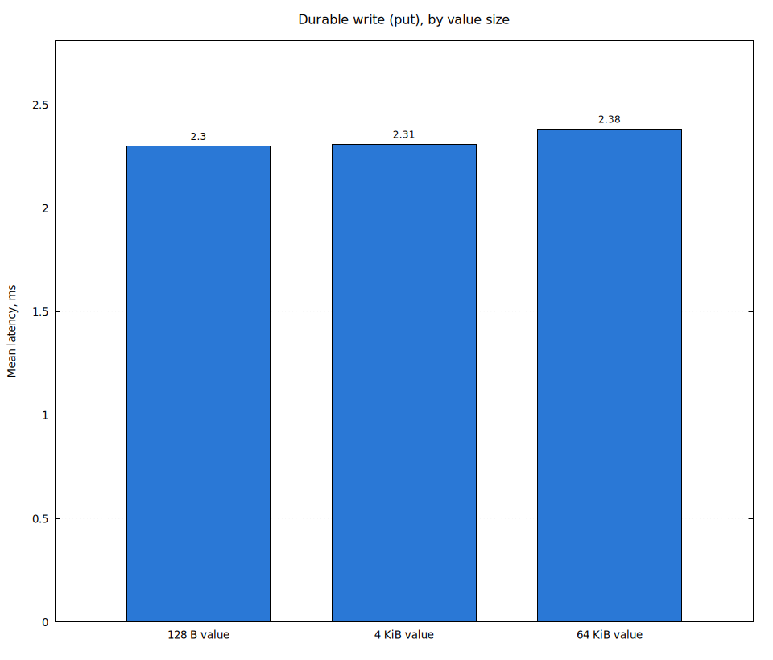

A 64 KiB value is 512 times the data of a 128-byte one and costs 3.6% more
(2.382 ms against 2.299 ms).

The chart below shows what the fsync costs on its own. It times a single WAL
append with and without the sync. Synced, an append takes 2.3 ms. Without the
sync it takes 0.55 µs — the fsync is about 4,000 times everything else the
append does. Only in the unsynced case does value size show up at all: 0.55 µs
at 128 bytes, 1.4 µs at 4 KiB, 9.9 µs at 64 KiB. Both cases append to a WAL
file that already exists, as production does; creating the file is not timed.

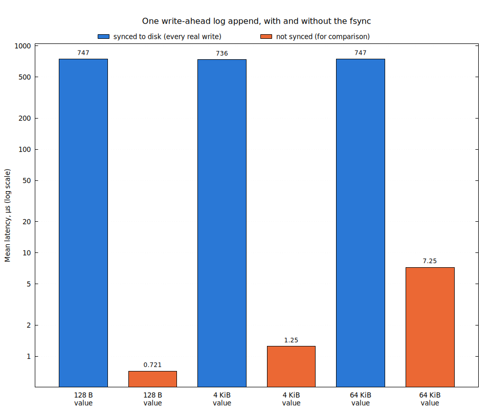

*Log scale: the synced bars are 240 to 4,200 times taller than the unsynced
ones. Production writes always sync; the unsynced case exists only to measure
the rest of the path.*

Other write-path measurements:

- **The full `put`** (WAL, value log and memtable together) measures 2.299 ms.
  That is within noise of the WAL append alone, so the value-log write and
  memtable insert are too small to see next to the fsync.
- **Namespaces cost nothing.** Writing to the default namespace and to a named
  one measure 2.28 and 2.29 ms, within noise.
- **Mixed read/write workloads cost the same as pure writes.** With 80% or 50%
  reads, from memory or from disk, every case lands between 2.26 and 2.31 ms per
  operation. A read costs a few microseconds against a write's 2.3 ms, so the
  writes set the average.
- **Encoding a WAL entry** takes 46 ns (128 B) to 1.1 µs (64 KiB), and decoding
  it 14 ns to 0.54 µs.
- **Replaying the WAL after a crash** reads about 3.4 million small entries per
  second (1,000 entries of 128 bytes in 0.29 ms), and 2.6 million per second at
  4 KiB.

### What `merge` costs over `put`

`merge` is the atomic read-modify-write: it reads a key, runs your closure on the
old value, and writes the result, while holding a per-key lock so no other write
to that key can land in between. Compared with a plain `put`, it does three
extra things: a read, the lock, and your closure. Those extras are timed
separately, because next to a 2.3 ms fsync they are too small to show up in the
write latency:

| Extra work `merge` does | Mean |
|---|---:|
| Reading the current value (a 2 KiB `get` from memory) | 437 ns |
| Taking the per-key lock (hash plus uncontended lock) | 51 ns |
| The closure: increment a counter | 10 ns |
| The closure: insert into a 2 KiB sorted set | 180 ns |

That adds up to 0.5–0.7 µs, about 0.03% of the fsync. The full operations,
measured directly, cannot tell merge and put apart:

| Operation | Mean |
|---|---:|
| `put`, 2 KiB | 2.311 ms |
| `delete`, 2 KiB | 2.368 ms |
| `get` then `put` by hand, 2 KiB sorted set (no atomicity) | 2.298 ms |
| `merge`, 2 KiB sorted set | 2.332 ms |
| `put`, 8 B | 2.294 ms |
| `merge`, 8 B counter | 2.302 ms |

The rows differ by up to 3% (about 70 µs), a hundred times the extra work
`merge` does. So that spread is the drive's fsync time varying from run to
run, not a cost of `merge`, and it is why the extra work is timed separately
above.
The practical conclusion: the atomicity of `merge` is free. It stays as cheap as
a `put` unless your closure does something expensive.

## Reads

Reading a key from memory takes well under a microsecond. Reading the same key
from disk adds about 2.9 µs: the check against the file's bloom filter, a
search of its index, and the read from the value log. That step is constant for
small and medium values. At 64 KiB the value itself becomes big enough to add
time on both tiers.

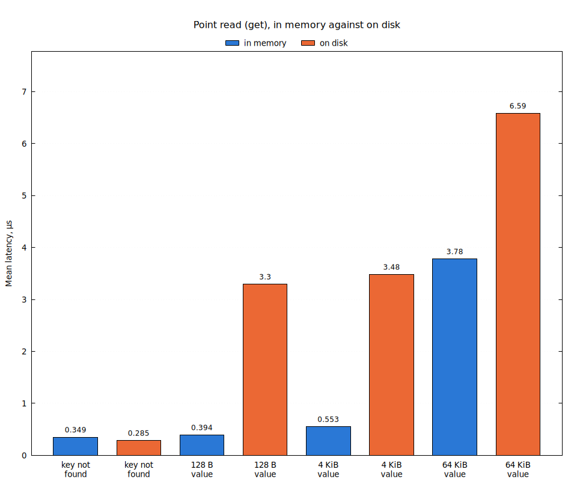

*Each pair is one kind of read, in memory (blue) then on disk (orange). The
first pair is a lookup for a key that doesn't exist; there, disk is faster than
memory — see below.*

### As the store grows

This benchmark repeats the lookup with 1,000 to 100,000 keys in the store (16-byte values), and adds
a third case that alternates on every call between a key in memory and a key on
disk.

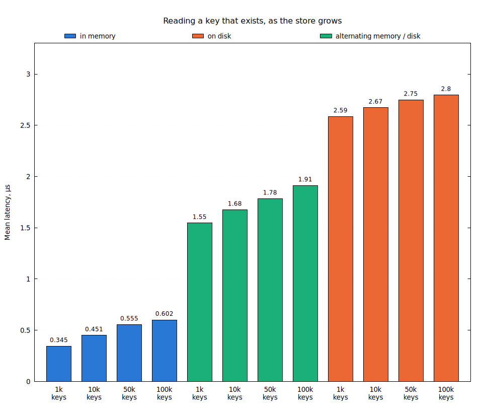

A read from disk barely slows as the store grows: 3.27 µs at 1,000 keys and
3.51 µs at 100,000, 7% more for 100 times the keys. The on-disk lookup
first rules files out by key range and bloom filter, then searches only a small
bounded section of the file, so its work does not grow with file size. A read
from memory rises 61% over the same range (0.36 to 0.58 µs), because the
in-memory table is a skip list whose search deepens as it grows. Memory is
still 6–9 times faster.

The alternating workload costs 4–11% more than the average of the two tiers
would predict, with no clear trend as the store grows. We have not measured why.
The two tiers use different code paths, and switching between them on every call
may cost cache locality.

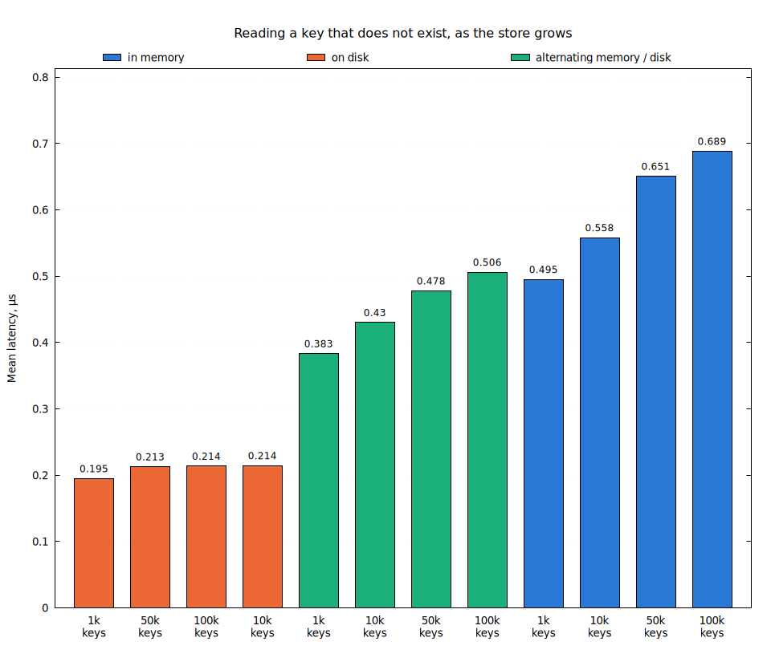

For a missing key the order flips: **disk is 2.5 to 3.2 times faster than
memory**. On disk, a bloom filter usually proves a key is absent without reading
anything else, so a miss stays at about 0.2 µs at any store size. The in-memory
table has no such filter. To prove a key is absent it walks the skip list just as
far as it would to find one. So an in-memory miss costs about what an in-memory
hit does, and grows the same way (0.50 to 0.69 µs).

## Scans

Four ways to read many keys at once, each measured in memory and on disk. On
disk, a scan costs 1.1 to 1.7 times the in-memory scan. The ratio shrinks as
the result grows, because most of the on-disk extra is a fixed setup cost per
scan.

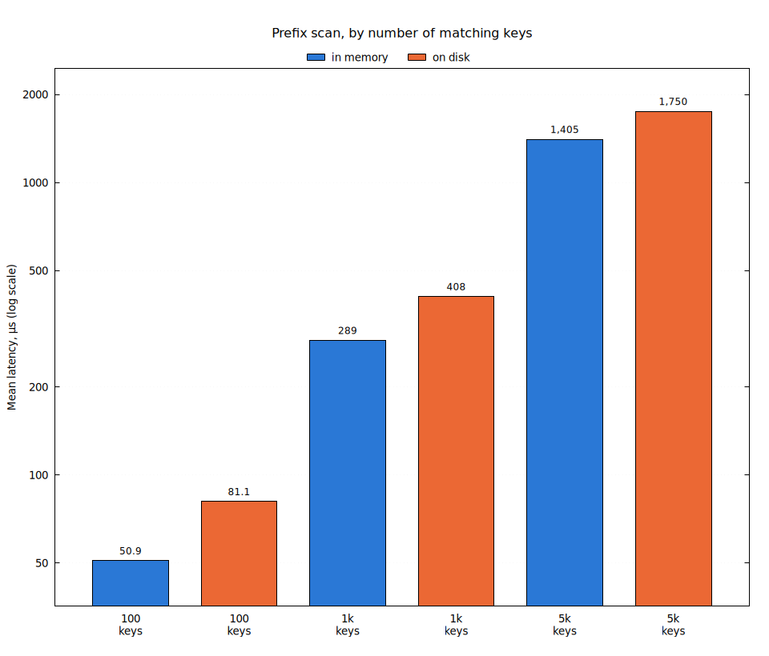

*Prefix scan: all keys starting with a given prefix, returned with their
values. On disk costs 1.69x memory at 100 keys and 1.11x at 5,000. Keys are 128
bytes here; 32-byte keys measure within 5% of these.*

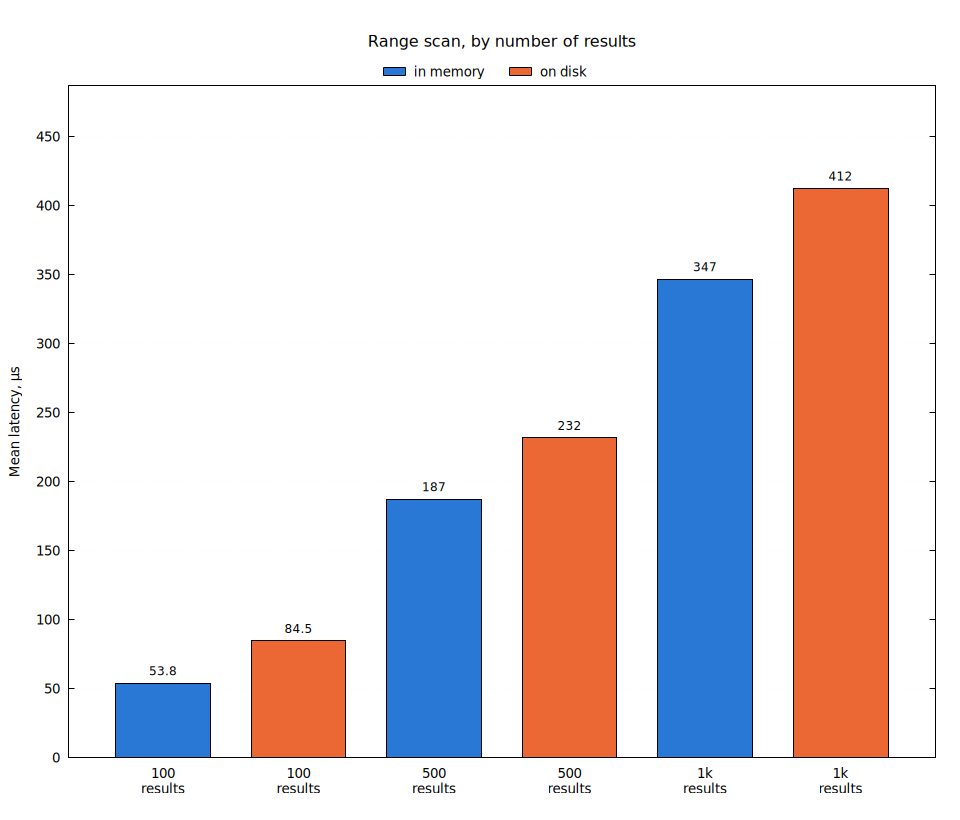

*Range scan: all keys between a start and end key, from a store of 2,000. On
disk costs 1.61x memory at 100 results and 1.30x at 1,000.*

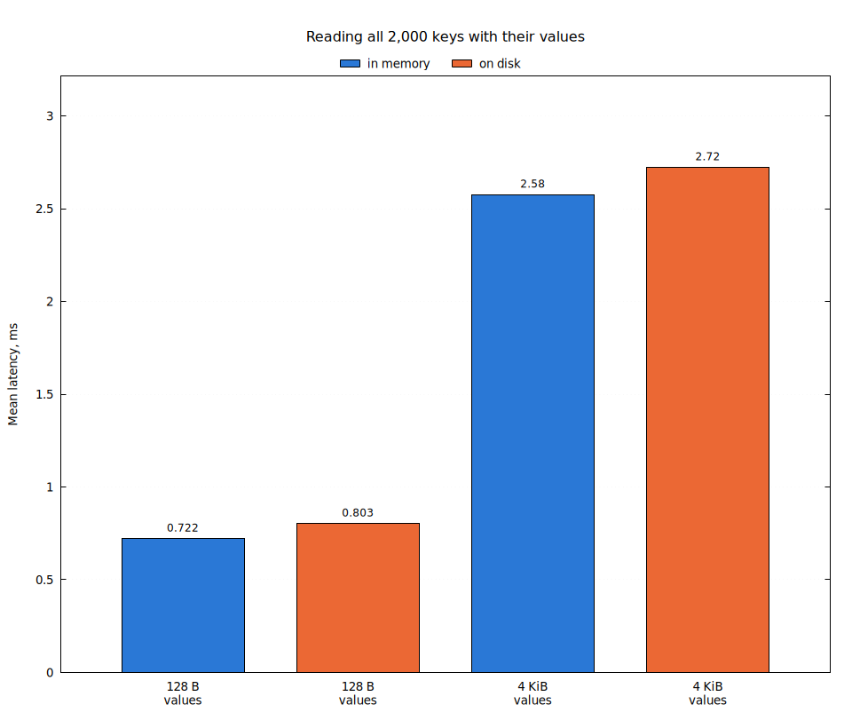

*Reading all 2,000 keys with their values. On disk costs 1.35x memory with
128-byte values and 1.08x with 4 KiB values. The larger the values, the more of
the time goes into reading them from the value log. That cost is the same on
both tiers.*

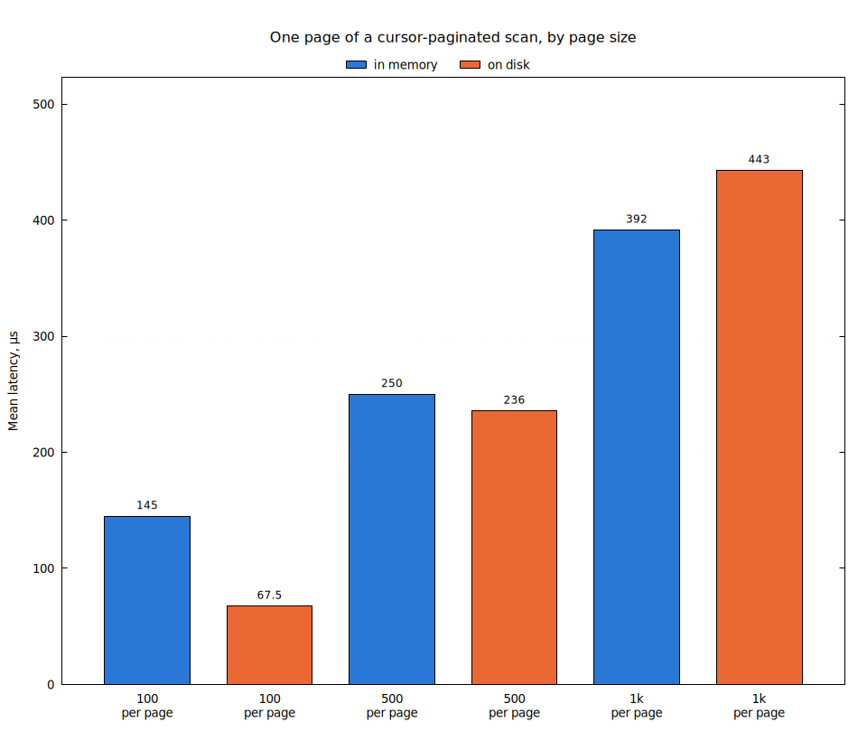

*Cursor pagination: the first page of a paginated scan over 1,000 keys with
256-byte values. This is how the REST API's list endpoints read.*

Cursor pagination is the one scan where the tiers swap. At 100 keys per page,
disk (75 µs) is almost twice as fast as memory (144 µs). At 500 per page they are close (265 µs on disk, 250 µs in memory), and at
1,000 (the whole store) disk is slower, as expected. We have not established why
small pages favour disk.

A related cost is visible in the memory numbers. A 100-key page costs 37% of
reading all 1,000 keys. Each page currently collects the keys from the cursor to
the end of the range before it keeps the first `limit` of them. It loads values
only for the page, but it still walks every key after the cursor. Bounding that
walk is a known follow-up.

## Typed API

The typed API (`put_typed`, `get_typed`, and so on) serialises your own Rust
types with `rkyv`, on top of the byte-oriented API. For single-key operations
it adds nothing measurable:

| Operation | Raw bytes | Typed |
|---|---:|---:|
| `put`, 128 B | 2.299 ms | 2.300 ms |
| `put`, 4 KiB | 2.308 ms | 2.302 ms |
| `get` from memory, 128 B | 0.39 µs | 0.35 µs |
| `get` from disk, 128 B | 3.30 µs | 3.21 µs |
| `get` from disk, 4 KiB | 3.48 µs | 3.43 µs |

The differences between the two columns, in either direction, are within the
noise.

Prefix scans cost more typed, because every returned pair is deserialised.
Range scans differ by 5% or less either way, within the noise:

| Scan | Raw bytes | Typed | Extra |
|---|---:|---:|---:|
| range, 100 results, in memory | 53 µs | 56 µs | +5% |
| range, 1,000 results, in memory | 362 µs | 365 µs | +1% |
| range, 100 results, on disk | 86 µs | 89 µs | +4% |
| range, 1,000 results, on disk | 471 µs | 462 µs | −2% |
| prefix, 100 keys, in memory | 50 µs | 56 µs | +13% |
| prefix, 1,000 keys, in memory | 304 µs | 378 µs | +25% |
| prefix, 100 keys, on disk | 83 µs | 86 µs | +3% |
| prefix, 1,000 keys, on disk | 401 µs | 460 µs | +15% |

One typed operation is slow for a structural reason. `keys_typed`, which lists
keys without values, takes about 270 µs even for 100 keys, in memory or on disk.
That is nearly five times as long as reading the same 100 keys *with*
their values from memory (58 µs). Key listing goes through the same full-store merge that value-log
garbage collection uses. Reading with values uses the faster range scan. Until
that changes, a range or prefix scan is the cheaper way to list keys.

## Field-index queries

A field index maps each value of a field to a compressed bitmap of the rows
holding it. A query combines those bitmaps. This benchmark queries 100,000 rows
with three indexed fields:

| Field | Type | Values |
|---|---|---|
| `status` | string | four values, each on 25% of rows |
| `active` | boolean | true on 50% of rows |
| `age` | integer | 18 to 80, spread evenly (63 distinct values) |

The indexes are written to their files before any query runs, so the queries
read the files, as they do in a running database: changes wait in memory only
until the next index checkpoint, every 1.75 seconds by default.

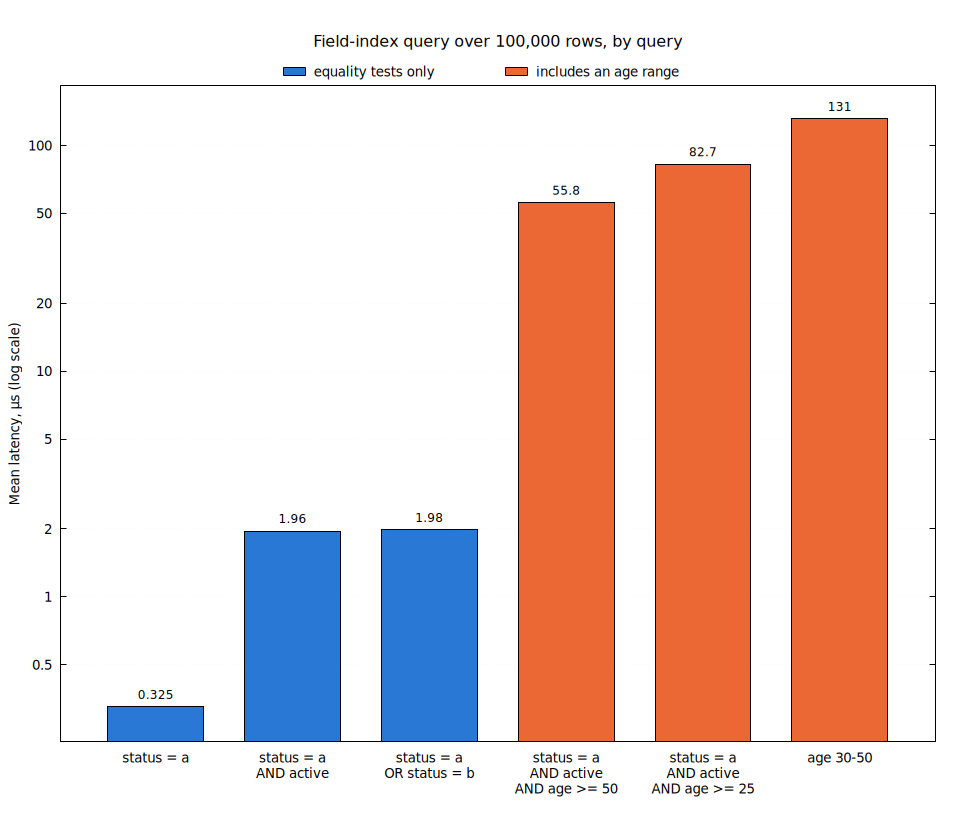

*`status = a` is `status = 'active'`, and `active` is `active = true`.*

The cost depends on **how many bitmaps the query has to load**, not on how many
rows it matches:

- **An equality test loads one bitmap.** `status = 'active'` takes 0.37 µs.
  Combining two equality tests with AND or OR takes 2.0 µs.
- **A range loads one bitmap per distinct value in the range.** `age >= 50` covers
  31 ages, so it merges 31 bitmaps. `age >= 30 AND age <= 50` is evaluated as
  two ranges, one over 51 values and one over 33, and then intersected. At
  139 µs it is the most expensive query here, about 370 times an equality test.

So adding a range to a query makes it slower even when it narrows the result:
`status = 'active' AND active = true` matches 12% of rows in 2.0 µs, and adding
`AND age >= 50` halves that to 6% but takes 61 µs. For a field queried by
range, fewer distinct values (bucketing ages into decades, say) make the query
cheaper.

Parsing the query text is negligible. A three-condition query takes 83 µs
parsed from text and 84 µs pre-parsed: the difference is noise.

## Paging through query results

A query result is a bitmap of matching rows. Returning a page means skipping
the rows before it. Bitmaps store rows in containers of up to 65,536, each of
which records how many rows it holds. The engine uses those counts to skip whole
containers without opening them. The simple alternative, stepping through the
rows one by one, decodes every container it passes into a list, so it pays for
a full 65,536-row container even on the first page. One page of 50 rows, from a
result of 200,000:

| Page starts at row | Stepping through rows | Skipping containers (used) |
|---|---:|---:|
| 0 | 79 µs | 0.32 µs |
| 1,000 | 79 µs | 0.67 µs |
| 50,000 | 82 µs | 17.7 µs |
| 199,000 | 249 µs | 0.24 µs |

Container skipping still steps through the rows *inside* the container where the
page starts. Row 50,000 is 50,000 rows into its container, which is why that page
costs more than the others.

Paging through a whole 20,000-row result, 200 rows at a time (100 pages), takes
0.46 ms with container skipping and 2.52 ms by stepping through rows, which
starts again from the first row on every page.

## Semantic search

A semantic search runs in two passes. Pass 1 picks the clusters nearest to the
query and scores every document chunk stored in them with compact 1-bit
vectors. Pass 2 re-scores the best candidates with more precise vectors. (See
[Semantic-Search-Architecture.md](src/semantic_search/report/Semantic-Search-Architecture.md).)
This benchmark runs the full search over an in-memory store of 5,000
documents with synthetic 768-dimension vectors, and a query shaped like
production's: one vector for the whole query. The store is partitioned into 64
clusters, their centres fitted by k-means on synthetic documents, and every
search probes all 64. That is what production does with a store this small:
Pass 1 keeps probing the nearest clusters until they hold 42,000 entries in
all (the default budget; an entry is one document's chunks in one cluster), and
5,000 documents hold fewer than that.

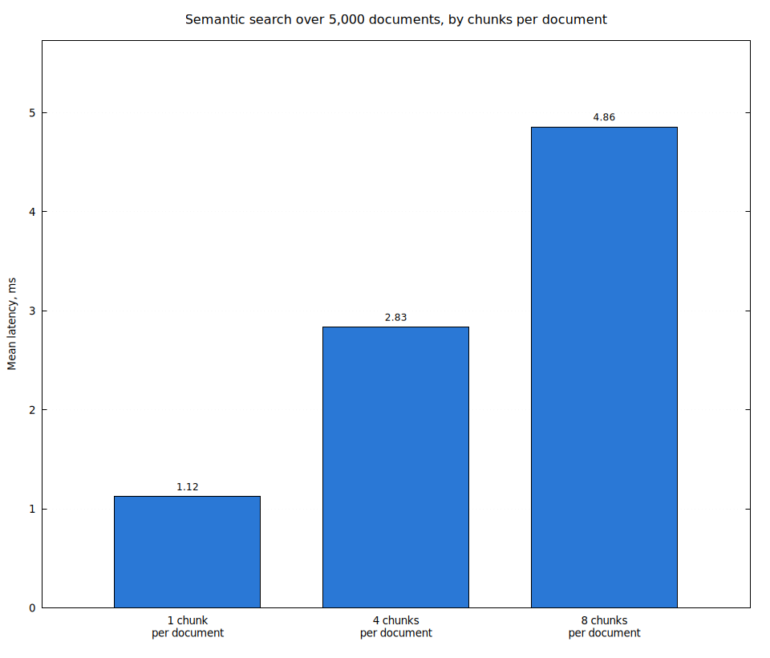

A document is split into overlapping chunks, and Pass 1 scores every chunk in
the clusters it probes. So search time grows with chunks per document: 2.0 ms
with one chunk, 4.0 ms with four, 5.8 ms with eight. Pass 2 re-scores a fixed
number of candidates, so its cost does not grow.

How these numbers relate to a real query:

- **The embedding call is not included.** A real query first sends its text to
  the embedding service, and that round trip usually takes longer than
  everything measured here. Repeated queries are served from a cache.
- **Multi-vector queries cost more.** `search()` also accepts several query
  vectors (production sends one). At one chunk per document, a 1-vector query
  takes 1.9 ms (the one-chunk bar above, measured separately), 4 vectors
  2.1 ms and 40 vectors 2.7 ms.
- **Real stores are larger and clumpier.** Here every chunk is scored. In a
  larger store, Pass 1 stops once the clusters it has probed hold 42,000
  entries, so its cost follows the budget rather than the store size. Real
  embeddings also pile into a few clusters, unlike these synthetic ones. The architecture doc's *Where a query's time goes* covers this, and
  [The engine at work](#the-engine-at-work) measures search on a real
  40,000-document store.

The steps inside a search are small by comparison. Ranking the 64 clusters by
distance to the query takes about 2 µs. Scoring 1,000 candidates takes 16 µs in
Pass 1 and 14 µs in Pass 2, so the more precise pass costs no more per
candidate.

---

## The engine at work

The sections above measure one operation at a time with the background workers
switched off, which isolates each operation's own cost. A running database is
never like that: memtables are flushing, compaction is merging, garbage
collection is reclaiming space, field indexes are being checkpointed, new
documents are being embedded and indexed, and the vector partition is being
split and merged. This benchmark measures what each operation costs **while all
of that is happening**, first one operation at a time and then with several
clients at once, with nothing outside the engine involved.

It is `minnal_db/benches/engine_bench` (not Criterion), reported by
`docs/benchmarks/engine/report.py`. The results come first. How the benchmark
works, and what it leaves out, follows them.

### Latency by number of clients

Code at commit `1007dbd`, on 2026-10-18, on the machine under [Setup](#setup),
with jemalloc as the allocator. Each cell ran once, and the soak lasted
10 minutes ([What is measured](#what-is-measured) explains both). Every cell
was valid.

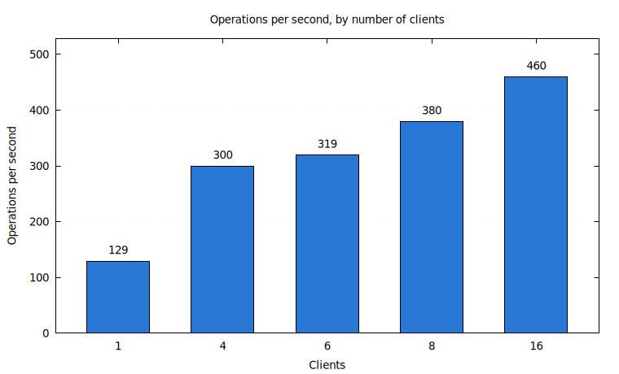

Throughput rises from 129 operations per second with one client to 460 with
16, 3.6 times as many.

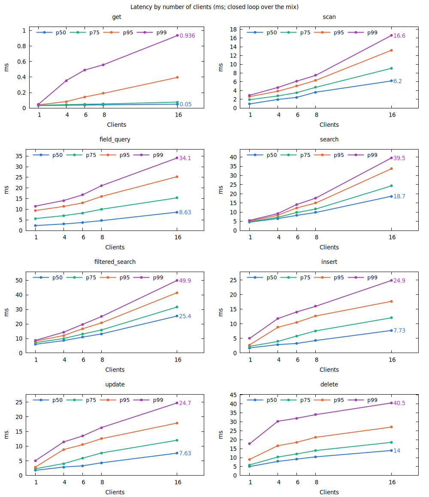

*One panel per operation, each with its own scale. The numbers at the right of
a panel are its p50 and p99 with 16 clients. Every figure behind the charts,
p99.9 included, is in [engine_latency.md](docs/benchmarks/engine_latency.md).*

What the charts show:

- **Reads stay fast.** `get` has a median of 0.04 ms at every client count; its
  p99 rises from 0.06 to 0.88 ms. `scan`'s median stays between 1.1 and
  2.1 ms, and `field_query`'s between 2.5 and 3.7 ms, with a p99 of 14–18 ms.
- **Searches slow gradually.** The median `search` takes 15 ms with one client
  and 24 ms with 16; its p99 goes from 18 to 59 ms. At most two searches score
  their candidates at once, each spread over every core, and the others wait
  their turn in order, so a search's time grows with the searches ahead of it.
  `filtered_search` costs a little more than `search`: up to 1.3 ms more at
  the median.
- **Writes queue for the fsync.** The median `insert` and `update` take 5.6 ms
  with one client and 69 ms with 16; `delete` takes 16 ms and 200 ms. Writes
  fsync the WAL one at a time, and a document write is at least two of them:
  the document, then its entry in the embedding queue. A delete first removes
  the document's vector-index entries, each a durable delete of its own, which
  is why it costs about three inserts.
- **Indexing keeps up to 4 clients.** The time from a write's acknowledgement
  until its document is searchable has a median of 22 ms with one client and
  67 ms with four. With six it is 10 s, and with 16 almost two minutes, because
  the vector-index worker falls behind for as long as that load lasts. In the
  10-minute soak at 4 clients (300 operations per second) the median stayed at
  79 ms and the indexing backlog at 5–6 documents. Neither disk use (250 MiB
  in the first quarter, 190 MiB in the last) nor resident memory (about
  2.5 GiB, 0.9 GiB of it the benchmark's replay table) grew.
- **Alone against in the mix.** Reads sent alone are faster than the same
  reads in the 1-client mix (`get` 0.01 against 0.04 ms, `scan` 0.34 against
  1.1 ms), where they share the machine with searches and indexing. We have not
  measured which part of that work slows them. Writes sent alone are *slower*
  (`insert` 16 against 5.6 ms): a client sending only inserts made the engine
  do 37,000 key-value puts and 16,000 deletes in 2 minutes 15 seconds, its
  inserts' indexing included, against 14,000 and 15,000 in 3 minutes
  15 seconds for the 1-client mix. All of them queue for the same fsync.

Search quality held through the run (nDCG, FiQA test queries):

| | @10 | @20 | @30 | @40 | @50 | @100 |
|---|---:|---:|---:|---:|---:|---:|
| Before the run | 0.501 | 0.528 | 0.538 | 0.545 | 0.551 | 0.565 |
| Under load, concurrent cells | 0.502 | 0.530 | 0.539 | 0.547 | 0.552 | 0.566 |
| At rest after the run | 0.510 | 0.539 | 0.548 | 0.555 | 0.561 | 0.575 |

The store changes during the run (documents are deleted, rewritten and
inserted), so the rows measure slightly different stores, not only a busier
index.

### How it runs

- **The engine, in process.** The document store is opened inside the
  benchmark's own process, from the same configuration file the API server
  uses, and every operation calls the library directly: the same calls the REST
  handlers make (`get`, `put`, `delete`, `scan_range`, `query_resolved`,
  `search_semantic`, `search_semantic_filtered`). There is no HTTP, no JSON
  encoding of replies and no network. The memory allocator is jemalloc, as in
  the API server ([Choosing the memory allocator](#choosing-the-memory-allocator)).
- **Every background worker runs**: memtable flushes, LSM compaction, value-log
  GC, WAL GC, the vector index WAL's GC, field-index checkpoints (every
  1.75 s), the vector-index worker (up to 4 embedding calls in flight) and
  partition maintenance (2 threads).
- **No external call: embeddings are replayed.** A document store with semantic
  search sends every new or changed document's text to an embedding service
  (a separate process; here, models on a GPU). That service's speed depends on
  its own batching and hardware, not on minnal, so it is left out. Instead, a
  small embedding server inside the benchmark process answers from a **replay
  table**: every embedding the run can ask for, recorded once from the real
  service. The engine's embedding client talks to it over localhost exactly as
  it would to the service, and then does all its own work with each embedding:
  chunking, quantisation, writing to the vector index WAL, routing chunks to
  partitions, splitting and merging.
- **How the table is recorded** (`engine_bench record`). A scratch copy of the
  starting database is opened with the embedding server in record mode in
  front of the real service, and the engine is made to embed every text the run
  can send: each test query once, every document it may rewrite (with its own
  text, and with the text an update produces), every document in the ingestion
  stream, and every text an insert past the end of the stream produces. The
  engine itself turns each text into what it sends (the whole text plus
  overlapping sentence windows), so the table holds exactly the requests a run
  makes. At the end, a sample of the table is read back through the embedding
  server and compared with what was recorded, bit for bit.
- **The set of texts is finite**, so that the table can cover it: an update
  that changes text appends one fixed sentence (`" Revised."`), and inserts
  past the end of the stream reuse its texts with one fixed suffix
  (`" (copy)"`). The engine embeds and indexes each one regardless. A request
  missing from the table fails, is counted, and makes the measurement invalid.
- **The store keeps its size.** Inserts and deletes are equally likely, and
  deletes take the oldest documents first, so a long measurement does not grow
  the store and no text is in it twice. A single-operation measurement of
  inserts or deletes still moves it by thousands, so before each measurement
  unmeasured writes bring it back to the 40,000 documents it started with.
  Otherwise a long run grows the store several times over, mostly with
  repeated texts, and search quality falls for a reason that has nothing to do
  with the engine: one non-relevant text takes several of the top places at
  once.
- **Searches use cached query embeddings.** Every test query is embedded once
  before measuring starts, so a search's latency is the search, not a call to
  the embedding service.
- **A search's latency is the search alone**: the ranked ids and scores of the
  top 100. The REST route then reads each result's document, which is not
  included.

### The workload

The data is FiQA, a financial question-answering set: 40,000 documents loaded
and indexed before the run, a stream of 17,638 more to insert, and 648 test
queries with relevance judgements. Each document carries three synthetic fields
for field queries and filters: `category` (12 values, skewed), `year`
(2010–2025) and `score` (0–1000), all indexed.

| Operation | What it does |
|---|---|
| `get` | Read one document; ids drawn from a skewed (Zipf) distribution, so a hot set exists |
| `insert` | Write a new document from the stream |
| `update` | Rewrite a document: half change only `score`, half change its text |
| `delete` | Delete a document |
| `scan` | Read one page of 50 documents from a random starting id |
| `field_query` | 1–3 conditions over `category`, `year`, `score`; first page of 20 |
| `search` | Semantic search for a test query, top 100 |
| `filtered_search` | The same, restricted to `score < S` (5–50% of documents) |

Every write is durable when it returns (its WAL fsync), and is embedded and
indexed afterwards by the vector-index worker.

### What is measured

1. **One operation at a time.** One client sends one kind of operation back to
   back for 2 minutes, while a steady trickle of 10 writes per second (inserts,
   updates and deletes) keeps indexing, flushing and maintenance busy. Reported
   per operation: p50, p75, p90, p95, p99, p99.9 and maximum latency.
2. **Concurrent clients.** 1, 4, 6, 8 and 16 clients, each sending its next
   operation as soon as the previous one returns (a *closed loop*), for
   3 minutes each, drawing from one mix: `get` 25%, `search` 25%,
   `field_query` 15%, `update` 10%, `filtered_search` 7%, `insert` 6.5%,
   `delete` 6.5%, `scan` 5%. Reported: operations per second, and the same
   percentiles per operation. Nothing is extrapolated beyond 16 clients:
   throughput stops growing wherever a shared resource saturates (writes, for
   example, fsync one at a time), so a line through the measured points does
   not predict higher ones. In a closed loop a client never has more than one
   request outstanding, so latency here is the operation's own time with that
   many in flight, not including time a request would wait to be sent.
3. **Soak.** 4 clients for an hour (10 minutes in the run reported above),
   sampled every 10 seconds, to show whether anything grows without bound:
   disk use, memory, the indexing backlog. Four clients is the highest load at
   which indexing keeps up with the writes; above it the backlog grows for as
   long as the load lasts, which the 3-minute concurrent measurements already
   show.
4. **Search quality** (nDCG at 10, 20, 30, 40, 50 and 100, and recall at 100):
   before the run, under load, and at rest after it, to show that the
   background work does not cost search quality.

Each measurement (a *cell*) also records the background work done during it
(flushes, compactions, garbage collection, checkpoints, splits and merges) and
the **ingestion lag**: how long after a write is acknowledged its document
becomes searchable.

### How a number is made trustworthy

- **Every cell is checked before the next starts.** It waits for the indexing
  backlog to drain, runs 15 seconds unmeasured, measures, and waits for the
  backlog to drain again. It is valid only if no operation failed, no
  embedding was missing from the replay table, every measured operation ran at
  least 50 times, and, if documents were written, the vector-index worker
  indexed them and a field-index checkpoint advanced. An invalid cell is saved
  with its reasons and **stops the run**, so a problem costs one cell, not
  hours. The run resumes at that cell once the cause is fixed.
- **Cells can be repeated**: with three repeats, all cells run once, then all
  again, then a third time, so drift over the run shows up as a difference
  between repeats, and tables give the median with the lowest and highest
  beside it. The run reported above ran each cell once.
- **Results are saved as each cell finishes** (`cells/<cell>.json`, plus a
  per-second timeline and the search results), with a manifest of what is
  done, so an interrupted run loses nothing.
- **A smoke run first.** `--smoke` runs every cell for a few seconds and
  produces the full report, to check the whole harness before a run of several
  hours.

### What it does not measure

The REST layer (HTTP, JSON, the per-result document reads of a search), the
embedding service, query-embedding cache misses, other datasets, and other
machines. The clients run in the same process and on the same cores as the
engine; they do almost no work of their own. The whole run uses one engine, so
later cells run on a store that has grown and been maintained by the earlier
ones.

### Reproducing it

The data and the starting database are built once.

1. **The data.** Download FiQA from [BEIR](https://github.com/beir-cellar/beir)
   and split it:

   ```sh
   python3 minnal_db/docs/benchmarks/engine/prepare.py FIQA_DIR DATA_DIR
   ```

   It writes the 40,000 starting documents (`base.jsonl`, including every
   document a test query judges relevant), the 17,638-document ingestion stream
   (`stream.jsonl`), the test queries and their judgements, and which ids the run
   may update or delete (`ids.json`). The synthetic fields are seeded per
   document id, so every run gets the same data.
2. **The starting database.** Start an API server on an empty data directory
   (with the embedding service running), load the starting documents into a
   store created from `docs/benchmarks/engine/schema.json`, and wait until the
   vector queue is empty (`GET /admin/indices/fiqa/vector/queue`):

   ```sh
   minnal_tools bulk_load --schema minnal_db/docs/benchmarks/engine/schema.json \
       http://127.0.0.1:PORT fiqa id DATA_DIR/base.jsonl
   ```

   Stop the server. Its database and schema directories are the snapshot that
   `CONFIG.json` names; every run works on a fresh copy of it.

Then:

```sh
# Once: record the replay table (needs the embedding service on :8001).
cargo bench -p minnal_db --features doc-store,semantic-search --bench engine_bench -- \
    record CONFIG.json --upstream http://127.0.0.1:8001

# Check the harness end to end (a few minutes), then the real run (several hours).
cargo bench -p minnal_db --features doc-store,semantic-search --bench engine_bench -- run CONFIG.json --smoke
cargo bench -p minnal_db --features doc-store,semantic-search --bench engine_bench -- run CONFIG.json
python3 minnal_db/docs/benchmarks/engine/report.py OUT_DIR
```

`CONFIG.json` names the server configuration, the starting database, the data,
the replay table and the output directory, and sets the mix, durations and
repeats; `docs/benchmarks/engine/fiqa.example.json` is the full plan (relative
paths resolve from `minnal_db/`, where `cargo bench` runs). The run reported
above used it with `"repeats": 1` and `"soak_s": 600`, and takes about an hour;
the full plan takes several hours. To redraw the charts and tables of
[Latency by number of clients](#latency-by-number-of-clients) from a run:

```sh
python3 minnal_db/docs/benchmarks/engine/plot.py OUT_DIR minnal_db/docs/benchmarks
```

It needs gnuplot. `cargo bench` without a command skips this benchmark, so the Criterion report
above does not run it.

### Choosing the memory allocator

Every request allocates and frees short-lived buffers, from many threads at
once. So the *memory allocator*, the code behind every allocation and free,
matters to both speed and memory use. A Rust program uses the system allocator
(glibc `malloc` on Linux) unless the binary names another one. `minnal_db` is a
library and leaves that choice to the program that embeds it. The API server
(`minnal_db_api`) uses jemalloc. The
[Embedded Quickstart](QUICKSTART.md#7-choosing-a-memory-allocator) shows how to
switch an application.

Two builds of `engine_bench` were compared on the same starting database and
the same operations. The only difference was the allocator: glibc `malloc` 2.43
or jemalloc 5.3 (`tikv-jemallocator` 0.7).

| | glibc `malloc` | **jemalloc** |
|---|---:|---:|
| Operations per second, 16 clients | 412 | **444** |
| Operations per second, soak (4 clients) | 280 | **292** |
| `search` p50 / p99, 16 clients (ms) | 33 / 91 | **23 / 61** |
| `filtered_search` p50 / p99, 16 clients (ms) | 34 / 96 | **25 / 63** |
| `field_query` p99, 16 clients (ms) | 28 | **23** |
| `get` p99, 16 clients (ms) | 1.8 | **0.8** |
| `insert` p50, 16 clients (ms) | 72 | 73 |
| Share of CPU time in the allocator's own code | 1.7% | 1.1% |
| Share of CPU time in the kernel | 45% | **20%** |
| Resident memory after the 16-client cell (GiB) | 5.2 | **1.3** |
| Resident memory at the end of the soak (GiB) | 5.7 | **2.4** |
| Highest resident memory during the run (GiB) | 5.7 | **2.7** |

Search quality at rest after the run (nDCG):

| | @10 | @20 | @30 | @40 | @50 | @100 |
|---|---:|---:|---:|---:|---:|---:|
| glibc `malloc` | 0.506 | 0.533 | 0.542 | 0.549 | 0.554 | 0.569 |
| jemalloc | 0.506 | 0.534 | 0.542 | 0.550 | 0.555 | 0.569 |

What the numbers show:

- **glibc keeps what it frees.** It spreads threads over many memory regions
  (*arenas*; up to eight per core), and memory freed into an arena mostly stays
  there, resident, for the next allocation from that arena. After the
  16-client cell, glibc's own account showed 1.1 GiB in use and 4.7 GiB freed
  but still held. jemalloc hands unused pages back to the operating system over
  about ten seconds, so resident memory follows what is actually in use.
- **Reads are faster with jemalloc.** With 16 clients the median search is 28%
  faster and its p99 33% faster; `get`'s p99 halves. Throughput rises 8% at
  16 clients and 4% in the soak.
- **The difference is not in the allocator's own code.** Both spend under 2% of
  their CPU time there. With glibc, 45% of the CPU samples were in the kernel,
  against 20% with jemalloc. The kernel's symbols were not readable on this
  machine, so where that kernel time goes has not been established.
- **Writes are unchanged.** The `insert`, `update` and `delete` medians at
  16 clients differ by less than 3% between the two allocators. Writes fsync
  one at a time, so the allocator does not set their pace.
- **Search quality is unchanged** at every cutoff.

mimalloc (`mimalloc` 0.1.52) was also tried, at commit `7ebb872` with the same
plan. It landed between the two on every measure (409 operations per second at
16 clients, `search` p50 38 ms, highest resident memory 4.0 GiB), so it was not
measured further.

Tuning glibc does not close the gap. Measured at commit `4537a9b` with the same
plan, limiting it to 8 arenas (`GLIBC_TUNABLES=glibc.malloc.arena_max=8`) cut
resident memory to 2 GiB but **halved** throughput (153 operations per second
at 16 clients), because threads then queue for the shared arenas' locks. A
larger per-thread cache (`glibc.malloc.tcache_count=1024`) used more memory
(8–8.5 GiB) and was slower (361 operations per second).

How these numbers were made. Code at commit `01ea124`, on 2026-10-18, with the
machine under [Setup](#setup). Each allocator ran a shortened plan once:
single-operation cells of 5 seconds, 8 and 16 clients for 3 minutes each, and a
10-minute soak with 4 clients. Every cell was valid. Both ran under
`perf record` (499 samples per second, frame pointers on), which costs each the
same; it is one reason the throughput here is a little below that in
[Latency by number of clients](#latency-by-number-of-clients). The CPU shares
are weighted by sample period. Repeated runs of one build have agreed within
1% on this machine, far less than the differences above. Resident memory
includes about 0.9 GiB held by the benchmark's replay table, which an
application does not have.

The benchmark uses jemalloc, as the API server does. To repeat a comparison,
build it with another allocator:

```sh
RUSTFLAGS='--cfg minnal_bench_alloc="system"' \
    cargo bench -p minnal_db --features doc-store,semantic-search --bench engine_bench -- run CONFIG.json
```

`"system"` selects glibc `malloc` and `"mimalloc"` selects mimalloc. The
allocator is recorded in `run.json` and named in the report. glibc's own
account of memory in use and freed but held is reported only for the system
allocator.
