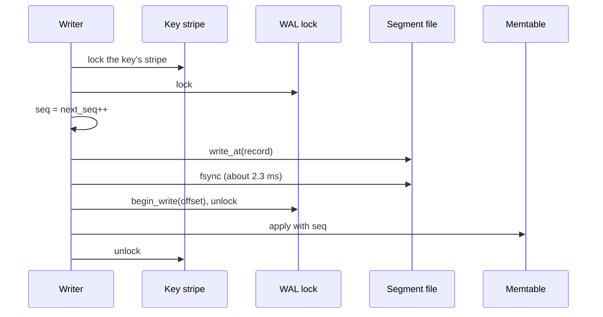
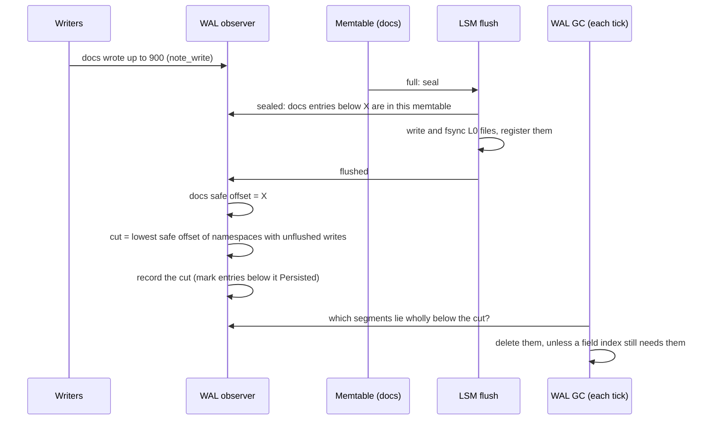
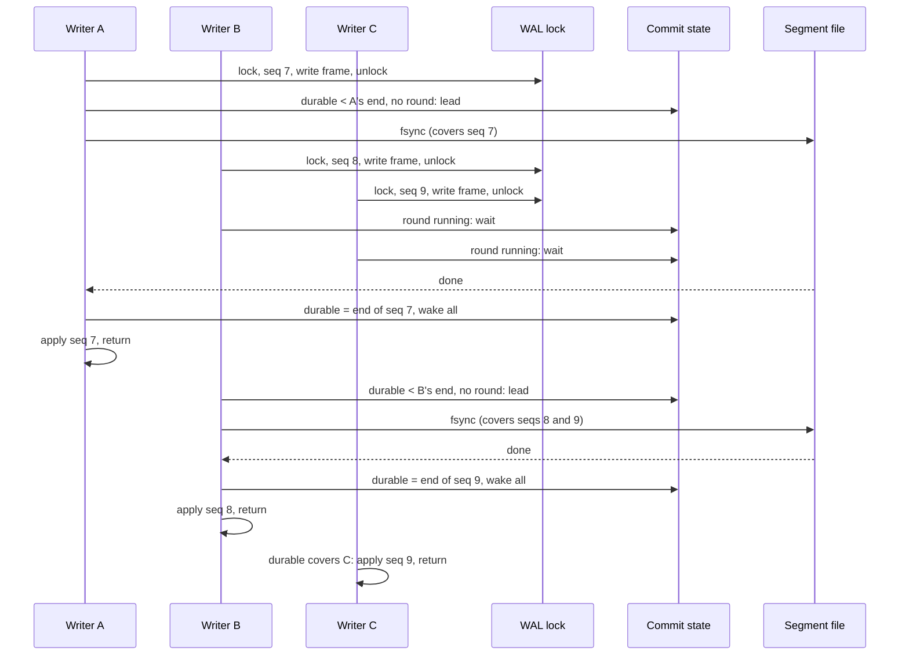

# Main WAL rework: retire by cut, checksum frames, group commit — design note

**Status:** built, 2026-10-24: A1, A2, B and C, with the crash testing in §13
and the measurements in §14. Preallocated segments (§15) built after; the vector index
WAL's syncs coalesced the same way (§16).
**Scope:** the main WAL (`db/wal.rs`, its append in `Database::put_ns_locked` /
`delete_ns_locked`, its recovery and its GC). Three changes, built in order:

- **A. Retire by cut.** Everything that needs the WAL reports, by an event, how
  far it no longer does, and the WAL keeps the log from the lowest such point.
  - **A1.** Memtable flushes: the log records its progress (the cut and each
    namespace's safe offset) in its metadata, before the flush's L0 files are
    registered, instead of rewriting each entry's status in place. The log
    becomes append-only, and the two logs retire the same way.
  - **A2.** Field-index checkpoints: each checkpoint reports its WAL position
    as an event, instead of WAL GC reading every checkpoint marker on every
    tick. WAL GC keeps the log from the lower of the two.
- **B. Checksummed frames.** Every record carries a CRC, and open truncates a
  torn tail.
- **C. Group commit.** Concurrent writers share one fsync.
  - **C1.** Commit rounds with no deliberate wait.
  - **C2.** An optional commit delay, off by default, chosen by measurement.

The guarantee a caller gets does not change: a `put`, `delete` or `merge`
returns only once its WAL record is on stable storage. The vector index WAL,
the no-WAL writes and the doc store's API are unchanged.

Section 1.2 explains how a flush retired WAL entries and how WAL GC worked before this change.
Section 2 compares minnal's two logs with RocksDB, Milvus and turbopuffer; the
three changes follow from that comparison.

## Terms used here

The engine-wide log terms (seq, key stripe lock, memtable, seal, flush,
segment, tail, torn tail, poisoned, flush observer and the rest) are defined in
`minnal_db/README.md` → *WAL terms*. The ones this note adds or leans on most:

- **fsync** — the system call that waits until a file's written bytes are on
  stable storage (`File::sync_data` here). On the benchmark NVMe drive one takes
  about 2.3 ms, and the drive completes about 420 of them a second, shared by
  every file on it.
- **WAL lock** — `Database::wal_metadata`, the lock every main-WAL write takes.
  It guards the log's **tail** (where the next record goes) and the in-memory
  WAL metadata, and it makes seq order equal to append order.
- **WAL metadata** — the small file `<db_path>/wal_metadata`, saved atomically
  (write a copy, fsync, rename, fsync the directory). It records the log's head
  and tail and, after change A, the cut.
- **Status** (today) — each entry's Inserted or Persisted flag, stored inside
  the entry. Marking an entry **Persisted** tells recovery to skip it.
- **Safe offset** (per namespace) and **cut** — kept by `WalPersistObserver`
  from the flush events. A namespace's safe offset is the WAL position below
  which all its writes are in L0 files. The cut is the lowest safe offset of
  the namespaces that still have unflushed writes, capped at the oldest write
  that is appended but not yet applied (*in flight*). Every entry below the cut
  is in an SSTable. In code it is `last_persisted_offset`.
- **Written tail** — the end of the bytes handed to the kernel (`write_at`).
  They are readable but can vanish in a power loss.
- **Durable tail** — the end of the bytes an fsync has confirmed. Today the two
  tails are equal whenever the WAL lock is free; with group commit the durable
  tail can lag the written tail.
- **Group commit** — several concurrent writers share one fsync. Each writer
  still waits for an fsync that covers its own record before it returns, so no
  write is acknowledged early. (Acknowledging first and fsyncing later is a
  different thing, *asynchronous commit*; this note does not do that.)
- **Commit round** — one fsync and the writers it releases. The writer that
  issues it is the round's **leader**; the others are **followers**.
- **Frame** — one record as stored in a segment: a length, then the body.
- **CRC** — a 32-bit checksum of a frame's body (`crc32fast`, already used by
  the vector index WAL and the WAL metadata file).
- **Field-index replay watermark** — the oldest WAL segment some field index
  still needs to replay after a crash (`index_replay_watermark_segment`). WAL GC
  keeps segments from it on, up to `max_pinned_wal_segments`.
- **WAL consumer** (A2) — anything that needs the WAL from some position on,
  and reports by an event when that position moves: a namespace's memtables
  (moved by the *flushed* event) and a field index (moved by its checkpoint).
- **Flush cut / retirement cut** — the flush cut is the cut above, where
  memtable replay starts after a crash. The retirement cut is the lowest
  position of all WAL consumers, memtables and field indexes; WAL GC deletes
  segments wholly below it.

## 1. Before this change

This section describes the main WAL as it was before A, B and C; §13 says
what was built.

### 1.1 One write

Every main-WAL write does this, one writer at a time:



The fsync is inside the WAL lock, so a second writer, in any namespace, waits
for the first writer's fsync to finish before it can even write its bytes. The
main WAL therefore manages one write per device flush, whatever the number of
clients: 387–402 writes a second during the semantic-search ingest benchmark,
with the drive about 92% busy (`Fewer-WAL-Fsyncs-Design.md`, §14).

### 1.2 From flush to garbage collection

An entry can leave the log once its write is in an L0 file. The WAL works that
out in two stages: it keeps a **cut** (every entry below it is in an SSTable)
and records it; WAL GC later deletes segments wholly below it.
`WalPersistObserver` in `db/database.rs` does the first stage, driven by the
flush events.

**While writes come in.** Each write is appended to the WAL, then applied to
its namespace's memtable. The observer tracks:

- each namespace's furthest WAL position (`note_write`), for example "*docs*
  has written up to 900";
- the *in-flight* writes, appended but not yet applied (`begin_write`,
  registered before the WAL lock is released and cleared after the apply), so
  nothing counts them as saved.

**Seal.** When a memtable fills, it is made read-only and a new one takes the
writes. The *sealed* event records, for that namespace and memtable, a
position X: "every entry of this namespace below X is in this memtable". X is
the log's tail capped at the oldest in-flight write (`wal_cut_ceiling`): an
in-flight write sits below the tail in the log but will be applied to the
*new* memtable.

**Flush.** The sealed memtable is written to L0, and four events fire in
order:

- *sealed* — above;
- *flushing* — before any L0 file is written (the vector index WAL syncs here);
- *written* — L0 files durable, not yet registered (the vector index WAL
  records its progress here);
- *flushed* — L0 files registered. This is the main WAL's event today (A1
  moves it to *written*, §4.2).

**On *flushed*, the namespace's safe offset moves, then the cut.**

1. The namespace's safe offset moves up to X (`advance_namespace`). It only
   moves through flushes that finished in order: if a newer memtable of the
   namespace finishes first, its X waits until the older one has flushed too.
2. The cut is recomputed (`try_advance_persisted`): the lowest safe offset
   among namespaces that still have unflushed writes (furthest position above
   their safe offset), capped at the oldest in-flight write. A namespace whose
   writes are all flushed does not hold it back. With *docs* flushed to 900 and
   *users* to 400, both with unflushed writes, the cut is 400; when *users*
   flushes to 1,000, it becomes 900.



**Recording the cut.** `Database::mark_persisted_range` reads every entry
between the old cut and the new one, rewrites each with status Persisted,
fsyncs every segment it touched, updates the per-segment persisted counts and
saves the WAL metadata file. The last two run while holding the WAL lock, so
every writer waits for that save's fsyncs. Change A replaces all of this with
saving the cut itself.

**WAL GC**, on its worker's tick, deletes a segment when both hold:

- **It is fully retired**: every entry in it is Persisted (after change A: it
  lies wholly below the cut), and it is not the active segment.
- **No field index still needs it.** A field index (the bitmaps behind field
  queries) is held in memory and saved to disk by periodic checkpoints. Each
  checkpoint records the WAL position it covers. After a crash, a field index
  is rebuilt by loading its last checkpoint and replaying the WAL from that
  position, so WAL GC keeps every segment from the oldest active field's
  checkpoint on (the *field-index replay watermark*).

**The backstop, and what a gap is.** If the checkpoint worker stalls, that
watermark stops moving and the WAL would grow without limit. So once more than
`max_pinned_wal_segments` (default 32) retired segments are held only by the
watermark, WAL GC deletes the oldest of them anyway. A field whose checkpoint
is older than a deleted segment could no longer be rebuilt fully after a
crash: the writes in that segment would be missing from its bitmaps. That is
the **gap**. Because the segment is the only record of which keys it held, WAL
GC first reads the keys out of it and saves a gap record beside the field's
checkpoint (`gap.json`): which field, which segments, and the keys
(`record_backstop_gaps`). The field is then reported as degraded, and
`POST /admin/indices/{ns}/attribute/{field}/repair` (`repair_field_index`)
re-derives just those keys' entries from their current stored values, or
rebuilds the whole field if the key list was too long, and clears the record.
If the process does not crash, the in-memory index is complete and the next
checkpoint covers it; the record is written anyway, because once the segment
is deleted nothing could reconstruct the keys later, and it stays until a
repair clears it. The documents themselves
are never affected: their writes are in SSTables, which is why the segment was
retired.

**What keeps the cut moving.** An idle namespace with a few unflushed writes
never fills its memtable, so it would hold the cut for good; the GC tick
flushes such namespaces (`flush_namespaces_pinning_wal`). A dropped namespace
is forgotten (`forget_namespace`), so it stops holding the cut, and recovery
skips its entries.

**After a crash**, recovery replays the entries from the cut to the tail, in
seq order, into the memtables, skipping namespaces that no longer exist. An
entry above the cut whose write is already in L0 is simply applied again,
which is harmless: the highest seq for a key wins. The cut is recorded only
after the flush it describes, so it can lag what is on disk (more replay) but
never run ahead of it (a lost write).

## 2. How other systems log, and where minnal stands

The minnal columns describe both logs as they were before this change.

### 2.1 RocksDB (embedded LSM, the closest relative)

- **One log for the whole database**, shared by all column families (its
  namespaces). A log file is deleted once every column family has flushed past
  its last sequence number; past `max_total_wal_size` RocksDB forces the
  slowest column families to flush so old files can go.
- **Group commit.** Concurrent writers form a group; one leader writes the
  group's records and issues one fsync for all of them. A group is capped at
  1 MB, and RocksDB never waits on purpose to make a group larger.
- **Durability is the caller's choice.** `sync=false` (the default) skips the
  fsync; `sync=true` fsyncs before returning; `manual_wal_flush` plus
  `FlushWAL`/`SyncWAL` lets the caller decide when; `disableWAL` skips the log.
- **Batches.** A `WriteBatch` can touch several column families and lands as one
  record, atomically.
- **Records carry checksums.** Recovery has four modes; the default,
  point-in-time recovery, stops at the first bad record, so what survives is a
  prefix of the log.
- **Fewer metadata writes per fsync:** log files can be recycled
  (`recycle_log_file_num`), so an fsync does not also have to commit a file-size
  change.

### 2.2 Milvus 2.6 (distributed)

- **The log is the source of truth.** It is Woodpecker, Milvus's own log on
  object storage (it replaced Kafka and Pulsar). It buffers writes in memory, or
  on a three-replica quorum that acknowledges after two, then uploads to object
  storage. Measured latency: about 2 ms on a local filesystem, about 166 ms on
  S3.
- **Indexes are never logged.** Inserts accumulate in growing segments, which
  are flushed to object storage, and indexes are built from those segments
  afterwards. (Woodpecker's blog post does not describe this path; it is how
  Milvus 2.x works generally.)

### 2.3 turbopuffer (vector database on object storage)

- **One log per namespace,** on S3, one object per log entry.
- **Group commit with a deliberate wait.** Concurrent writes to a namespace are
  batched into one entry, and a namespace commits at most one entry a second.
  A write takes 165–285 ms at the median (the docs give both figures).
- **Indexing follows the log** asynchronously, tracking its progress with an
  index cursor. Queries also scan the not-yet-indexed tail of the log, so they
  are strongly consistent by default.

### 2.4 Side by side

| | RocksDB | Milvus | turbopuffer | minnal main WAL | minnal vector index WAL |
|---|---|---|---|---|---|
| Logs | 1 per database | 1 per channel | 1 per namespace | 1 per database | 1 per database, a second log on the same drive |
| Fsyncs per write | shared by a group | shared by a buffer | shared, ≤ 1 commit a second | **one per write, inside a global lock** | one per batch, when the caller syncs |
| Record checksum | yes | yes | yes (object store) | **no**, only rkyv's structural check | CRC32 |
| After a crash | a prefix (default) | what was committed | what was committed | stops at the first frame that will not decode | a prefix, kept across flushes (the prefix rule) |
| Log reclaimed by | all column families past it; forced flushes | per-channel checkpoint | index cursor | per-entry statuses and counts; field-index pin | per-namespace safe offsets and a retired cut; forced flushes |
| Log written in place | never | never | never | **yes**: each entry's status is rewritten when it is retired | never |
| Vector index in a log | — | no, rebuilt from segments | no, built from the log | — | yes (the quantised codes) |
| Atomic multi-namespace write | `WriteBatch` | per message | per write | none: ordered single writes, reconciled later | none |

### 2.5 What minnal gets right, so-so and wrong

**Right.**

- *Vector index WAL:* appends are separate from syncs (RocksDB's
  `FlushWAL`/`SyncWAL` split), frames are checksummed, a torn tail is
  truncated so its stale bytes cannot replay later, retirement is recorded as
  positions rather than written into the log, and the prefix rule makes a
  memtable flush sync the log before any L0 file is written. A failed fsync
  poisons the log instead of retrying, as PostgreSQL does after learning that a
  retried fsync can report success over lost pages.
- *Both logs* draw from one sequence counter, so replay of either can be
  ordered against the other and against what is on disk.
- *Main WAL:* the cut is already computed from flush events (per-namespace safe
  offsets, capped by the oldest in-flight write); a new segment's directory
  entry is fsynced before anything is acknowledged into it; recovery stops at a
  torn tail; `merge_no_wal` is a general engine operation, like RocksDB's
  `disableWAL`.

**So-so: defensible, with a cost.**

- *Logging derived vector data.* Milvus and turbopuffer rebuild indexes from
  stored raw data. minnal stores only codes, not float vectors, so rebuilding
  means re-embedding on the GPU; logging the codes is the cheaper recovery. It
  is a consequence of that storage choice.
- *Two logs on one drive.* Everyone else has one log per shard. Two logs keep
  the bulky codes out of the main WAL and let them retire per namespace, but
  their fsyncs share the drive's flush budget: a main-WAL fsync that overlaps a
  vector-index-WAL fsync takes 3.56 ms instead of 2.34 ms
  (`Fewer-WAL-Fsyncs-Design.md`, §14).
- *No multi-namespace batch.* It keeps the engine small; the price is one fsync
  per namespace a logical operation touches, and reconciliation code for the
  gaps between them.

**Wrong.**

1. **Retirement rewrites the log.** The main WAL computes a cut, then records
   it by rewriting every entry below it, with segment fsyncs and a metadata
   save under the WAL lock (§1). No other log here modifies a record after
   writing it; they keep a position. The statuses hold nothing the cut does not
   (§4.1).
2. **No checksum on frames.** rkyv's validation catches a body whose structure
   is broken, but not changed bytes inside a key or value: those decode, and
   replay would write them. (The README's format diagram shows a CRC; the code
   does not write one.)
3. **One fsync per write, inside the global lock.** This is the
   400-writes-a-second ceiling of §1. Group commit is what RocksDB, PostgreSQL
   and MySQL do; §3 explains why it keeps minnal's guarantee.
4. **Segments grow as they are written.** Each `fdatasync` on a file that grew
   must also commit its new size. The trace counted about one device flush per
   fsync, so this does not double the flushes; whether it lengthens each one is
   measured in §15.

Changes A, B and C fix 1, 2 and 3; §15 fixes 4.

## 3. Why per-write fsync is not what makes a write durable

`minnal_db/README.md` and `minnal_db/CLAUDE.md` say not to add group commit,
because it "would let a write be acknowledged before it reached stable storage".
That describes asynchronous commit. Group commit as designed here acknowledges
nothing early: each writer returns only after an fsync that began after its
bytes were written. "Durable on return" is unchanged; the fsync is shared, not
skipped.

What group commit does change:

- **Latency of one write** can rise slightly: a writer that arrives just after
  a round started waits for that round and the next one, up to two fsyncs
  instead of one. Under load it falls, because today a writer waits for every
  queued writer's fsync before its own.
- **What a crash can leave on disk** is more than one unfinished record:
  several records may be written but not yet covered by an fsync. None of them
  was acknowledged. §8 shows recovery handles that.

Both files' rules change with change C (§11).

# Change A — retire by cut

## 4. The design

A1 (§4.1–§4.5) retires memtable entries by a saved cut. A2 (§4.6–§4.10) turns
field-index checkpoints into events, so WAL GC has one rule for both.

### 4.1 What the statuses record today

Statuses are written in exactly two places:

- `mark_persisted_range(start, cut)`, called when the cut moves (after a
  flush, and at clean shutdown with the cut at the tail). It marks every entry
  below the cut, so the Persisted entries are always exactly the prefix below
  the cut.
- `mark_namespace_persisted`, called when a namespace is dropped, for that
  namespace's entries. Recovery already skips entries of a namespace that no
  longer exists (`recover_from_wal`, "unknown namespace"), and
  `forget_namespace` stops the dropped namespace from holding the cut back. So
  these flips only feed the per-segment persisted counts that WAL GC reads.

So one saved position, the cut, tells recovery and GC everything the statuses
do. A1 saves a little more than that, for the reason in §4.2.

### 4.2 The metadata records the cut and each namespace's safe offset

The WAL metadata gains the cut and, for every namespace whose safe offset is
above the cut, that offset (the layout the vector index WAL's `retired_cut`
marker already uses). Recovery replays an entry only if it lies at or above
its own namespace's saved offset (the cut, for a namespace not listed).

**Why per namespace, and not just the cut.** One key's writes can be split
across the two logs. If a main-WAL put of a key were followed by a delete of
it in the vector index WAL, and that delete's tombstone were later dropped by
L1 compaction, replaying the put from a cut below its namespace's real
progress would bring the key back with nothing newer to beat it. The vector
index WAL guards against exactly this the other way round
(`replay_does_not_bring_back_a_key_whose_delete_reached_l1`). No caller does
it to the main WAL today (the only vector-index-WAL deletes are maintenance's
deletes of chunk-code keys, which get no main-WAL puts), but with
per-namespace offsets that stops being a rule every future caller must know.

**When it is saved: on *written*, before the L0 files are registered.** The
per-namespace offsets only protect replay if they are durable before the L0
files they describe can be compacted into L1. So the main WAL's observer moves
from the *flushed* event to *written* (L0 files durable, not yet registered),
as the vector index WAL's did:

1. The namespace's safe offset advances to the sealed memtable's ceiling
   (`advance_namespace`, still only through flushes that finished in order).
2. The cut is recomputed (`try_advance_persisted`).
3. The metadata is saved with the new cut and offsets.
4. Only then does the event return, and the LSM registers the L0 files.

If the save fails, the event returns an error and the LSM undoes the flush
(nothing registered, the memtable kept for a retry), which the flush events
already support. The event runs behind `SyncValueLogBeforePersist`, so the
values these entries point at are fsynced first, as they must be before the
entries stop being replayed.

A crash after the save but before registration leaves durable L0 files that
open finds by listing the level directory, so their writes are not lost; a
crash before the save replays those entries again, which is harmless because
files not yet registered cannot have been compacted. A saved offset is never
**ahead** of what is on disk, and never behind what L1 compaction can have
merged.

The save runs under `persist_lock` (which already serialises retirement), not
the WAL lock: it reads the tail and the progress under brief locks, then writes
the file. Holding `persist_lock` across the write means two saves cannot finish
in the opposite order, so older progress never overwrites newer. The other
saves (WAL GC, clean shutdown, recovery) take the same lock. Writers no longer
wait for any metadata fsync; the flush that triggers a save waits for it, as it
waits for its L0 fsyncs.

### 4.3 Recovery replays each namespace from its own offset

`recover_from_wal` scans from the cut to the tail, skips entries of namespaces
that no longer exist and entries below their namespace's saved offset, and
replays the rest in seq order, as today. After it has flushed and compacted
every namespace it sets the cut to the tail, clears the offsets and saves the
metadata (today it rewrites every replayed entry's status).

`rebuild_wal_persisted_state`, the open-time scan that counts Persisted entries
to find where the prefix ends, goes: the progress is read from the metadata.

### 4.4 WAL GC deletes segments below the cut

A segment is reclaimable when it is not the active segment and lies wholly
below the cut, with the field-index replay watermark, its
`max_pinned_wal_segments` backstop and the flush of namespaces holding the cut
(`flush_namespaces_pinning_wal`) unchanged (A2 then replaces how the watermark
is found, §4.9). The per-segment total and persisted counts, and
`WalMetadata::persisted_entries` / `total_entries`, go.

What reports them changes:

- `garbage_collect_wal` returns `(bytes_reclaimed, pending_bytes)`, where
  `pending_bytes` is `tail - cut`: the bytes recovery would replay.
- The admin API's WAL section reports `cut`, `tail`, `pending_bytes` and the
  live segments, instead of entry counts per segment.

### 4.5 What goes away

- The status field of `WalEntry`, and `WalPointer.status`.
- `write_entry_status`, `update_entry_status_deferred`, `sync_segment` and the
  `status_syncs` guard counter.
- The per-entry sweeps `mark_persisted_range` and `mark_namespace_persisted`
  (the first becomes "save the cut"; the second has nothing left to do).
- `rebuild_wal_persisted_state`.
- The per-segment entry counts in `WalMetadata` and their reconciliation.

After A1 nothing writes into the log except appends, so a frame never changes
once written, which change B relies on.

### 4.6 A2: why field-index checkpoints should be events

The two things that hold the WAL are found in different ways:

- **Memtables** are event-driven: the *flushed* event moves a namespace's safe
  offset, then the cut (§1.2).
- **Field indexes** are polled: on every GC tick,
  `index_replay_watermark_segment` reads each active field's checkpoint marker
  from disk, applies GC's own rules for which fields count (only active ones;
  not one being built for the first time, which has no marker and an empty
  index), and takes the lowest position.

A2 makes both the same thing, a **WAL consumer**: something that needs the WAL
from a position on, tells the WAL by an event when that position moves, and
has a remedy when it lags.

| Consumer | Needs the WAL from | Moved by | When it lags |
|---|---|---|---|
| A namespace's memtables | its safe offset | the *flushed* event | the GC tick flushes it (`flush_namespaces_pinning_wal`) |
| A field index | its checkpoint position | the *checkpointed* event (new) | the GC tick requests a checkpoint; past `max_pinned_wal_segments`, segments go anyway and a gap is recorded |

WAL GC then has one rule: delete segments wholly below the **retirement cut**,
the lowest position of all consumers.

### 4.7 The checkpointed event

`run_index_checkpoint` takes its position P from `wal_cut_ceiling`, so P never
covers a write whose index update has not landed. It flushes each namespace's
row map, then each field's bitmaps, then writes the field markers
(`IndexManager::checkpoint_fields`: write, fsync, rename, fsync the
directory). After a field's marker is durable, the checkpoint reports
*checkpointed* (namespace, field, P) to the WAL observer, which sets that
field's position to P.

The event fires only after the marker is durable. Reported earlier, GC could
delete a segment that a crash would then send the field back to.

The row maps are checkpointed in the same pass, before the fields and at the
same P, so the field positions bound them too; they need no consumer of their
own.

### 4.8 Adding and removing field consumers

The field's registration in the namespace index stays the source of truth for
whether it is a consumer. Its consumer is added or removed in the same call
that changes that, so the two cannot disagree:

- **Added** when the field is activated (`activate_field_index`), at the
  position GC's rules give today: the field's checkpoint position if it has a
  marker; from 0 if it has no marker but holds entries; not at all while it has
  no marker and an empty index (a first build, populated from the stored
  documents rather than by replay), until its first *checkpointed* event.
- **Removed** when the field is deactivated (`deactivate_field_index`) or
  dropped (`drop_field_index`), and with all its namespace's fields when the
  namespace is dropped (next to `forget_namespace`).
- **At open**, the consumers are built once from the markers with the same
  rules, which is the read GC does on every tick today.

A consumer that is never removed would hold the retirement cut for good, the
same failure a dropped namespace caused before `forget_namespace`; §9's tests
cover each removal path.

### 4.9 WAL GC with consumers

- The retirement cut is `min(flush cut, lowest field position)`, read from
  memory; no marker is read on a tick.
- The backstop is unchanged: when more than `max_pinned_wal_segments` retired
  segments are held only by field consumers, the oldest are deleted anyway,
  after `record_backstop_gaps` has saved their keys in the affected fields' gap
  records. The lagging field keeps its position; segments that no longer exist
  simply hold nothing.
- `has_deletable_wal_segments` uses the same in-memory state.

Recovery is unchanged by A2: memtable replay starts at the saved flush cut
(A1), and each field index replays from its own marker when it is activated,
as today (`activate_field_index`, which also detects a gap if the segments it
needs are gone).

### 4.10 What goes away (A2)

- The per-tick marker reads in `index_replay_watermark_segment`, and the
  activity and first-build filters there and in `record_backstop_gaps`, which
  move to where consumers are added (§4.8).

# Change B — checksummed frames

## 5. The design

### 5.1 Frame layout

A frame is today `[len u32][rkyv WalEntry]`. It becomes:

```
[len u32][crc32(body) u32][body: rkyv WalEntry]
```

Recovery reads a frame as valid only if its length fits in the segment, its CRC
matches and its body decodes. Greenfield: no format version and no reader for
the old frame.

### 5.2 Open truncates the log at the recovered tail

`Wal::recover_tail` finds the end of the valid frames. Open then truncates the
last segment to that point and fsyncs it before accepting appends, as the
vector index WAL's `open` does. Without that, a later, shorter record written
over a torn region can leave older valid-looking frames behind it, and a second
recovery would replay them. A checksum does not prevent this, since those old
frames were valid when written.

# Change C — group commit

## 6. The design

### 6.1 Append and fsync split; one fsync per commit round

Under the WAL lock a writer does what it does today except the fsync: take a
seq, write its frame, `begin_write(offset)`, and note the frame's end
`my_end`. Then it releases the lock and waits until the durable tail reaches
`my_end`:

```text
commit(my_end):
    loop:
        if durable_tail >= my_end: return Ok
        if poisoned: return Err(Poisoned)
        if no round is running:
            become leader: running = true
            target = written_tail          (read under the WAL lock)
            unlock state; fsync the active segment; lock state
            on error: poison, wake all, return Err
            durable_tail = target; running = false; wake all
        else:
            wait on the condition variable
```

`commit` uses a `parking_lot::Mutex` and `Condvar` of its own, never the WAL
lock, so writers keep appending while a round's fsync runs; the next round's
leader picks all of them up. By default there is no deliberate wait to grow a
round (RocksDB's choice; C2, §6.5, adds an optional one): a round
starts as soon as the previous one ends, so a lone writer pays one fsync, as
today, and under load each fsync covers everyone who wrote during the
previous one.



Everything after the wait is unchanged: the writer applies its record to the
memtable with its seq, bumps counters, may sync the value log, releases its key
stripe and returns. The stripe is held across the wait, so two writes to one
key still apply in seq order. The leader reads the written tail under the WAL
lock, so the target never covers a half-written frame.

### 6.2 Rotation fsyncs the segment it leaves

Rounds fsync only the active segment. So a writer that fills a segment and
rotates fsyncs the old segment (under the WAL lock, once per 64 MiB) before
writing into the new one. Every segment but the last is then fully durable, and
"durable tail" is a single position.

### 6.3 Neither saved position runs ahead of the durable tail

- **Tail.** The metadata's saved tail is where recovery starts scanning
  forward for the real end (`recover_tail`). If it were saved beyond the
  durable tail and a crash lost the bytes below it, open would append at the
  saved tail behind a hole of zeros; a later recovery reads a zero length as
  the end of a segment and would skip every acknowledged write after the hole.
  So every save records `min(tail, durable_tail)`.
- **Cut.** No rule needed: a write is *in flight* from before the WAL lock is
  released until after it is applied, which is after its round's fsync, and
  the cut is capped at the oldest in-flight write. So the cut is always at or
  below the durable tail.

### 6.4 A failed fsync poisons the main WAL

If a round's fsync fails, the main WAL is poisoned: every writer waiting in
that round and every later write gets an error, until the database is
reopened. The writers in the failed round do not apply their records, so no
reader ever sees a write that was not acknowledged. This is the vector index
WAL's rule (and PostgreSQL's): after a failed fsync the kernel may have dropped
the dirty pages, and a later fsync that succeeds says nothing about them.

Today a failed fsync returns an error to its one writer and leaves the tail
unmoved, so the next write overwrites the same bytes. With rounds, other
frames already sit after the failed ones, so overwriting is no longer possible
and poisoning is the only safe answer. (After change A, rounds and rotation
are the only fsyncs of the log, so there is no other path to cover.)

### 6.5 C2: an optional commit delay

A leader can wait a moment before its fsync so that more writers join the
round: PostgreSQL's `commit_delay`, and turbopuffer's one-second window. It
trades each write's latency for fewer fsyncs, and it only pays when the fsync
is expensive compared with the wait. minnal's clients also wait for each write
before sending the next, so a long delay lowers throughput: with 16 clients and
a 200 ms delay, at most 16 / 0.2 = 80 writes a second, and a document's three
main-WAL writes in a row would each pay it.

So the delay is a setting, `sync.commit_delay_us` (`SyncConfig`, next to
`records_per_sync`), **default 0**:

- A leader waits `commit_delay_us` before taking its target, then fsyncs.
- It waits only if another writer is already waiting for a round (PostgreSQL's
  `commit_siblings` idea, with a threshold of one), so a lone writer never pays
  it.
- The wait is bounded by the setting; no writer waits longer than one delay
  plus two fsyncs.

The value is chosen by the sweep in §10; the default changes only if a value
other than 0 wins there.

### 6.6 Metrics

- Per namespace, `wal_fsyncs` becomes `wal_writes` (it counts writes, which
  is what the tests that use it mean).
- Global: `wal_commit_rounds` (fsyncs issued by rounds) and
  `wal_commit_writes` (writes they covered); the admin API reports both, and
  their ratio is the average round size.

## 7. Expected effect

The drive's flush rate (about 420 a second) stays the limit on fsyncs, but each
fsync covers every writer that queued during the previous one. With 16 ingest
clients plus the vector worker, rounds should hold several writes, so main-WAL
writes a second should rise well past 400. Writers also stop waiting for the
retirement sweep's fsyncs (change A). Ingest should then be limited by
something else (request handling, the value log, or the embedding service), and
the vector worker's own WAL writes stop queueing behind ingest. §10 says what is
measured; no number is promised here.

## 8. Crash analysis

What can be on disk after a power loss, and what recovery makes of it, with all
three changes in:

| Crash point | On disk | Recovery | Acknowledged writes lost |
|---|---|---|---|
| Before a round's fsync starts | the round's frames partly or fully, in any order | `recover_tail` stops at the first frame whose length, CRC or body fails; open truncates there | none: the round's writers had not returned |
| During the fsync | same | same | none |
| After the fsync, before the writers apply | the round's frames are durable | replayed with their seqs | none |
| Hole inside a round (a later page reached disk, an earlier one did not) | valid frames after a zero or torn region | recovery stops at the hole; later frames are truncated | none: every frame after the hole belongs to the same unfinished round or a later one |
| In a flush's *written* event, before its save | L0 files durable, not registered; saved progress lags | open finds the L0 files by listing; replays those entries again from the older offsets, harmless because unregistered files cannot have been compacted | none |
| Mid metadata save | old or new file (atomic rename) | either is valid: the tail is ≤ durable, each offset ≤ what is in L0 | none |
| During namespace drop | its entries above the cut | skipped as an unknown namespace, as today | none (the namespace was being dropped) |
| After a field's marker is durable, before its *checkpointed* event | marker at P; GC still held the older position | the consumers are rebuilt from the markers at open; the field replays from P | none (GC was only more conservative) |

What does not change:

- **Seq order equals append order** (seq is taken inside the WAL lock), which
  recovery relies on.
- **Visibility:** a record is applied to the memtable only after its fsync, so
  a reader never sees a write that a crash could undo.
- **The vector index WAL** and its prefix rule are untouched; the two logs share
  only the sequence counter, and both now save per-namespace progress before
  L0 files are registered. A main-WAL entry still retires only once the L0
  files holding its write are durable, so the cross-log replay argument in
  `Vector-Index-WAL-Design.md` holds as it is.

## 9. Tests

**Change A** (`db/database_tests.rs`, `db/wal_gc.rs`):

- After a flush the saved cut equals the observer's cut, and a crash then
  replays nothing below it.
- A main-WAL put followed by a vector-index-WAL delete of the same key
  (a test-only use), flushed and compacted to L1, does not come back after a
  crash (the main-WAL twin of
  `replay_does_not_bring_back_a_key_whose_delete_reached_l1`).
- A failed metadata save in *written* undoes the flush, and the retry
  completes it.
- A crash between a flush and its metadata save replays the flushed entries
  and every key reads its last value (including a key whose delete was later
  compacted).
- A dropped namespace's entries never replay, and do not hold back WAL GC.
- WAL GC reclaims exactly the segments wholly below the cut, still held by the
  field-index watermark and backstop (the existing watermark tests keep
  passing).
- Writing to the log after a frame is appended never happens: a test reads
  every segment's bytes before and after a flush and a GC pass and checks the
  frames are unchanged.

**A2** (`db/wal_gc.rs`, `db/database_tests.rs`):

- A field whose checkpoint is behind a segment holds it; after its
  *checkpointed* event moves past, GC deletes it.
- A deactivated field, a dropped field and the fields of a dropped namespace
  stop holding the WAL (one test per removal path).
- A field being built for the first time does not hold the WAL; after its first
  checkpoint it does.
- After a reopen, the consumers rebuilt from the markers give the same
  retirement cut as before the close.
- The existing watermark and backstop tests
  (`wal_gc_does_not_reclaim_segments_an_active_field_index_still_needs`,
  `wal_gc_can_strand_a_field_index_checkpoint_and_the_gap_is_detectable` and the
  rest) keep passing.

**Change B** (`db/wal.rs`):

- A frame with one changed byte in its key or value is rejected, and recovery
  stops there.
- Open truncates a torn tail: after a torn record and a shorter new record, a
  second open replays only the new one.

**Change C** (`db/wal.rs`, `db/database_tests.rs`):

- Sixteen threads writing concurrently: every write is readable and replays
  after a crash, and `wal_commit_rounds` < writes.
- A lone writer still costs one round per write.
- An injected fsync failure in a round: every writer in it gets an error,
  none of their writes is readable, and later writes fail with `Poisoned`.
- With `commit_delay_us` set, a lone writer still returns after one fsync
  (no delay), and concurrent writers form larger rounds than with 0.

**A crash that drops unsynced bytes.** The crash simulation today keeps
everything written to the page cache, so it cannot tell a durable byte from a
merely written one. A test helper truncates each main-WAL segment to its
durable length (the active one to the durable tail) before reopening. Under it,
every write that returned survives (16 threads, many rounds), and no write that
had not returned is half-applied.

**Mutation checks** (each must make a test fail, then be reverted):

- Save the progress before the L0 files are durable (at *sealed*) → a crash
  after the save loses writes that were only in the memtable.
- Save it on *flushed*, after registration → the cross-log test above brings
  the key back (with a test hook that compacts between registration and the
  save).
- Replay from the cut instead of each namespace's offset → the same test fails.
- GC a segment that straddles the cut → its entries above the cut are lost.
- Send *checkpointed* before the field's marker is durable → after GC and a
  crash, the field misses entries with no gap recorded.
- Do not remove a dropped field's consumer → the WAL stops shrinking.
- Add a first-build field's consumer at 0 → the whole WAL is held.
- Skip the truncate at open → a stale frame replays.
- Return before waiting for the round → the drop-unsynced crash loses
  acknowledged writes.
- Apply to the memtable before the fsync → a read sees a write that the crash
  then loses.
- Rotate without fsyncing the old segment → the crash loses acknowledged writes
  from the old segment.
- Save `tail` instead of `min(tail, durable_tail)` → after the crash and one
  more write, recovery skips acknowledged writes.

Feature combos and clippy as usual (`-p minnal_db`, four combos).

## 10. Measurements

On the settled-store pair (`work/bench/wal-contention`), the current main
against change C:

- main-WAL fsyncs a second, writes per round, and the drive's flush rate and
  busy time (iostat);
- ingest docs a second and p50/p99 latency, 16 clients;
- docs embedded a second during and after ingest;
- a lone writer's latency (one client), to confirm it has not risen.

C2's commit delay is swept on the same pair: `commit_delay_us` at 0, 1,000,
2,000, 5,000, 20,000 and 200,000 (0 to 200 ms), recording writes a second,
writes per round, ingest docs a second and p50/p99 for each. The default stays
0 unless another value raises ingest without raising p99.

Change A is measured on its own too (time writers spend waiting on the WAL
lock during flushes, before and after), so its effect is not folded into C's.

Separately, a microbenchmark of `fdatasync` after a small append on a growing
file against a preallocated one, on the same drive: if preallocation saves
more than a few percent per fsync, segments are preallocated (§15: sized up
front, sparse, which keeps a zero length meaning "end of segment").

## 11. Steps

Each step is built, tested and reviewed before the next.

1. **Retire memtable entries by cut** (A1). Removes the status field, so it
   goes before the frame change. Update the README's WAL sections
   (*Persisted*, the recovery steps, WAL GC) and the admin API's WAL section and
   its README.
2. **Field-index checkpoints as events** (A2). Update the README's WAL GC and
   field-index sections.
3. **Checksummed frames** (change B). Fix the README's format diagram.
4. **Group commit** (C1, then C2's setting at default 0), with the
   drop-unsynced crash helper and the mutation checks; `config/sample.toml`
   gains `commit_delay_us` under `[sync]`. Update `minnal_db/README.md` (*Durability model*, *WAL
   terms*), `minnal_db/CLAUDE.md`, the `Db` doc comment in `facade.rs` and the
   bench comments that describe per-write fsync.
5. **minnal_ui** (change D): the admin console reads the WAL fields A1 and
   C change (per-segment entry counts, `wal_fsyncs`, the GC result's
   unpersisted entries); it switches to the cut, pending bytes, `wal_writes`
   and the commit-round counters.
6. **Measure** (§10) on the settled snapshot, against the current main.
7. **Preallocation**, if §10's microbenchmark shows it is worth it.

## Not covered here

- **A multi-namespace batch** (RocksDB's `WriteBatch`). Group commit already
  lets the writes of one logical operation share an fsync when they are
  concurrent; a batch would make them atomic, which is a larger change to the
  engine's single-op model.
- **The vector index WAL's syncs.** It keeps its own fsyncs; it shares the
  drive, not the lock.

## 12. Decisions for review

1. Retire by saved progress instead of per-entry statuses (A1): the cut plus
   each namespace's safe offset, saved on the *written* event before L0 files
   are registered (a failed save undoes the flush), under `persist_lock` rather
   than the WAL lock. Recovery replays each namespace from its own offset.
2. Field-index checkpoints report their position as an event, and WAL GC
   retires below the lowest position of all consumers (A2); consumers are added
   and removed in the same calls that activate, deactivate and drop fields.
3. `garbage_collect_wal` and the admin API report pending bytes (`tail - cut`)
   instead of entry counts. Greenfield: no compatibility fields.
4. Group commit as in §6.1 (C1), plus an optional commit delay
   `sync.commit_delay_us`, default 0, applied only when another writer is
   waiting, its value chosen by the §10 sweep (C2).
5. A failed fsync poisons the main WAL until reopen (§6.4), the same rule as the
   vector index WAL.
6. Rename the per-namespace `wal_fsyncs` to `wal_writes` and add the two global
   round counters (§6.6).
7. Order: A1, A2, B, C1, then C2 (§11).

## 13. What was built, and how it was tested

Each change was built as its own commit, with its tests and mutation checks:
A1, A2, B, then C1 and C2 together.

**The power-loss model** (`Database::power_loss_image`). A process kill keeps
the page cache, so it cannot show a write acknowledged before an fsync covered
it. The model copies the database directory at one moment, with every writer
and worker stopped, and in the copy cuts each log back to what an fsync
actually covered:

- the main WAL to the length each segment had when an fsync of it was issued
  (recorded as the fsyncs happen, not taken from the WAL's own bookkeeping, so
  a missing fsync shows up as lost bytes);
- each value-log bucket to its synced offset;
- the vector index WAL to its durable tail.

The copy is then opened, which runs recovery. Writers are stopped either between
operations or inside a commit (`Wal::freeze_commits`), with their entry
appended but not yet covered, which is where a power loss would catch them.

**Tests** (`db/power_loss_tests.rs`, plus the per-change tests in §9):

- deterministic: an unacknowledged write is not readable and does not survive;
  concurrent writers share fsyncs and all survive; a lone writer issues one
  fsync per write; the commit delay never slows a lone writer and forms larger
  rounds under load; a failed fsync fails every writer in its round and stops
  the WAL; leaving a segment makes it durable, including a segment filled to
  its last byte; the saved tail never passes the durable tail;
- a randomised stress: 8 writers (puts, deletes, merges over two namespaces), a
  maintenance thread (flushes, WAL GC, field-index checkpoints), 64-entry
  memtables and 4 KiB WAL segments, stopped at random moments; each image is
  checked key by key, and its field index against the documents. The default
  run takes 12 images; the long run (`--ignored`) took 400 and passed;
- a kill harness: a child process writes the same way and is killed with
  SIGKILL at a random moment, four kill-and-recover cycles on one directory,
  checked against the child's log of each operation's start and
  acknowledgement. It passed 10 runs out of 10;
- a test-only assertion in `Database::commit_wal`: every write that returns
  was covered by an fsync actually issued.

**A bug the stress test found.** When a frame filled a segment to its last
byte, the tail landed on the segment boundary, and the next append moved to the
next segment from there, without fsyncing the full one. Commit rounds fsync
only the active segment, so writes in the full segment that a later round
acknowledged had no fsync behind them. 13 of 30 stress runs lost acknowledged
writes before the fix and none of 30 after. Every way of leaving a segment now
fsyncs it (`a_segment_filled_to_its_last_byte_is_durable_when_left`).

**Mutation checks** (each made at least one test fail, then was reverted):

| Change | Mutation | Caught by |
|---|---|---|
| A1 | replay from the global cut, not each namespace's offset | `main_wal_replay_does_not_bring_back_a_key_whose_logged_delete_reached_l1` |
| A1 | skip the rollback when the vector index WAL fails | `a_vector_wal_failure_after_the_main_save_puts_the_main_progress_back`, `a_failed_rollback_stops_the_main_wal` |
| A1 | make progress live before the vector index WAL succeeds | the same two |
| A1 | save progress at the seal (before L0 is durable) | three progress tests |
| A2 | fire the checkpointed event before the marker is durable | `a_checkpoint_whose_marker_fails_does_not_move_the_position` |
| A2 | keep a dropped field's consumer | `deactivating_or_dropping_a_field_stops_it_holding_the_wal` |
| A2 | register a first build at 0 | `a_field_without_a_checkpoint_holds_the_wal_only_once_populated`, `a_never_checkpointed_empty_field_index_does_not_pin_wal_gc` |
| A2 | keep a dropped namespace's fields | `dropping_a_namespace_stops_its_fields_holding_the_wal` |
| B | skip the CRC check | `a_changed_byte_in_a_value_is_rejected_and_recovery_stops_there`, `open_truncates_a_torn_tail_so_stale_frames_cannot_replay` |
| B | skip the truncation at open | `open_truncates_a_torn_tail_so_stale_frames_cannot_replay` |
| C | leave a full segment without an fsync | `a_segment_filled_to_its_last_byte_is_durable_when_left` |
| C | return before the round | five power-loss tests |
| C | apply before the fsync | three power-loss tests |
| C | seal a segment without an fsync | the stress, via the coverage assertion |
| C | save the raw tail | `the_saved_tail_never_passes_the_durable_tail` |
| C | a failed fsync does not poison | `a_failed_fsync_fails_the_write_and_stops_the_wal`, `a_failed_round_fails_every_writer_in_it` |

**Not covered by the model:** the field-index files are memory-mapped and
synced at checkpoints, and are copied whole; their own recovery (checkpoint
marker plus WAL replay) is what the stress's index check exercises.

## 14. Measured

Hardware and load as in `Fewer-WAL-Fsyncs-Design.md` §14: the semantic-search
ingest benchmark (`work/bench/wal-contention/run_pair.sh`), 16 clients writing
17,638 FiQA documents with embedding enabled, on a new store and on the settled
snapshot. "Before" is main at `bee8b04`; "after" is this branch. Both ran the
same day against the same embedding service.

| | Before, new | After, new | Before, settled | After, settled |
|---|---|---|---|---|
| Ingest docs/s | 159 | **1,463** | 155 | **1,413** |
| Ingest p50 | 90.7 ms | 9.5 ms | 96.7 ms | 9.6 ms |
| Ingest p99 | 176.5 ms | 27.2 ms | 182.2 ms | 30.8 ms |
| Main-WAL writes/s during ingest | 375 | 2,265 | 377 | 2,210 |
| Embedding queue empty at | 407 s | 261 s | 273 s | 261 s |

- **Ingest is about 9× faster.** Main-WAL writes per document stay at 3.2; the
  difference is that one fsync now covers about 8 of them (8.2 writes per
  round on the settled store at the default delay).
- **Embedding is not faster.** The queue empties in about 260 s either way,
  with the GPU about 60% busy: the embedding service is the limit
  (`Fewer-WAL-Fsyncs-Design.md` §14), not the WAL.
- The settled runs open a snapshot written in the old WAL format. Its frames
  fail their CRC, so the log starts empty (the snapshot was shut down cleanly,
  so nothing is lost), and its field-index markers point past the new tail and
  are treated as uncheckpointed (6 warnings at open). Greenfield: no reader
  for the old format.

**C2, the commit delay**, swept on the settled store (ingest only):

| `commit_delay_us` | docs/s | p50 | p99 | writes per fsync |
|---|---|---|---|---|
| 0 (default) | 1,407 | 9.6 ms | 32.0 ms | 8.2 |
| 1,000 | 1,447 | 10.5 ms | 27.6 ms | 11.0 |
| 2,000 | 1,316 | 11.7 ms | 30.6 ms | 11.4 |
| 5,000 | 908 | 17.6 ms | 29.9 ms | 11.9 |
| 20,000 | 339 | 48.4 ms | 67.9 ms | 13.3 |
| 200,000 | 38 | 424 ms | 633 ms | 19.4 |

1 ms is within the noise of a single run of 0 and raises p50, so the default
stays 0. Longer delays put more writes in each fsync but cut throughput, since
each client waits for its write before sending the next.

**Preallocation** (microbenchmark, `fdatasync` after a 128-byte write, 3,000
writes, same drive): on a file that grows with every write, 2.30 ms mean
(p99 2.53 ms); on a preallocated file, 0.79 ms mean (p99 2.40 ms). The
growing file pays for committing its new size on every fsync. Since that
changes how segments are laid out, which recovery, open-time truncation and
the power-loss model all depend on, it was designed and built as its own step
(§15).

## 15. Preallocated segments

**Why.** An `fdatasync` on a file that grows with each write must also commit
the new file size. On the benchmark drive (ext4, NVMe), 3,000 128-byte writes
each followed by `fdatasync`:

| File | mean | p99 |
|---|---|---|
| grows with each write | 2.31 ms | 2.81 ms |
| sized up front (`set_len`, sparse) | 0.76 ms | 2.33 ms |
| `posix_fallocate` | 0.75 ms | 2.32 ms |
| zero-filled | 0.71 ms | 1.02 ms |

**Design.**

- A new segment file is created at its full size with `set_len(segment_size)`
  (a sparse file of zeros) and fsynced, before its directory entry is fsynced
  and anything is written into it. `set_len` is std-only and works on Linux
  and macOS; it matches `fallocate` here. Zero-filling has the best p99 but
  would write 64 MiB inside the WAL lock at every segment change.
- Nothing about reading changes: past the last frame a segment holds zeros,
  and a zero length already ends a segment's records (§5).
- Open still cuts the log off at the recovered tail, by zeroing what follows
  it: truncate to the tail, then size the file back up. So stale frames past a
  torn tail still cannot replay (§5.2), and the active segment stays
  preallocated.
- A segment takes its full size on disk only as it is written (sparse), though
  `ls` shows 64 MiB for each segment file.
- The power-loss model can no longer use a segment's file length as what an
  fsync covered (it is always the full size). It records, per segment, how far
  frames have been written, and an fsync covers what was written before it
  started. A power loss then zeroes everything after that point, as the
  kernel would for pages never written back.

**Measured** after building it, same benchmark as §14:

| | Without preallocation | With |
|---|---|---|
| One writer, 2,000 `put`s of 128 B into one database (mean) | 2.31 ms (433/s) | **0.82 ms (1,220/s)** |
| Ingest, 1 client, settled store | 172 docs/s, p50 4.9 ms | **364 docs/s, p50 1.8 ms** |
| Ingest, 16 clients, settled store (two runs each) | 1,458 / 1,447 docs/s | 1,458 / 1,457 docs/s |

One writer is about 2.8× faster, since each of its writes waits for its own
fsync. With 16 clients nothing changes: a commit round already covers about
8 writes, and ingest is limited elsewhere.

**Found afterwards: sparse preallocation helps only small writes.** An fsync
after a write that starts a new 4 KiB block must also commit that block's
allocation, in a sparse file as in an `fallocate`d one; only a segment filled
with zeros avoids it:

| fsync after a write of | grows | sparse (`set_len`, built) | `fallocate` | zero-filled |
|---|---|---|---|---|
| 128 B | 2.28 ms | 0.77 ms | 0.77 ms | 0.73 ms |
| 2 KiB | 2.28 ms | 1.50 ms | 1.51 ms | 0.71 ms |
| 8 KiB | 2.29 ms | 2.36 ms | 2.31 ms | 0.71 ms |

The steady-state `crud/put/2KiB` benchmark measures 1.57 ms, which matches.
The criterion `write/put` benchmark (2.32 ms) is a different problem: criterion
calls its `setup` once per iteration, and the setup opens a new database, so it
times the first write into a brand-new database — new blocks every time. The
same holds for `wal/db_put_with_wal`, the typed puts and the mixed workload.
`benchmark.md` predates all of this and needs a refresh once the benchmarks
measure the steady state.

## 16. The vector index WAL shares the commit rounds

**Why.** The two logs should work the same way wherever they can. They
already share a lot: append under a lock and fsync outside it, a segment
fsynced as it is left, a CRC per record, a torn tail cut off at open, a failed
fsync stopping the log, the sequence counter, and retirement by per-namespace
offsets saved before L0 is registered. Their syncs still differ. The main WAL
coalesces concurrent fsyncs into commit rounds (§6.1). The vector index WAL's
`sync()` snapshots the tail and fsyncs, so concurrent callers — the vector
worker's batch sync, partition maintenance's per-batch syncs
(`ivf_split::sync_batch`), and the flush-time syncs of the prefix rule
(`before_memtable_written`) — each issue their own fsync, even while another
covering the same bytes is running.

**Design.**

- The round logic moves out of `Wal` into one small type, `CommitRounds`
  (`db/commit_rounds.rs`): the durable position, whether a round is running,
  how many wait, the condition variable, the poisoned state, and the test
  hooks (freezing commits, failing the next fsync). Its `commit(end, delay,
  round)` is §6.1's loop; `round` is the log's own step: take a snapshot of
  its tail and active file under its lock, fsync the file outside it, and
  return the position the fsync covers. A failed round poisons the rounds,
  and with them the log.
- The main WAL calls it per write, as now. The vector index WAL's `sync()`
  calls it with `end` = the tail when `sync` is called, so its contract is
  unchanged (every append that returned before the call is durable when it
  returns), and concurrent syncs share one fsync. No commit delay: the vector
  callers already batch.
- Both logs read the durable position from their rounds (the vector index
  WAL's `durable_tail`, which the prefix rule and the stats use, becomes
  `rounds.durable()`), and both advance it when a segment is sealed.
- Positions are each log's own: byte offsets in the main WAL,
  `(segment_id << 32) | byte` in the vector index WAL. Both only grow, which
  is all the rounds need.

**Tests.** Concurrent syncs share fsyncs (`vector_wal_fsyncs` < syncs); a sync
still makes every earlier append durable (the existing prefix-rule and crash
tests); a failed round's fsync fails every sync waiting on it and poisons the
log (`a_failed_fsync_stops_the_log_until_it_is_reopened`, plus a concurrent
variant); every main-WAL test still passes on the shared type.

**Not covered here:** preallocating the vector index WAL's segments and
zeroing (rather than truncating) its torn tail. Its segments have a header,
end markers and an open-time rule that tells a torn tail from corruption by
which segment a bad frame is in; preallocation changes what the zeros past
the tail mean to that rule, so it is a separate step.

## 17. Zero-filled segments, prepared ahead

**Why.** §15's sparse segments save the size update but not block allocation:
an fsync after a write that starts a new 4 KiB block still costs about as much
as before (table in §15). Blocks that already hold data — zeros written and
fsynced — need neither, so every write's fsync costs about 0.7 ms whatever its
size.

**Design.**

- When the active segment passes half its size, a background thread writes
  the next segment's file in full with zeros, under a temporary name
  (`wal.log.segNNNNNN.prep`), and fsyncs it. Half full leaves a whole half
  segment of writes for it to finish, and a database that never writes much
  never pays the 64 MiB.
- When the log moves to that segment, the prepared file is renamed into place
  and the directory fsynced (a new segment's name was already fsynced before
  anything is acknowledged into it). If preparation has not finished, the
  writer waits for it; if there is none, the segment is created sparse, as in
  §15.
- The temporary name keeps the file invisible to recovery, which takes "the
  next segment file exists" to mean the log continues there. Open deletes any
  leftover `.prep` file.
- Reading is unchanged: past the last frame a segment holds zeros, which ends
  its records.
- The first segment of a new database, and the active segment at open, stay
  sparse; the zero-filled ones start from the next segment.

**Cost.** One extra 64 MiB write per 64 MiB of WAL, off the write path.

**Measured** (one writer, 2,000 `put`s after the log moved onto zero-filled
segments, 2 MiB segments): 0.743 ms at 128 B, 0.726 ms at 2 KiB, 0.748 ms at
8 KiB — against 0.77, 1.5 and 2.3 ms with sparse segments (§15). Tests:
`the_next_segment_is_zero_filled_ahead_and_installed` (the installed file's
blocks are allocated, and the log reads back whole),
`a_leftover_prepared_segment_is_removed_at_open`; the power-loss stress, whose
4 KiB segments switch to prepared ones constantly, and the kill harness pass.

