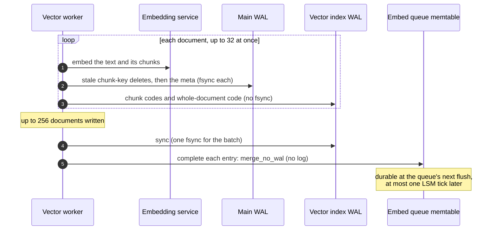
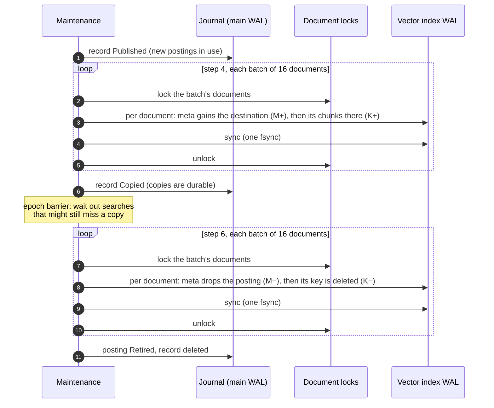

# Fewer main-WAL fsyncs per indexed document — design note

**Status:** 2026-10-24. Part 1 is built (`5335516`). Part 2 is built as §8
(§10 was considered and set aside); decisions in §13. The measurements here
were taken with the main WAL fsyncing one write at a time; it now uses group
commit and preallocated segments (`minnal_db/docs/Main-WAL-Rework-Design.md`),
which changes the fsync arithmetic in §1 and §14.
**Scope:** two writes the vector side makes durable one fsync at a time, on the
lock every client write waits for: the embed worker's queue removal (Part 1)
and partition maintenance's per-document writes (Part 2). Nothing here changes
what search reads, the order of the worker's or maintenance's steps, the main
WAL's write path, or the doc store's API.

## Terms used here

The engine-wide log terms (seal, flush, L0/L1, tail, segment, retired cut,
safe offset and the rest) are defined in `minnal_db/README.md` → *WAL terms*.
The ones this note leans on most:

**The two logs and how writes reach them**

- **Main WAL** — the database's write-ahead log (`db/wal.rs`). Every ordinary
  write appends one entry and returns only once an fsync covers it. When this
  note's measurements were taken, every such write in every namespace held one
  lock (`Database::wal_metadata`) across its own fsync, so they ran one at a
  time: about 400 a second here, where an fsync took about 2.3 ms. Concurrent
  writes now share fsyncs (group commit; `Main-WAL-Rework-Design.md`).
- **Vector index WAL** — a second log, one per database, in
  `<db_path>/vector_index_wal/` (`db/vector_index_wal.rs`, design in
  `Vector-Index-WAL-Design.md`). It has its own lock, so client writes never
  wait on it. It holds the vector worker's chunk codes and whole-document codes
  and, after Part 2, partition maintenance's per-document writes; a record is a
  put or a delete.
- **Logged write** — a write recorded in the vector index WAL instead of the
  main WAL: `Database::put_ns_logged` / `delete_ns_logged`, called through a
  namespace as `put_logged` / `delete_logged`. It is appended and applied with no
  fsync, and becomes durable at the next **sync**
  (`sync_vector_index_wal`), one fsync for everything appended before it.
- **No-WAL write** — `put_no_wal` / `delete_no_wal` / `merge_no_wal`: the change
  goes to the memtable (and value log) with no log entry at all, so it exists
  only in memory until the namespace's memtable is flushed to a level-0 (L0)
  file. The LSM worker flushes every namespace holding no-WAL writes on each of
  its **ticks** (`Database::flush_no_wal_memtables`; the tick is
  `scheduled_tasks.lsm_compaction_interval_secs`, 60 s in `config/sample.toml`).
  `flush_namespaces` flushes named namespaces on demand.
- **`merge` / `merge_no_wal`** — read a key, hand its value to a closure, write
  back what the closure returns (or delete the key, or write nothing). `merge`
  logs the result in the main WAL; `merge_no_wal` (Part 1) is the same with no
  log entry.
- **Sequence (seq)** — the global write counter every write draws from,
  whichever log it uses. The highest seq for a key wins everywhere: memtable,
  L0, L1, and replay of either log, which re-applies each record with its
  original seq.
- **Key stripe lock** (`db/key_locks.rs`) — 1,024 locks, each key hashed to one
  (its *stripe*). Every write takes its key's stripe first. `merge` holds it
  across its read, its closure and its write, which is what makes a conditional
  update atomic.
- **Prefix rule** (Part 2, §8.2) — what survives a crash of the vector index WAL
  is a prefix of it, across all namespaces: a memtable flush syncs the log
  before writing any L0 file.
- **Flush observer events** — a memtable flush reports, in order: *sealed*,
  *flushing* (before any L0 file is written; added by Part 2), *written* (L0
  files durable, not yet registered) and *flushed* (registered).

**The embed queue**

- **Embed queue** — the namespace `system_pending_vec_index`. A document write to
  a semantic-search store adds one entry, keyed by store and document, holding the
  text to embed. A document delete replaces it with a **`Clear` tombstone**: an
  entry telling the worker to delete the document's vectors.
- **Completing an entry** — removing it from the queue after the document's
  vectors are written and durable (`vector_kv::complete_entry`). The removal is
  **conditional**: it happens only if the stored entry is still the one the worker
  took. A newer upsert or a `Clear` that arrived meanwhile stays queued.
- **R1–R3** — the rules that make queue updates safe against a document
  changing mid-embed (`vector_kv.rs`): **R1**, a completion removes the entry
  only if it still asks for the text that was embedded; **R2**, a failure bumps
  the retry count only if the entry is unchanged; **R3**, a delete that lands
  mid-embed leaves a `Clear` tombstone, which the worker then handles by
  deleting what it just wrote.
- **Completion batch** — the worker syncs the vector index WAL once per batch
  of up to 256 written entries (`COMPLETION_BATCH`), then completes them
  (`make_vector_writes_durable`).

**Partition maintenance** (`ivf_split.rs`)

- **Chunk** — one sentence window of a document; its code (1 bit per dimension
  by default) is what Pass 1 of search scores.
- **Posting** — a group of chunks with one centre, the unit search reads. A
  store's postings are its **partition**. Postings are *active* (searched and
  written), *draining* (being emptied; still searched) or *retired* (empty, no
  longer read; its id is never reused).
- **Chunk key** — `{posting id}‖{document id}` in `{ns}_sparse_vector`: all of
  one document's codes in one posting.
- **Meta** — `{ns}_sparse_vector_meta`: per document, which postings hold its
  chunks and how many, and the hash of the text they came from. It is the only
  record of where a document's chunk keys are, so it must list every chunk key
  that can be on disk.
- **Split** — a posting grown past its limit is divided in two by 2-means.
  **Merge** (of postings, not the `merge` write above) — a posting shrunk below
  its limit is folded into a neighbour.
- **Drain** — what a split or a merge does to the old posting: copy each chunk
  to where it belongs, delete the originals, retire the posting.
- **Reassign** — after a split, move chunks of nearby active postings whose
  nearest centre is now a different posting. The source stays active, so its
  key shrinks (or is deleted when empty).
- **Batch** — maintenance handles documents 16 at a time (`BATCH_DOCS`), each
  batch holding those documents' vector locks; after Part 2 each batch ends
  with one sync (`sync_batch`).
- **Journal** — `{ns}_ivf_journal`: one WAL-backed record per operation in
  progress, naming its step: **Planned** (decided, nothing routed to the new
  postings yet), **Published** (new postings in use; copying), **Copied** (copies
  durable; deleting originals). After a crash, recovery **redoes** the
  operation from the step the record names (or abandons a `Planned` one).
- **Barrier** — the sync that makes the copies durable before the record says
  `Copied`. An **epoch barrier** is different: waiting out every search and
  write that started before a given moment.
- **`M+ K+` / `M− K−`** (§9) — a document's meta gaining a destination and its
  chunks written there; its meta dropping a posting and that posting's key
  deleted.

**Tests**

- **Crash point** (`crash_point!`) — a test-only check before each write that
  can stop an operation there, as a crash would. The **crash audits** stop an
  operation before every write in turn, under several patterns of which
  namespaces were flushed, then reopen and check every invariant.
- **Mutation check** — breaking the rule a test guards on purpose, to confirm
  the test then fails.

## 1. The cost before this change

Where a document's main-WAL writes went, measured with 16 REST clients writing
FiQA documents (`[vector_index] concurrency = 32`, binary `9d83b46`,
2026-10-24):

| Who | Write | New store (16,363 docs) | Settled store (40k docs, 665 postings; 16,308 added) |
|---|---|---|---|
| REST insert | the document | 1.00 | 1.00 |
| REST insert | its queue entry | 1.00 | 1.00 |
| Worker | queue removal (**Part 1**) | 1.00 | 1.00 |
| Worker | the meta | 1.00 | 1.00 |
| Maintenance | meta rewrites and chunk-key deletes of moved documents (**Part 2**) | 2.6 | 2.6 |
| **Total** | | **6.6** | **6.6** |

(Measured totals 6.65 and 6.58; rows are rounded.)

On this host one fsync takes about 2.3 ms, so all of these share about 410
main-WAL writes per second. The bytes are small: about 2 KB of main WAL, 1.5 KB
of vector index WAL and 3 KB of compaction rewrite per document, under 0.5 MB/s
in all. The limit is how many fsyncs run one after another on the main WAL's
lock, not disk bandwidth.

Maintenance costs the same on a settled store as on a new one. The settled store
split only 49 times for 16,308 new documents, but a split moves its whole
posting (about 330 chunks), and a posting refills and splits again. So each
insert pays for about one rewrite of a neighbour, whatever the store's size.

Completing queue entries concurrently (`9d83b46`) gave the worker a fair share
of the budget but did not shrink it: against completing one at a time
(`c90cf8e`), embedding during ingestion went from 18 to 59 documents/s and REST
ingestion from 176 to 136 documents/s, with the main WAL full in both.

The two parts below were expected to remove about 3.6 of the 6.6 writes per
document; measured, they remove 3.4 (§14).

# Part 1 — queue removal without the WAL

## 2. Why the removal does not need the WAL

What the removal records is "this document is done". If a crash loses it, the
entry comes back on restart and the worker embeds the document again. The text
is the same, so it writes the same vectors, which is harmless; it already
happens when a crash lands between the vector sync and the removal
(`crash_after_flush_before_completion_redoes_the_entry`). A lost removal costs
some repeated embedding work. It never loses or corrupts an index entry.

This is the argument the query-embedding cache already relies on for no-WAL
writes (`put_no_wal`, see `semantic_search/CLAUDE.md` → *Durability split*), and
a store drop already removes its queue entries this way (`clear_queue_for`).

What must still hold:

- **R1–R3** (the conditional rules in `vector_kv.rs`): never remove a newer
  entry or a `Clear` tombstone. The removal still runs under the key's stripe
  lock, as a merge, so this is unchanged.
- **Removal after the vector sync.** The vectors of an entry must be durable
  before anything can make its removal durable. Unchanged: the worker still
  calls `make_vector_writes_durable` before it completes the batch.
- **No resurrection of a stale entry over a newer one after a crash.** See §4.

## 3. The design

### 3.1 A no-WAL merge

Add `Database::merge_ns_no_wal` and its facade, `AsyncNamespace::merge_no_wal`
(next to `AsyncNamespace::merge`; `AsyncDb::merge`, for the default namespace,
needs no twin, since its only caller here uses a namespace). They
behave exactly like `merge` (same closure contract, same stripe lock held across
the read, the closure and the write, same abort and absent-key no-op), except
that the resolved write is a no-WAL put or delete:

- no WAL append and no fsync;
- the write still draws a seq from the global counter, so it resolves against
  concurrent writes to the key by seq, as `delete_no_wal` does;
- it calls `note_no_wal_write`, so the LSM worker's next tick flushes it.

The stripe is already held, so the resolved write must use the storage calls
directly (`put_to_storage` / `delete_from_storage`), not `put_ns_no_wal` /
`delete_ns_no_wal`, which take the stripe again and would deadlock.

It is a general operation of the storage engine, the no-WAL counterpart of
`merge` in the way `put_no_wal` and `delete_no_wal` are of `put` and `delete`.
It knows nothing about the embed queue: the conditions that make a completion
safe (R1–R3) stay in the caller's closure in `vector_kv.rs`, and the choice to
skip the WAL stays with the caller. A narrower, queue-shaped operation (a
"conditional delete") would put the doc store's rules into the engine's write
path.

The doc comment carries the same warning as `delete_no_wal`: use it only for
data whose lost write repairs itself.

### 3.2 Use it for completions

`complete_entry` switches from `merge` to `merge_no_wal`. That covers both
callers:

- **Embed completions** (`complete_embed`), the per-document write this part is
  about;
- **`Clear` tombstone removals** (`process_clear`). A lost one brings the
  tombstone back, and the worker deletes vectors that are already gone, which is
  harmless.

Unchanged and still WAL-backed: the worker's meta write and chunk-key deletes,
the queue entry a REST write adds, `Clear` tombstones, retry-count updates
(`record_queue_failure`), and the re-queue `complete_embed` does when a document
vanishes and comes back mid-completion.

One batch of the worker, as built:

### 3.3 When the removals reach disk

They stay in the queue's memtable until the LSM worker's next tick flushes it,
or the memtable fills first. No flush is added on the worker's path: a flush per
batch would add an L0 file per batch, which is the write amplification the
vector index WAL was built to remove.

## 4. Crash analysis

Consider an entry `E` written by a REST insert as `P` (WAL-backed, seq `p`) and
completed by `D` (no-WAL, seq `d > p`).

| Crash point | After restart | Result |
|---|---|---|
| Before `D` | `P` replays | redone (as before) |
| After `D`, before the queue memtable flushes | `D` is lost, `P` replays | redone: the same vectors are written again |
| During the flush, before `P` is retired | `P` replays with seq `p`, `D` is in L0 with seq `d` | `D` wins by seq: entry stays gone |
| After the flush | `P` is retired and not replayed | entry gone |
| A newer upsert `P2` (WAL, seq > `d`) landed, then crash, `D` lost | `P` and `P2` replay | `P2` wins: the newer text is embedded |
| A delete wrote `Clear` `T` (WAL, seq > `d`), then crash | `T` replays | the tombstone is processed again |

Every row ends either with the entry gone or with the latest entry for the
document queued. None ends with a document indexed under a stale text, or with
a current document missing from the queue.

The third row is the only one that depends on something outside this change:
an older replayed write must lose to a newer tombstone already in L0. That rests
on seq ordering across levels, which reads and replay already guarantee (see
*Terms used here*); a test pins it (§5).

**Field indexes.** After an unclean shutdown, a namespace with outstanding
no-WAL writes and a field index is reported as needing a rebuild
(`record_no_wal_gaps_after_unclean_shutdown`). The queue namespace has no field
index, so this never fires for it. Step 1 checks that.

**Cost of a crash.** A crash loses the removals since the queue's last flush: at
most one LSM tick of completions (60 s in `config/sample.toml`), fewer if the
memtable filled first. At the measured 63 documents/s that is about 3,800
repeated embeddings, roughly a minute of embedding-service time. The vectors stay
searchable throughout.

## 5. Tests

New tests for `merge_no_wal` (in `db/`):

- it appends no WAL entry and costs no fsync (`wal_writes` unchanged);
- abort writes nothing and draws no seq; absent → absent writes nothing;
- it is atomic against a concurrent `put` to the same key (as the `merge` tests);
- `crash()` before a flush loses it; after a flush keeps it;
- a no-WAL delete flushed to L0 beats a replayed older put of the same key
  (the third row of §4).

Doc-store and vector tests:

- every existing queue-race and crash test in `vector_kv.rs` passes unchanged
  (`queue_race_tests`, `crash_audit_tests`);
- new: crash after a no-WAL completion, before the queue flush → the entry is
  redone and the document ends with exactly its current vectors;
- new: crash after a no-WAL completion, then a newer upsert, then crash → the
  newer text is embedded;
- mutation check: making the removal durable before the vector sync (moving
  `make_vector_writes_durable` after completion) must still fail
  `crash_before_reembed_is_synced_keeps_new_vectors`.

# Part 2 — maintenance's per-document writes in the vector index WAL

## 6. What maintenance writes

A drain (`ivf_split.rs`, module docs) runs through its journal record in steps;
the ones that write per document are:

| Step | Per moved document, under its vector lock | Durable how, before Part 2 |
|---|---|---|
| 4. Copy | the meta gains the destination; the chunks are written there | meta: main WAL; chunks: vector index WAL |
| 5. Barrier | (one sync of the vector index WAL, then the record says `Copied`) | — |
| 6. Delete | the meta drops the drained posting; its key is deleted | both main WAL |

A reassign is the same shape: copy (meta, chunks), barrier, record `Copied`, then
shrink each source key (main WAL). Documents are handled in batches of 16
(`BATCH_DOCS`), one batch at a time, each holding its documents' vector locks.

So before Part 2 each moved document cost three main-WAL fsyncs: one meta write
in step 4, and a meta write and a delete in step 6.

## 7. Why they need not be durable one by one

The journal already makes each operation redoable. After a crash, recovery
reads the record and redoes the copy (`Published`) or the delete (`Copied`)
from scratch. It walks the drained posting's own keys and finishes every one,
whatever state each document was left in. So a per-document write does not need
to be durable on return. It needs to be durable:

1. **before the record moves past its step**, since recovery then no longer
   redoes it; and
2. **in the order the code wrote it**, across namespaces, since redo depends on
   the meta and the keys agreeing in specific ways. The meta must gain a
   destination before any chunk key there is on disk (rule 2 in the module
   docs). In step 6 the meta must drop the posting before its key goes:
   `drain_delete` explains that the reverse order "left a meta naming the
   posting with no key, and the redo, which walks the posting's keys, never came
   back to it".

**Why plain no-WAL writes do not work.** The meta and the chunk keys live in
different namespaces, and no-WAL writes reach disk when each namespace's
memtable is flushed, independently and in any order. A crash could then keep a
step-6 key delete and lose the meta change before it: exactly the stranded meta
`drain_delete` warns about.

**Why the vector index WAL does.** It is one log with one order. A sync makes a
prefix of it durable, and a torn tail drops only a suffix. If every
per-document write of maintenance is logged there, then after a crash what
survives of them is a prefix in program order, so the meta-before-key rules hold
across namespaces. One condition was missing before Part 2: a namespace's
memtable could be written to L0 while some of the records in it were not yet
synced. That L0 file
would then hold a write the log lost, ahead of the log's prefix. §8.2 closes it.

## 8. The design

### 8.1 The vector index WAL gets a delete record

A record is a put: namespace id, seq, key, value length, value. A delete is the
same body with a value length of `u32::MAX` and no value bytes. No put can have
that length (a record must fit a segment), so the two cannot be confused and
the format version stays the same. Recovery replays a delete with its seq, as
the main WAL does. Retirement,
garbage collection and the per-namespace replay start are unchanged: a delete
retires when the memtable holding it is written to L0, like a put.

The facade gains `AsyncNamespace::delete_logged`, the counterpart of
`put_logged`. Like `merge_no_wal`, it is a general operation that knows nothing
about postings or documents.

### 8.2 The log is synced before a memtable it covers is written to L0

When a namespace with records in the vector index WAL writes a memtable to L0,
it first syncs the log (a no-op if nothing is unsynced). Then no L0 file can
hold a logged write the log could still lose, and **after any crash, the logged
writes that survive are exactly a prefix of the log**: in the log, or in L0, but
never in L0 ahead of the log.

This is a general rule of the log, not a maintenance rule. It costs at most one
fsync per memtable flush of a vector namespace (flushes are seconds to minutes
apart), on the log's own lock, not the main WAL's.

**Where it hooks in.** Before Part 2 a flush reported three events to its
`LsmFlushObserver` (`store/lsm/lsm_tree.rs`): the memtable is sealed (under the
active memtable's write lock), its L0 files are written and fsynced but not yet
registered, and they are registered. Neither of the first two can host the sync:

- an fsync at the seal would stall every writer to the namespace;
- by the time the files are written it is too late. At open, L0 files are found
  by scanning each bucket's directory (`load_existing_level0_files`), so a
  written file survives a crash whether or not it was registered.

So the flush gains a fourth event, `on_ro_memtable_flushing(version)`, sent
after the seal and before the first L0 file is written. The trait method has no
default: an observer that wraps another (`SyncValueLogBeforePersist` wraps the
hub) must forward it explicitly, since a defaulted method it forgot to forward
would silently skip the sync. The per-namespace observer hub forwards it to the
vector index WAL (`before_memtable_written`). For a namespace with records past
the durable tail, the log runs `sync()`; for any other namespace it returns at
once. A plain
`sync()` covers the memtable: each of its records was appended before it was
applied, so before the seal, so before this event. `sync()` does no I/O when
nothing is unsynced, which is the usual case, since the worker and maintenance
sync each batch. A failed sync vetoes the flush before anything is on disk, as a
failure at the written event does: the memtable stays read-only and is flushed
again later.

### 8.3 Maintenance logs its per-document writes

- Step 4: the meta gains the destination with `put_logged`; the chunks already
  go there.
- Step 6: the meta drop with `put_logged`, the key delete with `delete_logged`.
- Reassign: the source key's shrink with `put_logged`, or `delete_logged` when
  it is left empty.
- **One sync per batch, before the batch releases its documents' locks.** Then
  no foreground write (the worker re-embedding a document, a document delete)
  ever builds on maintenance state that a crash could still lose, and the
  barriers before `Copied` and before retiring are covered by the last batch's
  sync.

Unchanged and still in the main WAL: the journal records, the centres and
posting records, and every foreground vector write (the worker's meta and
stale-key deletes, document deletes).

A drain, as built (a reassign is the same, with a shrink of each source key in
place of step 6's delete):

**Cost.** Moving 16 documents costs two vector-index-WAL fsyncs (one batch in
step 4, one in step 6) instead of 48 main-WAL fsyncs, and none of it waits on
the main WAL's lock. Each batch also holds its documents' locks for one fsync
instead of 16 or 32 queued ones, which shortens the wait for a foreground write
that hits a moving document.

## 9. Crash analysis

Write a moved document's logged writes in step 4 as `M+` (meta gains the
destination) then `K+` (chunks at the destination), and in step 6 as `M−` (meta
drops the posting) then `K−` (key deleted). By §8.2, what survives a crash is a
prefix of the log, and each batch's records are durable before its locks are
released and before the record advances.

| Record | Crash leaves of a batch | Redo | Result |
|---|---|---|---|
| `Published` | nothing, `M+`, or `M+ K+` | copy again | as before: redo writes `M+ K+` for every document still under the drained posting |
| `Published`, batch synced | `M+ K+` | copy again; destination already holds the chunks | as before |
| `Copied` | nothing, `M−`, or `M− K−` | delete again | as before: `M−` without `K−` is the state the code already allows (the key still exists, so redo walks to it) |
| `Copied`, then a foreground write on the document | the batch was synced before its locks were released | — | the foreground write built only on durable state, as before |
| Retired | every batch synced | — | as before |

Every row is a state the code could already crash into before Part 2, when every
write was durable on return, so every crash left a prefix of the program order.
§8.2 keeps that property for the logged writes; the per-batch sync keeps it
between them and the main WAL. The one state this design must never reach is
`K−` durable without `M−`. It cannot, because `K−` follows `M−` in the log.

Replaying an old seq is safe for the same reason as the chunk codes (see
`Vector-Index-WAL-Design.md` → *Why replaying an old seq is safe here*): a later
write to the same key, logged or not, holds the key's stripe from seq to apply,
so it lands in the same memtable or a later one, and replay starts each
namespace past its last flush.

## 10. Alternative: the source-side writes without any log

*Considered and set aside (§13, decision 3): it touches no log, but it makes
"nothing reads a retired posting" a rule that every future reader of postings,
counts and metas must keep, and it allows one crash state the code before Part 2 cannot
reach. §8 keeps every crash state one the existing redo already handles, and
removes more writes.*

§8 makes all three per-document writes cheap at the cost of a new record type
and a new rule in the vector index WAL. This alternative changes no log at all.
It leaves step 4 in the main WAL and moves only the **source-side** writes
(step 6, and reassign's shrinks) to no-WAL writes. It relies on two facts about
partition maintenance:

### 10.1 Nothing reads a retired posting

Checked against the code (2026-10-24):

- **Searches** probe `Active` and `Draining` postings only. `NamespaceIvf` puts
  every posting that is not `Retired` in its probing set
  (`cluster/layout.rs`, `from_parts`). Routing uses `Active` postings only.
- **Maintenance, rebuild and the recall check** pick from `Active` postings, or
  filter out `Retired` ones (`ivf_split.rs`, `rebuild.rs`, `recall_check.rs`).
- **A retired id is never handed out again.** New ids come from
  `NamespaceIvf::max_ids`, the largest id among all postings, retired ones
  included, and posting records are kept after retirement.
- **A retired posting never becomes active again.** Abandoning an operation
  reactivates only the postings an unpublished (`Planned`) operation was going
  to drain, and those were never retired.

So a key under a retired posting is dead space, and a meta entry naming one is a
dead entry. The only code that acts on a dead meta entry is a later write of the
document: `upsert_vectors` and `delete_vector` delete the chunk key of every
posting the meta lists (one WAL delete of an absent key), then write a meta
without it. The entry removes itself.

One reader needs a change. On open, posting sizes are recounted from the metas
(`vector_kv::count_postings`), so a dead entry would show as chunks in a retired
posting. Health reports them, and `NamespaceIvf::total_entries` (read by the
recall check) sums over every posting. Both should skip retired postings.

### 10.2 The journal record is the checkpoint

A no-WAL write becomes durable when its namespace's memtable is written to L0,
and `Database::flush_namespaces` does that on demand: it returns once the named
namespaces' memtables are in L0, no-WAL writes included. The store drop already
uses it for the embed queue's no-WAL deletes.

So the source-side writes go no-WAL, and **before the journal record moves past
`Copied`** (retiring the posting, or deleting a reassign's record), maintenance
flushes the meta and chunk namespaces. Until that flush returns, the record
still says `Copied`, so a crash at any point leaves recovery redoing the step,
exactly as before.

### 10.3 The design

- **Drain, step 6:** the meta drop with `merge_no_wal`, the key delete with
  `delete_no_wal`. Then, after the last batch, flush both namespaces and retire.
- **Reassign:** the meta stays a main-WAL write; the source key's shrink goes
  `put_no_wal`, or `delete_no_wal` when it is left empty. Then flush the chunk
  namespace and delete the record. A reassign's source is an active posting that
  searches read, so the shrink is allowed to be lost only in ways the earlier code
  can already crash into (§10.4).
- **Step 4 is unchanged:** the destination's meta stays in the main WAL, ahead of
  the chunks.
- The documents' vector locks are held as before, one batch at a time. No batch
  waits on an fsync any more, so each batch holds its locks for less time.

Everything here uses operations the engine already has: `merge_no_wal`,
`put_no_wal`, `delete_no_wal` and `flush_namespaces`. Neither log changes.

### 10.4 Crash analysis

Before the flush, a crash can keep any subset of the no-WAL writes. A
namespace's memtables reach L0 in order, so within one namespace what survives
is a prefix. Across the two namespaces, either may be ahead. Write the meta
change as `M` and the key change as `K`, per document:

| Operation | Survives | Redo (record still `Copied`) | Result |
|---|---|---|---|
| Drain | nothing, or `M` | walks the posting's keys, finishes `M K` | as before |
| Drain | `M K` | nothing left under the posting | as before |
| Drain | `K` without `M` | the key is gone, so redo does not visit the document | the meta keeps a dead entry naming the retired posting (§10.1) |
| Reassign | nothing (`M` is in the main WAL, so it is always there) | re-decides from the source key: the destination holds the chunks, so it shrinks the source again | as before |
| Reassign | `K` | nothing left to move | as before |
| Any | after the flush | — | everything durable; the record moves on |

The third row is the one state the earlier code cannot reach. It is the stranded
meta `drain_delete` describes. Before Part 2 it would be wrong for good, but only
because the counts are rebuilt from metas. With §10.1's counting fix it costs a
dead entry until the document is written again. The reassign rows are all
states the earlier code can reach, because the meta still lands first and durably.

A foreground write after a batch releases its locks may build on a no-WAL change
that a crash then loses. That is safe for the same reason: the foreground write
is a main-WAL write with a higher seq, so it wins when both survive, and if the
no-WAL change is lost, redo finds the state of an earlier row.

### 10.5 What it saves, and what it costs

Each moved document has three per-document writes: the destination's meta
(step 4), the source's meta, and the source's key. This removes the source key
for every moved document, and the source meta for drained ones. That is between
a third and two thirds of maintenance's 2.6 writes per inserted document,
depending on how the moves split between drains and reassigns. That split was
not measured; §12 step 7 measures the result. §8 would remove all three.

It adds one flush per operation: two namespaces, one small L0 file each. At the
rates of §1 that is about one operation per second, so a few more L0 files for
compaction to merge, and a few fsyncs per operation instead of several hundred.

If it is built first, §8 can still follow for step 4's meta. Its delete record
would then not be needed.

## 11. Tests (Part 2)

Vector index WAL (in `db/`):

- a logged delete replays with its seq; it retires with its memtable; a torn
  tail drops it with every record after it;
- an L0 write syncs the log first: crash after a namespace's flush, with the log
  unsynced, keeps every record the L0 file holds;
  mutation check: removing the sync must fail this test;
- a delete reads back as a delete, and an empty value is still a put.

Maintenance (`ivf_split/tests.rs`, the crash-anywhere tests):

- every existing split, merge, reassign and recovery test passes unchanged;
- the crash-anywhere tests run with the logged writes, crashing at every
  `crash_point!` and also between a batch's writes and its sync;
- mutation check: logging `K−` before `M−` must fail (it is the stranded-meta
  state);
- a split's main-WAL fsyncs stay below one per moved document
  (`a_split_writes_nothing_per_document_to_the_main_wal`); mutation check:
  putting step 4's meta back on the main WAL must fail it.

The sync before a batch releases its locks has no mutation test: no crash
could be found where releasing first goes wrong, since recovery redoes the step
from its journal record and the worker syncs the log itself before it completes
an entry. It is kept as a cheap safeguard (one fsync per batch, which the batch
needs anyway before the record moves on).

If §10 is built instead:

- the crash-anywhere tests crash at every `crash_point!` and also after the
  last batch but before the flush, each time with the meta namespace, the chunk
  namespace, both or neither flushed. Afterwards no key is left under a retired
  posting, every active posting's count equals its keys, and any meta entry
  that does not match a key names a retired posting;
- mutation check: removing the flush before the record moves past `Copied` must
  fail (a retired posting keeps keys, or a reassign's source keeps moved
  chunks);
- mutation check: making reassign's meta write no-WAL must fail the count check;
- opening a store whose meta names a retired posting leaves that posting out of
  health's counts and `total_entries`.

All four feature combinations must pass tests and `clippy -D warnings`.

## 12. Steps

All eight are done.

1. Part 1: `merge_no_wal` in `db/` and the facade, with its tests. Check that the
   queue namespace has no field index.
2. Part 1: `complete_entry` uses it; its crash tests and mutation check.
3. Measure Part 1 with the load of §1 on both stores, against `9d83b46`.
4. Part 2: the delete record and `delete_logged`, with the log's tests.
5. Part 2: sync before an L0 write, with its crash test and mutation check.
6. Part 2: maintenance logs its per-document writes, syncs per batch; the
   crash-anywhere tests and mutation checks.
7. Measure Part 2 the same way, against step 3.
8. Docs: `semantic_search/CLAUDE.md` → *Durability split*, the root `CLAUDE.md`
   code conventions (which list every write that skips the main WAL and why),
   `Vector-Index-WAL-Design.md` (what is logged, record format) and the
   `ivf_split.rs` module table.

## Not covered here

- **The worker's own meta and stale-key deletes.** §8.2 would let them move to
  the vector index WAL too (one more main-WAL write per document), but the
  worker's `Clear` path completes entries without a sync. With Parts 1 and 2 in,
  this meta write is one of the three main-WAL writes a document still costs
  (§14).
- **Group commit in the main WAL.** Letting concurrent writers share one fsync
  would cut the cost of every write at once: REST, worker and maintenance. It
  changes the main WAL's core write path, and was ruled out earlier. With Parts
  1 and 2 in, ingestion is bound by the REST insert's own two fsyncs per
  document, so it is the next thing to look at.

## 13. Decisions and open questions

Decided (2026-10-24):

1. **`merge_no_wal` is a general engine operation**, matching `merge` (§3.1), not
   a narrower conditional delete shaped for the queue: that would leak the doc
   store's rules into the WAL layer.
2. **Order of work:** Part 1, then Part 2, measuring after each; then group
   commit.
3. **Part 2 is §8**, not §10: its rules live in the vector index WAL, and
   maintenance's crash states stay the ones its redo already handles.
4. **No format migration.** The project is greenfield: the delete record is
   encoded so that the format version need not change (§8.1), and no
   compatibility code is kept.

Open:

5. **Crash cost of Part 1.** Is up to one LSM tick of repeated embedding
   acceptable (§4), or should the worker also flush the queue when a pass ends
   after completing many entries (say, more than 1,000)? Proposed: accept it.

## 14. Measured

The load of §1 (16 REST clients writing 17,638 FiQA documents,
`[vector_index] concurrency = 32`), on the settled store, 2026-10-24.
"Queue empty" counts from the start of ingestion. The `9d83b46` run ingested
16,308 documents before its 120 s limit; the others ingested all of them.

| | `9d83b46` | Part 1 (`5335516`) | Part 1 + Part 2 (§8) |
|---|---|---|---|
| Main-WAL writes per document | 6.58 | 5.79 | **3.21** |
| of which maintenance | 2.6 | 2.75 | **0** |
| REST ingestion | 136 docs/s | 159 docs/s | 154 docs/s |
| REST ingestion p99 | 298 ms | 169 ms | 181 ms |
| Embedded during ingestion | 63 docs/s | 76 docs/s | 75 docs/s |
| Embedded after ingestion | 61 docs/s | 66 docs/s | 65 docs/s |
| Queue empty after | 263 s (16,308 docs) | 251 s | 253 s |
| Splits during ingestion | — | 3 | 85 |
| Main-WAL writes/s after ingestion | — | 405 | 85 |

The new store gave the same per-document cost (3.20) and rates within 6%.

What the numbers say:

- **Part 2 removes maintenance from the main WAL entirely.** What is left is
  exactly the REST insert (document and queue entry) and the worker's meta.
- **Maintenance now keeps up.** With Part 1 alone it got almost no main-WAL
  time while ingestion ran (3 splits) and did its work afterwards, holding the
  WAL at 405 writes/s. With Part 2 it splits as documents arrive (85 splits
  during ingestion; 960 postings when the queue empties, against 719), and
  after ingestion the main WAL is mostly idle.
- **Ingestion and embedding did not get faster.** Ingestion is still bound by
  the main WAL (about 380 writes/s while it runs: two per inserted document and
  one per embedded one). Embedding is bound by the embedding service, not by
  minnal: after ingestion the WAL is at 85 writes/s and embedding still runs at
  about 65 documents/s.
- **The embedding service's own ceiling** (gemma on this host's GPU, driven
  directly with minnal's payloads, about 4 texts per document): about 63
  documents/s through its gateway at 16 or more requests in flight, with the
  GPU 58% busy, and about 70 documents/s calling `llama-server` directly, with
  the GPU 70% busy. The gateway sends the document lane to `llama-server` in
  calls of 8 texts, two at a time (to keep queries from waiting behind
  documents), which costs about 12%.
- **Why ingestion is 3% slower with Part 2: fsyncs share the drive.** Traced
  with `strace` (both binaries, same load; server CPU 18% and 29% of one core,
  so CPU is not it), the drive serves about 420 flush requests a second in both
  runs, at about 92% busy: every fsync, of any file, costs one device flush of
  about 2.3 ms. Part 2 adds about 22 vector-index-WAL fsyncs a second during
  ingestion (maintenance's batches and the worker's). A main-WAL fsync that
  overlaps one takes 3.56 ms instead of 2.34 ms; that happens to about 10% of
  them, so the main WAL makes about 4% fewer fsyncs a second (402 → 387). The
  same happens, less often, with the field indexes', value logs' and L0 files'
  fsyncs.

So the next lever for ingestion is the REST path's own two fsyncs per
document: group commit in the main WAL, which also cuts the number of device
flushes, the resource every log shares.
